# 某某ERP系统 - 业务流程（Workflow）

## 文档说明

**版本：** v1.4  
**创建日期：** 2025-01-XX  
**最后更新：** 2025-01-XX

**基于**：某某ERP系统MVP版本需求规格说明书 v1.4

本文档描述了某某ERP系统的主要业务流程，使用Mermaid流程图格式展示。所有流程图都基于需求文档1.4和代码实现。

---

## 一、销售与分销模块（SD Module）

### 1.1 销售报价流程

#### 流程说明

销售报价流程是销售业务的起点，从客户询价开始，经过报价单创建、报价计算、三级审核、客户确认等环节，最终可以转为销售订单。

**关键步骤：**

1. **报价单创建**：销售员根据客户需求创建报价单，填写客户信息、产品信息（本厂编号、产品名称）、价格条款等。如果输入的14位本厂编号不存在对应的产品主数据，SD模块调用ENG模块的产品主数据创建API自动创建产品主数据（产品编码为本厂编号，产品类型为成品FG，物料分类为成品），并自动填充产品名称。自动创建的产品主数据不需要审核。产品主数据由工程管理模块统一管理，销售模块可以引用和自动创建

2. **报价单预估报价**：销售员填写板规格参数（出货长、出货宽、利用率、PNL参数等）、工艺参数（层数、板厚、铜厚、线宽线距、表面处理等）、加价选项（常规加价、特殊加价、额外加价等）后，点击"计算报价"按钮手动计算报价明细成本。计算内容包括：
   - **交货面积计算**：根据出货长、出货宽、订单数量计算交货面积（m²）
   - **基础成本计算**：根据基础成本基准值和层数调整系数计算成本/平米
   - **加价计算**：根据常规加价、特殊加价、额外加价选项计算总加价/平米
   - **最终成本计算**：基础成本 + 加价，得到最终成本/平米和成本PCS
   - **报价价格计算**：在成本基础上按利润率系数（如1.3，即30%利润）计算报价价格/平米和报价价格PCS
   - **费用计算**：计算工程费（根据层数）、板材费（成本×面积）、测试架费用（根据测试点数）、其他费用（最低消费等）
   - **最终总价计算**：工程费 + 板材费 + 测试架费用 + 其他费用
   - **工序成本分摊**：将成本按比例分摊到各工序（开料、钻孔、电镀、线路、阻焊、表面处理、成型等），生成工序成本明细
   - 系统采用手动计算模式（点击"计算报价"按钮）
   - 计算结果保存到报价单主表和报价明细工序表

3. **三级审核（串行）**：
   - **一级审核**：销售经理（SALES_MANAGER）进行一级审核，检查报价单的基本信息和价格合理性。审核不通过时，报价单退回草稿状态，销售员可修改后重新提交。退回操作记录审核历史，保存退回原因
   - **二级审核**：工程师（ENGINEER）进行二级审核，确认价格策略和交期承诺。审核不通过时，报价单退回草稿状态，销售员可修改后重新提交。退回操作记录审核历史，保存退回原因
   - **三级审核**：客户经理（ACCOUNT_MANAGER）或总经理（GENERAL_MANAGER）进行三级审核，最终确认报价单。审核不通过时，报价单退回草稿状态，销售员可修改后重新提交。退回操作记录审核历史，保存退回原因

4. **销售员经客户确认报价单**：销售员与客户确认报价单，客户确认是线下确认，销售员在系统中标记"客户已确认"。客户确认后可以转为销售订单。客户不确认时，报价单退回草稿状态，销售员可修改后重新提交审核。退回操作记录审核历史，保存退回原因

5. **报价转订单**：将已确认的报价单转为销售订单

#### 流程图

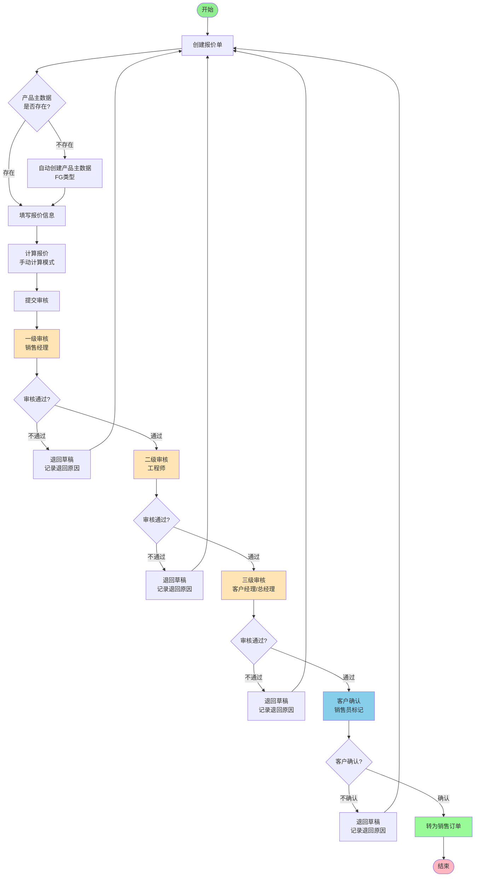

### 1.2 报价转订单流程

#### 流程说明

将已通过审核并获客户确认的报价单转为销售订单。

**关键步骤：**
1. 检查报价单状态：报价单必须为"客户已确认"状态
2. 创建销售订单：基于报价单信息创建销售订单
3. 订单评审：进入多部门评审流程

#### 流程图

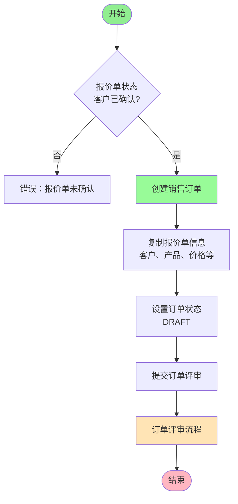

### 1.3 返单快速下单流程

#### 流程说明

返单快速下单流程针对老客户重复下单的场景，系统自动识别返单并匹配历史订单信息，快速创建销售订单，跳过报价环节。

**关键步骤：**

1. **返单识别**：系统自动检测是否为返单（相同客户、相同产品主数据（本厂编号）、在时间范围内）

2. **历史订单匹配**：系统自动匹配历史订单，显示历史价格、交期等信息

3. **订单信息填充**：系统自动填充订单信息，包括产品主数据（本厂编号）、价格、交期等

4. **产品主数据确认**：确认或创建产品主数据（本厂编号），如果输入的14位本厂编号不存在对应的产品主数据，SD模块调用ENG模块的产品主数据创建API自动创建产品主数据（产品编码为本厂编号，产品类型为成品FG，物料分类为成品），并自动填充产品名称。自动创建的产品主数据不需要审核。产品主数据由工程管理模块统一管理

5. **订单确认**：销售员确认订单信息，可以调整数量、价格等

6. **订单创建**：创建销售订单，进入生产流程

#### 流程图

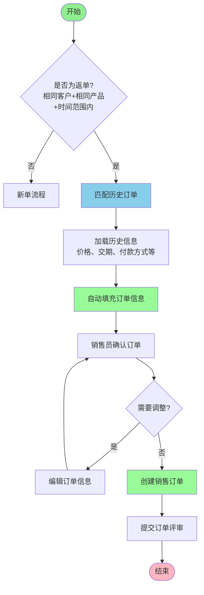

### 1.4 新单下单流程

#### 流程说明

新单下单流程针对新客户或新产品下单的场景，需要完整录入订单信息，经过订单审核等环节，创建销售订单。

**关键步骤：**

1. **客户选择**：选择或创建客户主数据，确认客户信息

2. **产品主数据确认**：确认或创建产品主数据（本厂编号），如果输入的14位本厂编号不存在对应的产品主数据，SD模块调用ENG模块的产品主数据创建API自动创建产品主数据（产品编码为本厂编号，产品类型为成品FG，物料分类为成品），并自动填充产品名称。自动创建的产品主数据不需要审核。产品主数据由工程管理模块统一管理

3. **订单信息录入**：手动录入订单信息，包括产品主数据（本厂编号）、数量、价格、交期、付款方式等

4. **价格确认**：确认订单价格，可以查询历史价格作为参考

5. **订单审核**：对订单进行审核，确认订单信息的完整性和准确性

6. **订单创建**：创建销售订单，进入生产流程

#### 流程图

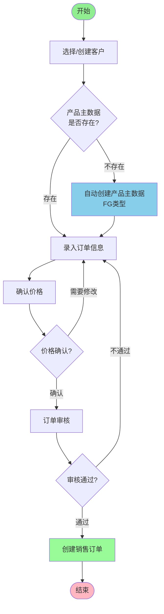

### 1.5 销售订单评审流程

#### 流程说明

销售订单创建后，需要经过多部门评审（串行），包括销售、工程、物料、财务等部门。

**关键步骤：**
1. 提交评审：销售订单提交评审
2. 多部门评审（串行）：
   - 销售部门评审
   - 工程部门评审
   - 物料部门评审
   - 财务部门评审
3. 评审通过：所有部门评审通过后，订单状态更新为"已批准"
4. 评审拒绝：任一部门拒绝，订单退回草稿状态

#### 流程图

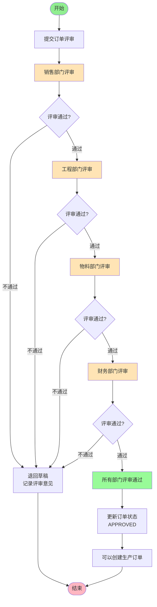

### 1.6 客户管理流程

#### 流程说明

客户管理流程包括客户创建、提交审批、审批通过/拒绝等环节。

**关键步骤：**
1. 创建客户：销售员创建客户主数据
2. 提交审批：提交客户审批
3. 审批：销售经理审批客户
4. 审批通过：客户状态更新为"激活"
5. 审批拒绝：客户退回草稿状态

#### 流程图

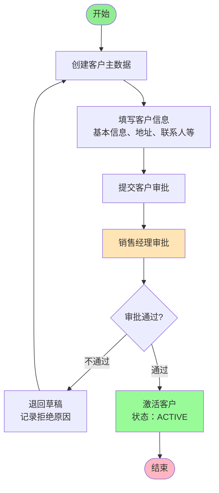

---

## 二、工程管理模块（ENG Module）

### 2.1 BOM管理流程

#### 流程说明

BOM（物料清单）管理流程包括BOM创建、审核、发布等环节。

**关键步骤：**
1. 创建BOM：工程师创建BOM，定义产品的物料组成结构
2. 添加BOM明细：添加子项物料、用量等信息
3. 审核BOM：对BOM进行审核
4. 发布BOM：审核通过后发布BOM，状态更新为"RELEASED"
5. 使用BOM：只有RELEASED状态的BOM才能用于生产版本

#### 流程图

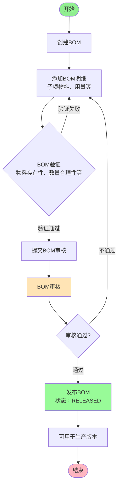

### 2.2 工艺路线管理流程

#### 流程说明

工艺路线管理流程包括工艺路线创建、工序定义、审核、发布等环节。

**关键步骤：**
1. 创建工艺路线：工程师创建工艺路线，定义产品的生产工艺流程
2. 添加工序：添加工序序列、工作中心、标准时间等
3. 审核工艺路线：对工艺路线进行审核
4. 发布工艺路线：审核通过后发布工艺路线，状态更新为"RELEASED"
5. 使用工艺路线：只有RELEASED状态的工艺路线才能用于生产版本

#### 流程图

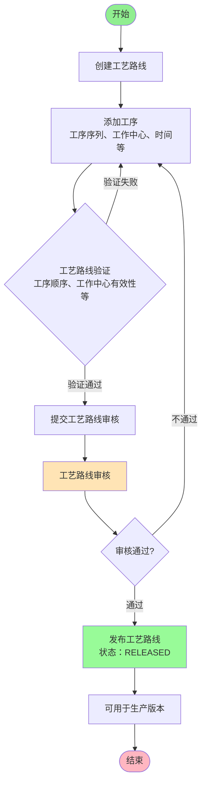

### 2.3 MI管理流程

#### 流程说明

MI（制造指令）管理流程包括MI创建、基于工艺路线自动生成、审核、发布等环节。

**关键步骤：**
1. 创建MI：工程师创建MI，或基于工艺路线自动生成MI草稿
2. 编辑MI内容：编辑工艺参数与指令集列表（JSON格式）
3. 审核MI：对MI进行审核
4. 发布MI：审核通过后发布MI，状态更新为"RELEASED"
5. 使用MI：发布后的MI可用于生产版本发布和生产订单/工单下达

#### 流程图

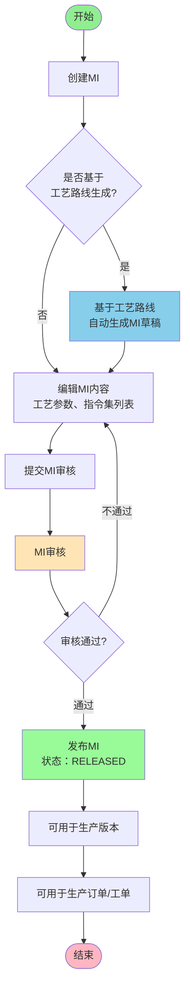

### 2.4 生产版本管理流程

#### 流程说明

生产版本管理流程将BOM、工艺路线和MI组合，形成可执行的生产版本。

**关键步骤：**
1. 创建生产版本：选择物料、BOM、工艺路线、MI（可选）
2. 验证依赖：验证BOM和工艺路线必须为RELEASED状态
3. 发布生产版本：发布时需要MI已关联且状态为RELEASED
4. 使用生产版本：发布后的生产版本可用于销售订单和生产订单

#### 流程图

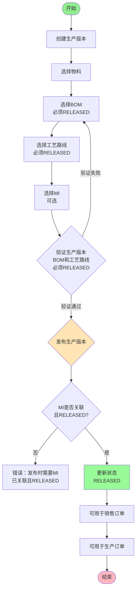

---

## 三、生产计划与控制模块（PP Module）

### 3.1 生产订单创建流程

#### 流程说明

生产订单创建流程基于销售订单创建生产订单/工单，如果关联了MI，系统自动生成LOT卡。

**关键步骤：**

1. **选择销售订单**：选择已批准的销售订单

2. **创建生产订单**：基于销售订单创建生产订单/工单

3. **检查MI关联**：如果生产版本关联了MI，系统检查MI是否存在且状态为RELEASED。如果MI不存在，不允许创建生产订单/工单或提示用户先创建MI

4. **生成LOT卡**：如果关联了MI，系统根据MI自动生成LOT卡（1:1关系），自动复制MI内容到LOT卡，并将lot_number写回生产订单。如果MI不存在，不允许创建生产订单/工单或提示用户先创建MI

5. **设置生产订单状态**：设置生产订单状态为RELEASED。由于生产订单承担工单职责，工单状态与生产订单状态一致

#### 流程图

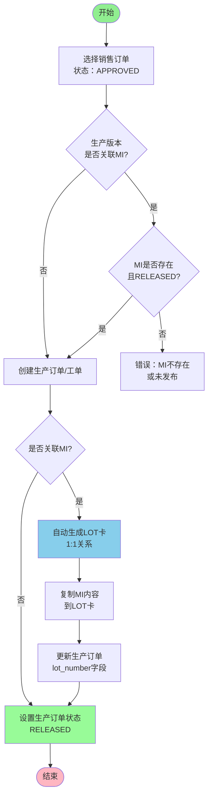

### 3.2 生产领料流程

#### 流程说明

生产领料流程根据生产订单关联的BOM自动生成领料需求，进行物料发放。

**关键步骤：**
1. 选择生产订单：选择状态为RELEASED或IN_PRODUCTION的生产订单
2. 加载BOM：系统根据生产订单关联的BOM自动生成领料需求
3. 显示库存信息：实时显示库存信息（当前库存、在途量、可用量）
4. 创建领料单：创建领料单，记录领料明细
5. 发放物料：物控岗发放物料，生产线领料
6. 更新库存：领料后自动更新物料库存，创建MaterialTransaction记录

#### 流程图

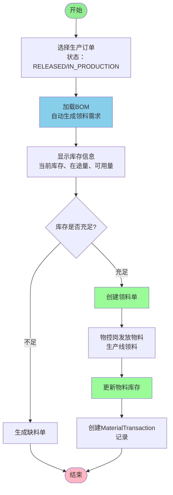

### 3.3 工序报工流程

#### 流程说明

工序报工流程记录各工序的完成情况，包括完成数量、良品数量、不良品数量、工时等。

**关键步骤：**

1. **选择生产订单/工单并自动读取LOT卡**：选择要报工的生产订单/工单后，系统根据生产订单号自动查询关联的LOT卡（一个生产订单/工单对应一个LOT卡，1:1关系），并自动填充报工单中的LOT卡号字段（只读、不可修改）；如找不到LOT卡，则不允许保存报工

2. **任务确认**：确认当前工序任务，显示生产订单、LOT卡号、工序名称、计划数量等信息

3. **报工数据录入**：录入完成数量、良品数量、不良品数量等数据

4. **不良品管理**：记录不良品信息，包括不良原因、处理方式等

5. **工时记录**：记录实际工时，系统自动计算工时差异

6. **设备信息**：记录使用的设备信息和设备状态

7. **报工保存**：保存报工记录，更新生产进度。如果工序配置了自动倒扣料，则扣减物料库存

#### 流程图

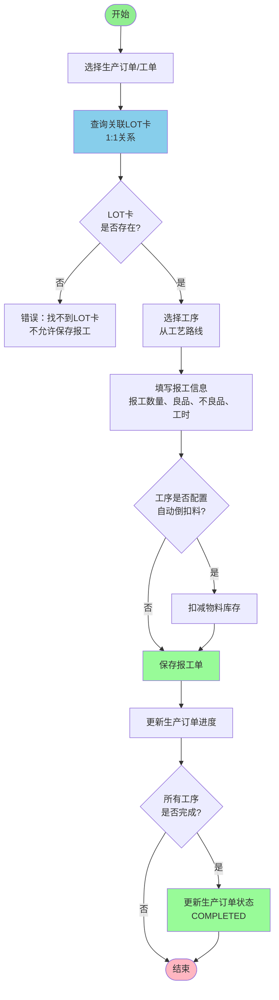

### 3.3 开始生产流程

#### 流程说明

开始生产流程将生产订单/工单从已下达（RELEASED）状态转为生产中（IN_PRODUCTION）状态。

**关键步骤：**

1. **检查生产订单状态**：生产订单/工单状态必须为RELEASED

2. **开始生产**：将生产订单/工单状态更新为IN_PRODUCTION

3. **记录实际开始时间**：系统记录实际开始时间

4. **同步销售订单状态**：系统同步销售订单状态为IN_PRODUCTION

#### 流程图

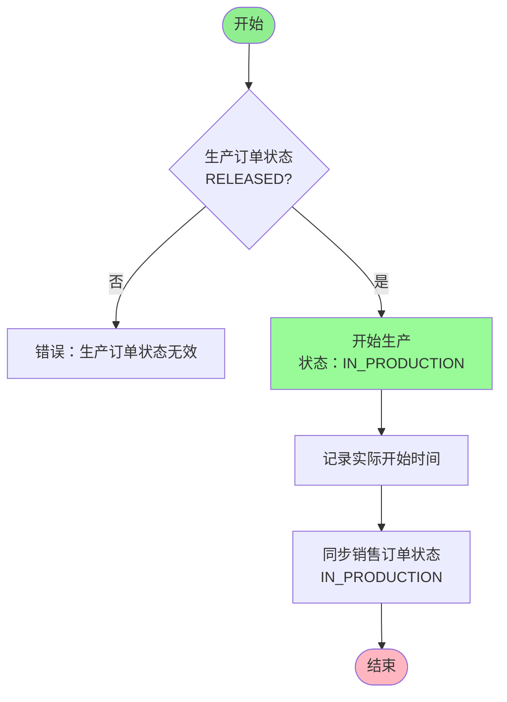

### 3.4 生产订单关闭流程

#### 流程说明

生产订单关闭流程在所有工序完成后，关闭生产订单。

**关键步骤：**

1. **检查完成情况**：检查所有工序是否已完成

2. **关闭生产订单**：更新生产订单状态为"CLOSED"。前置条件：生产订单状态必须为RELEASED、IN_PRODUCTION或COMPLETED。后置条件：状态更新为CLOSED，记录实际完成时间，同步销售订单状态

3. **更新销售订单**：当所有生产订单/工单状态为COMPLETED或CLOSED时，更新销售订单状态为COMPLETED

#### 流程图

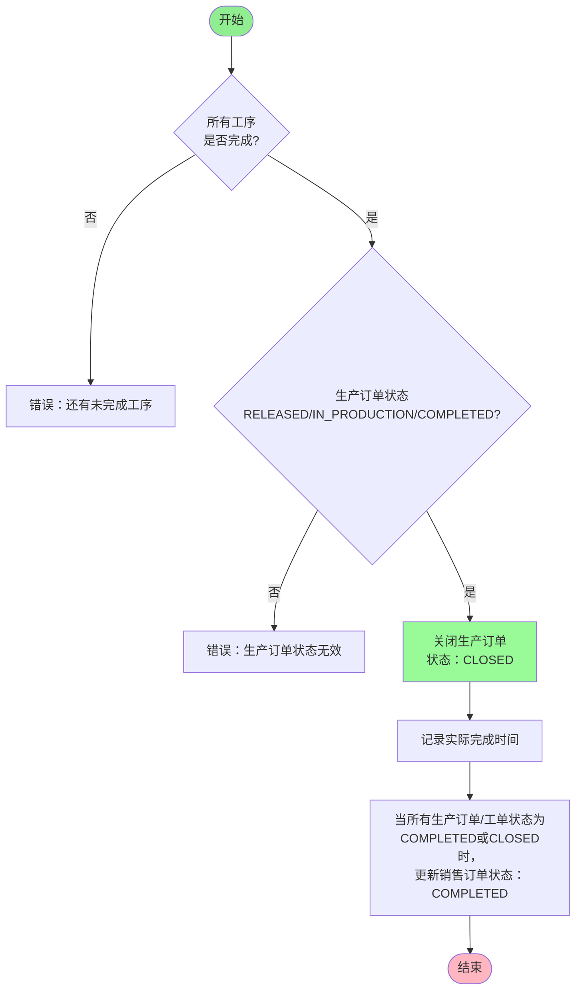

---

## 四、物料管理模块（MM Module）

### 4.1 物料主数据管理流程

#### 流程说明

物料主数据管理流程包括物料创建、审核、激活等环节。物料主数据管理不显示FG类型的物料（FG类型在产品主数据管理中显示）。

**关键步骤：**
1. 创建物料：创建物料主数据（RAW、SEMI等类型）
2. 填写物料信息：填写物料编码、名称、分类、规格型号、库存信息等
3. 审核物料：对物料进行审核
4. 激活物料：审核通过后激活物料，状态更新为"ACTIVE"

#### 流程图

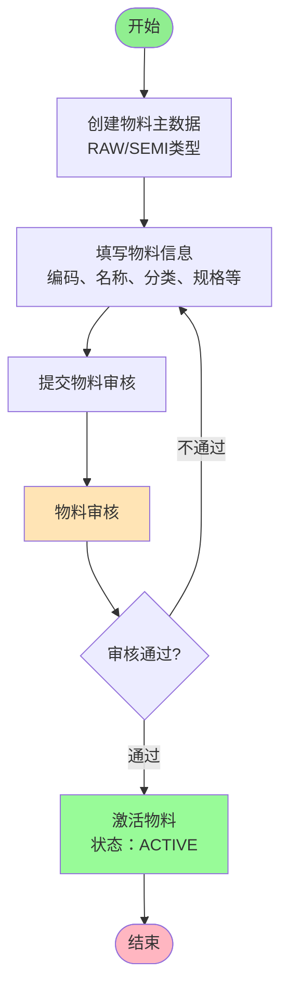

---

## 五、跨模块业务流程

### 5.1 完整订单到生产流程

#### 流程说明

从销售订单创建到生产完成的完整业务流程。

**关键步骤：**

1. **订单评审**：对销售订单进行评审，确认价格、交期等

2. **产品主数据确认**：确认或创建产品主数据，以本厂编号作为唯一标识。如果本厂编号对应的产品主数据不存在，系统提示用户创建。产品主数据由工程管理模块统一管理

3. **BOM和工艺路线准备**：准备产品的BOM和工艺路线（基于产品主数据的本厂编号）。BOM和工艺路线准备可以并行进行，无依赖关系

4. **生产版本建立**：将BOM和工艺路线组合，建立生产版本。生产版本建立必须等待BOM和工艺路线都准备好。如果任一准备失败，生产版本建立失败，提示用户

5. **MI制作**：根据订单创建制造指令，包含技术参数和生产要求。MI制作需要生产版本已建立

6. **生产版本发布**：发布生产版本，使其可用于生产订单下达。生产版本发布需要MI已制作且MI审核通过

7. **生产订单下达**：下达生产订单/工单，如果关联了MI，系统根据MI自动生成LOT卡，LOT卡包含MI内容和生产信息，并将lot_number写回生产订单。如果MI不存在，不允许创建生产订单/工单或提示用户先创建MI。由于生产订单承担工单职责，工单状态与生产订单状态一致

8. **物料领料**：根据生产订单/工单领料

9. **工序报工**：各工序完成后进行报工，系统根据生产订单/工单自动读取LOT卡号并填充到报工单中，LOT卡号不可修改

10. **成品入库**：生产完成后，成品入库

#### 流程图

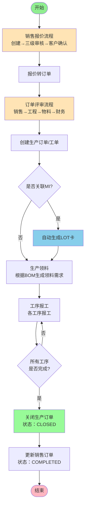

### 5.2 从客户建档到销售订单关闭全流程

#### 流程说明

从客户建档到销售订单关闭的完整端到端业务流程，涵盖了销售、工程、生产、物料等所有模块的关键环节。

**关键步骤：**

1. **客户建档**：销售员创建客户主数据，填写基本信息、地址、联系人等，提交审批。销售经理审批通过后，客户状态更新为"激活"（ACTIVE）

2. **销售报价**：销售员创建报价单，填写客户信息、产品信息（本厂编号）。如果本厂编号不存在对应的产品主数据，系统自动创建产品主数据（FG类型）。填写板规格参数、工艺参数、加价选项后，手动计算报价。提交三级审核（销售经理→工程师→客户经理/总经理），审核通过后客户确认报价单

3. **报价转订单**：将已确认的报价单转为销售订单，复制报价单信息（客户、产品、价格等）

4. **订单评审**：销售订单进入多部门评审流程（串行），依次经过销售部门、工程部门、物料部门、财务部门评审。所有部门评审通过后，订单状态更新为"已批准"（APPROVED）

5. **生产订单创建**：基于已批准的销售订单创建生产订单/工单。如果生产版本关联了MI，系统检查MI是否存在且状态为RELEASED。如果关联了MI，系统自动生成LOT卡（1:1关系），复制MI内容到LOT卡，并将lot_number写回生产订单。设置生产订单状态为"已下达"（RELEASED）

6. **生产领料**：根据生产订单关联的BOM自动生成领料需求，创建领料单。物控岗发放物料，生产线领料。领料后自动更新物料库存，创建MaterialTransaction记录

7. **开始生产**：将生产订单/工单状态从"已下达"（RELEASED）更新为"生产中"（IN_PRODUCTION），记录实际开始时间，同步销售订单状态为IN_PRODUCTION

8. **工序报工**：各工序完成后进行报工。系统根据生产订单/工单自动查询关联的LOT卡（1:1关系），自动填充报工单中的LOT卡号字段（只读、不可修改）。填写报工数量、良品数量、不良品数量、工时等信息。如果工序配置了自动倒扣料，则扣减物料库存。保存报工记录，更新生产进度

9. **生产订单关闭**：当所有工序完成后，检查生产订单状态（必须为RELEASED、IN_PRODUCTION或COMPLETED），更新生产订单状态为"已关闭"（CLOSED），记录实际完成时间

10. **销售订单关闭**：当所有生产订单/工单状态为COMPLETED或CLOSED时，更新销售订单状态为"已完成"（COMPLETED）。销售订单可以进一步流转到发货、交付、对账等环节，最终关闭销售订单

#### 流程图

```mermaid
flowchart TD
    Start([开始]) --> CreateCustomer[创建客户主数据<br/>填写基本信息、地址、联系人]
    CreateCustomer --> SubmitCustomerApproval[提交客户审批]
    SubmitCustomerApproval --> CustomerApproval[销售经理审批]
    CustomerApproval --> CustomerApprovalCheck{审批通过?}
    CustomerApprovalCheck -->|不通过| RejectCustomer[退回草稿<br/>记录拒绝原因]
    RejectCustomer --> CreateCustomer
    CustomerApprovalCheck -->|通过| ActivateCustomer[激活客户<br/>状态：ACTIVE]
    
    ActivateCustomer --> CreateQuotation[创建报价单<br/>填写客户、产品信息]
    CreateQuotation --> CheckProduct{产品主数据<br/>是否存在?}
    CheckProduct -->|不存在| AutoCreateProduct[自动创建产品主数据<br/>FG类型]
    CheckProduct -->|存在| CalculatePrice[计算报价<br/>手动计算模式]
    AutoCreateProduct --> CalculatePrice
    
    CalculatePrice --> SubmitQuotationApproval[提交报价单审核]
    SubmitQuotationApproval --> Level1Approval[一级审核<br/>销售经理]
    Level1Approval --> Level1Check{审核通过?}
    Level1Check -->|不通过| RejectQuotation1[退回草稿<br/>记录退回原因]
    RejectQuotation1 --> CreateQuotation
    Level1Check -->|通过| Level2Approval[二级审核<br/>工程师]
    
    Level2Approval --> Level2Check{审核通过?}
    Level2Check -->|不通过| RejectQuotation2[退回草稿<br/>记录退回原因]
    RejectQuotation2 --> CreateQuotation
    Level2Check -->|通过| Level3Approval[三级审核<br/>客户经理/总经理]
    
    Level3Approval --> Level3Check{审核通过?}
    Level3Check -->|不通过| RejectQuotation3[退回草稿<br/>记录退回原因]
    RejectQuotation3 --> CreateQuotation
    Level3Check -->|通过| CustomerConfirm[客户确认<br/>销售员标记]
    
    CustomerConfirm --> CustomerConfirmCheck{客户确认?}
    CustomerConfirmCheck -->|不确认| RejectQuotation4[退回草稿<br/>记录退回原因]
    RejectQuotation4 --> CreateQuotation
    CustomerConfirmCheck -->|确认| ConvertToOrder[报价转订单<br/>创建销售订单]
    
    ConvertToOrder --> SubmitOrderReview[提交订单评审]
    SubmitOrderReview --> SalesReview[销售部门评审]
    SalesReview --> SalesCheck{评审通过?}
    SalesCheck -->|不通过| RejectOrder[退回草稿<br/>记录评审意见]
    RejectOrder --> ConvertToOrder
    SalesCheck -->|通过| EngineerReview[工程部门评审]
    
    EngineerReview --> EngineerCheck{评审通过?}
    EngineerCheck -->|不通过| RejectOrder
    EngineerCheck -->|通过| MaterialReview[物料部门评审]
    
    MaterialReview --> MaterialCheck{评审通过?}
    MaterialCheck -->|不通过| RejectOrder
    MaterialCheck -->|通过| FinanceReview[财务部门评审]
    
    FinanceReview --> FinanceCheck{评审通过?}
    FinanceCheck -->|不通过| RejectOrder
    FinanceCheck -->|通过| OrderApproved[订单已批准<br/>状态：APPROVED]
    
    OrderApproved --> CreatePO[创建生产订单/工单]
    CreatePO --> CheckMI{生产版本<br/>是否关联MI?}
    CheckMI -->|否| SetPOStatus[设置生产订单状态<br/>RELEASED]
    CheckMI -->|是| CheckMIStatus{MI是否存在<br/>且RELEASED?}
    CheckMIStatus -->|否| ErrorMI[错误：MI不存在<br/>或未发布]
    CheckMIStatus -->|是| AutoGenerateLotCard[自动生成LOT卡<br/>1:1关系]
    AutoGenerateLotCard --> CopyMIContent[复制MI内容到LOT卡]
    CopyMIContent --> UpdateLotNumber[更新生产订单<br/>lot_number字段]
    UpdateLotNumber --> SetPOStatus
    
    SetPOStatus --> MaterialIssue[生产领料<br/>根据BOM生成领料需求]
    MaterialIssue --> IssueMaterial[物控岗发放物料<br/>生产线领料]
    IssueMaterial --> UpdateStock[更新物料库存<br/>创建MaterialTransaction]
    
    UpdateStock --> StartProduction[开始生产<br/>状态：IN_PRODUCTION]
    StartProduction --> RecordStartTime[记录实际开始时间]
    RecordStartTime --> SyncSOStatus1[同步销售订单状态<br/>IN_PRODUCTION]
    
    SyncSOStatus1 --> OperationReport[工序报工<br/>查询关联LOT卡]
    OperationReport --> FillReportInfo[填写报工信息<br/>数量、良品、不良品、工时]
    FillReportInfo --> CheckAutoDeduct{工序是否配置<br/>自动倒扣料?}
    CheckAutoDeduct -->|是| DeductMaterial[扣减物料库存]
    CheckAutoDeduct -->|否| SaveReport[保存报工单]
    DeductMaterial --> SaveReport
    SaveReport --> UpdatePOProgress[更新生产订单进度]
    
    UpdatePOProgress --> CheckAllCompleted{所有工序<br/>是否完成?}
    CheckAllCompleted -->|否| OperationReport
    CheckAllCompleted -->|是| ClosePO[关闭生产订单<br/>状态：CLOSED]
    
    ClosePO --> RecordFinishTime[记录实际完成时间]
    RecordFinishTime --> CheckAllPOClosed{所有生产订单/工单<br/>状态为COMPLETED或CLOSED?}
    CheckAllPOClosed -->|否| WaitForOtherPO[等待其他生产订单完成]
    WaitForOtherPO --> CheckAllPOClosed
    CheckAllPOClosed -->|是| UpdateSOStatus[更新销售订单状态<br/>COMPLETED]
    
    UpdateSOStatus --> CloseSO[关闭销售订单<br/>状态：CLOSED]
    CloseSO --> End([结束])
    
    style Start fill:#90EE90
    style End fill:#FFB6C1
    style CreateCustomer fill:#E6F3FF
    style ActivateCustomer fill:#98FB98
    style Level1Approval fill:#FFE4B5
    style Level2Approval fill:#FFE4B5
    style Level3Approval fill:#FFE4B5
    style CustomerConfirm fill:#87CEEB
    style SalesReview fill:#FFE4B5
    style EngineerReview fill:#FFE4B5
    style MaterialReview fill:#FFE4B5
    style FinanceReview fill:#FFE4B5
    style OrderApproved fill:#98FB98
    style AutoGenerateLotCard fill:#87CEEB
    style MaterialIssue fill:#E6F3FF
    style StartProduction fill:#98FB98
    style OperationReport fill:#E6F3FF
    style ClosePO fill:#98FB98
    style UpdateSOStatus fill:#98FB98
    style CloseSO fill:#98FB98
```

#### 流程关键节点说明

1. **客户建档阶段**：
   - 客户必须激活（ACTIVE）后才能进行后续业务
   - 审批不通过可退回修改后重新提交

2. **报价阶段**：
   - 产品主数据自动创建（如果不存在）
   - 三级审核必须串行进行
   - 客户确认是线下确认，销售员在系统中标记

3. **订单评审阶段**：
   - 多部门评审必须串行进行
   - 任一部门拒绝，订单退回草稿状态

4. **生产订单创建阶段**：
   - 如果关联MI，必须确保MI存在且RELEASED
   - LOT卡自动生成，与生产订单1:1关系

5. **生产执行阶段**：
   - 领料后自动更新库存
   - 开始生产时同步销售订单状态
   - 工序报工必须关联LOT卡

6. **订单关闭阶段**：
   - 所有工序完成后才能关闭生产订单
   - 所有生产订单完成后才能更新销售订单状态
   - 销售订单可进一步流转到发货、交付、对账等环节

---

## 六、流程状态说明

### 6.1 报价单状态

- **DRAFT**：草稿
- **PENDING_SALES**：待一级审核（销售经理）
- **PENDING_ENGINEER**：待二级审核（工程师）
- **PENDING_ACCOUNT_MANAGER**：待三级审核（客户经理/总经理）
- **APPROVED**：已批准
- **REJECTED**：已拒绝（自动退回DRAFT）
- **CUSTOMER_CONFIRMED**：客户已确认
- **LINKED**：已关联销售订单
- **CANCELLED**：已取消

### 6.2 销售订单状态

- **DRAFT**：草稿
- **PENDING_REVIEW**：待评审
- **REVIEWING**：评审中
- **APPROVED**：已批准
- **REJECTED**：已拒绝（自动退回DRAFT）
- **IN_PRODUCTION**：生产中
- **COMPLETED**：已完成
- **SHIPPED**：已发货
- **DELIVERED**：已交付
- **RECONCILED**：已对账
- **CLOSED**：已关闭
- **CANCELLED**：已取消

### 6.3 生产订单状态

- **DRAFT**：草稿
- **RELEASED**：已下达
- **IN_PRODUCTION**：生产中
- **COMPLETED**：已完成
- **CLOSED**：已关闭
- **CANCELLED**：已取消

### 6.4 BOM状态

- **NEW**：新建
- **REVIEWING**：审核中
- **RELEASED**：已发布
- **PRODUCING**：生产中
- **OBSOLETE**：已废弃

### 6.5 工艺路线状态

- **DRAFT**：草稿
- **RELEASED**：已发布
- **OBSOLETE**：已废弃

### 6.6 MI状态

- **DRAFT**：草稿
- **REVIEWING**：审核中
- **APPROVED**：已批准
- **RELEASED**：已发布
- **OBSOLETE**：已废弃

### 6.7 生产版本状态

- **ACTIVE**：激活
- **RELEASED**：已发布

---

## 七、流程规则说明

### 7.1 审核规则

1. **三级审核（串行）**：报价单审核必须按顺序进行，一级→二级→三级
2. **多部门评审（串行）**：销售订单评审必须按顺序进行，销售→工程→物料→财务
3. **拒绝退回**：任何审核/评审拒绝，都自动退回草稿状态，记录拒绝原因
4. **重新提交**：退回后可以修改并重新提交审核/评审

### 7.2 依赖规则

1. **BOM和工艺路线**：只有RELEASED状态的BOM和工艺路线才能用于生产版本
2. **MI依赖**：生产版本发布时需要MI已关联且状态为RELEASED
3. **生产订单依赖**：创建生产订单时，如果关联MI，MI必须存在且RELEASED
4. **LOT卡依赖**：工序报工时必须找到关联的LOT卡，否则不允许保存

### 7.3 自动生成规则

1. **产品主数据**：报价单/订单创建时，如果本厂编号不存在，SD模块调用ENG模块的产品主数据创建API自动创建产品主数据（产品编码为本厂编号，产品类型为成品FG，物料分类为成品）。自动创建的产品主数据不需要审核。产品主数据由工程管理模块统一管理

2. **LOT卡**：生产订单创建时，如果关联了MI，系统根据MI自动生成LOT卡（1:1关系），自动复制MI内容到LOT卡，并将lot_number写回生产订单。如果MI不存在，不允许创建生产订单/工单或提示用户先创建MI

3. **领料需求**：生产领料时，系统根据BOM自动生成领料需求

4. **物料事务**：领料后自动创建MaterialTransaction记录

### 7.4 状态同步规则

1. **生产订单状态**：工单状态与生产订单状态一致

2. **销售订单状态同步**：
   - 当有生产订单/工单状态变为IN_PRODUCTION时，销售订单状态自动更新为IN_PRODUCTION
   - 当所有生产订单/工单状态为COMPLETED或CLOSED时，销售订单状态自动更新为COMPLETED

3. **库存更新**：领料和报工（自动倒扣料）后自动更新物料库存

---

## 八、流程图使用说明

### 8.1 流程图格式

本文档使用Mermaid流程图格式，支持以下工具查看：

1. **在线查看**：GitHub、GitLab等平台自动渲染Mermaid图表
2. **VS Code插件**：安装"Markdown Preview Mermaid Support"插件
3. **在线编辑器**：https://mermaid.live/
4. **导出图片**：使用Mermaid CLI或在线工具导出为PNG/SVG

### 8.2 流程图符号说明

- **圆角矩形**：开始/结束节点
- **矩形**：处理步骤
- **菱形**：判断节点
- **颜色说明**：
  - 绿色：开始节点
  - 粉色：结束节点
  - 黄色：审核/评审节点
  - 蓝色：自动处理节点
  - 浅绿色：成功/完成节点

### 8.3 流程图更新

当业务流程发生变化时，需要同步更新本文档中的流程图，确保文档与代码实现保持一致。

---

## 九、相关文档

- [需求规格说明书](../需求/某某ERP系统MVP版本需求规格说明书1.4.md)
- [用例文档](./某某ERP系统02%20-%20用例（Use%20Cases）.md)
- [状态机模型](./某某ERP系统%20-%20状态机模型（State%20Machine）.md)
- [事件模型](./某某ERP系统%20-%20事件模型（Event%20Model）.md)
- [服务模型](./某某ERP系统%20-%20服务模型（Service%20Contracts）.md)

---

**文档版本：** v1.4  
**最后更新：** 2025-01-XX  
**维护者：** 开发团队
