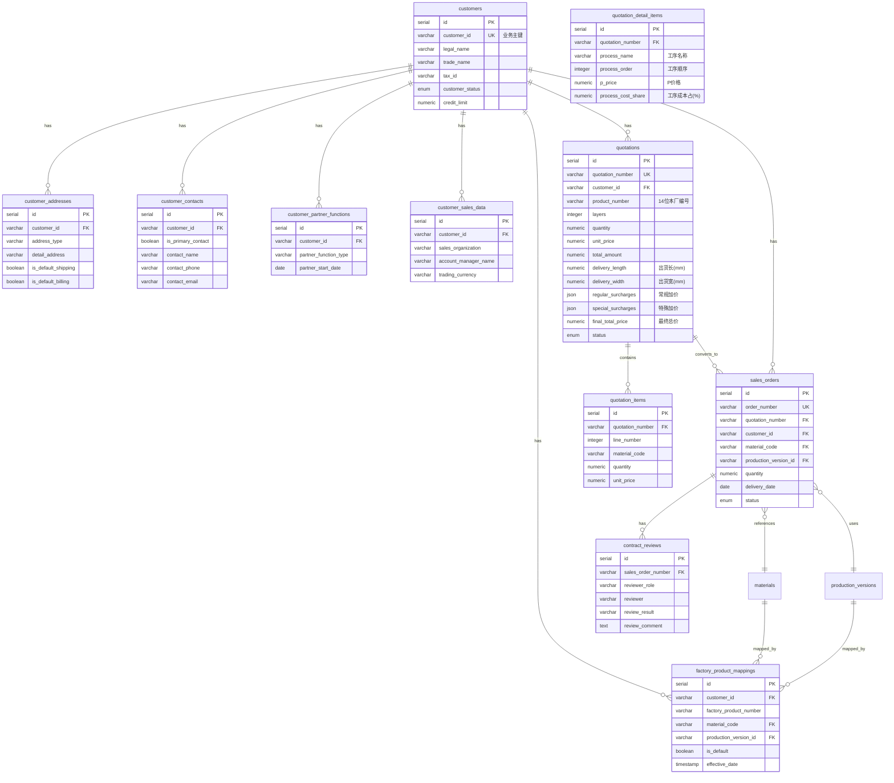
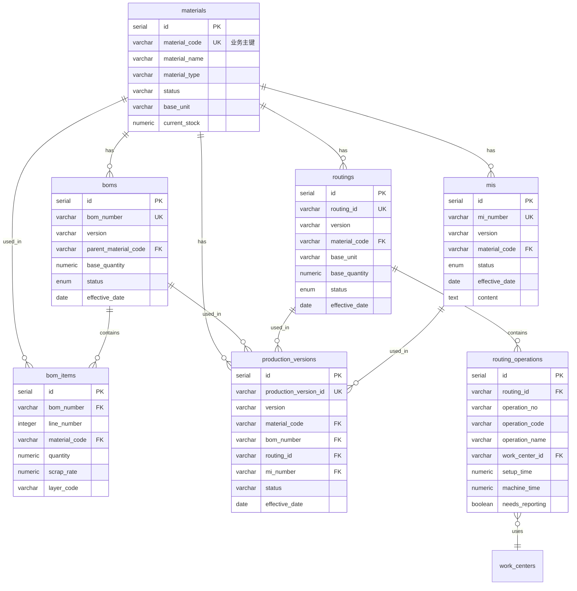
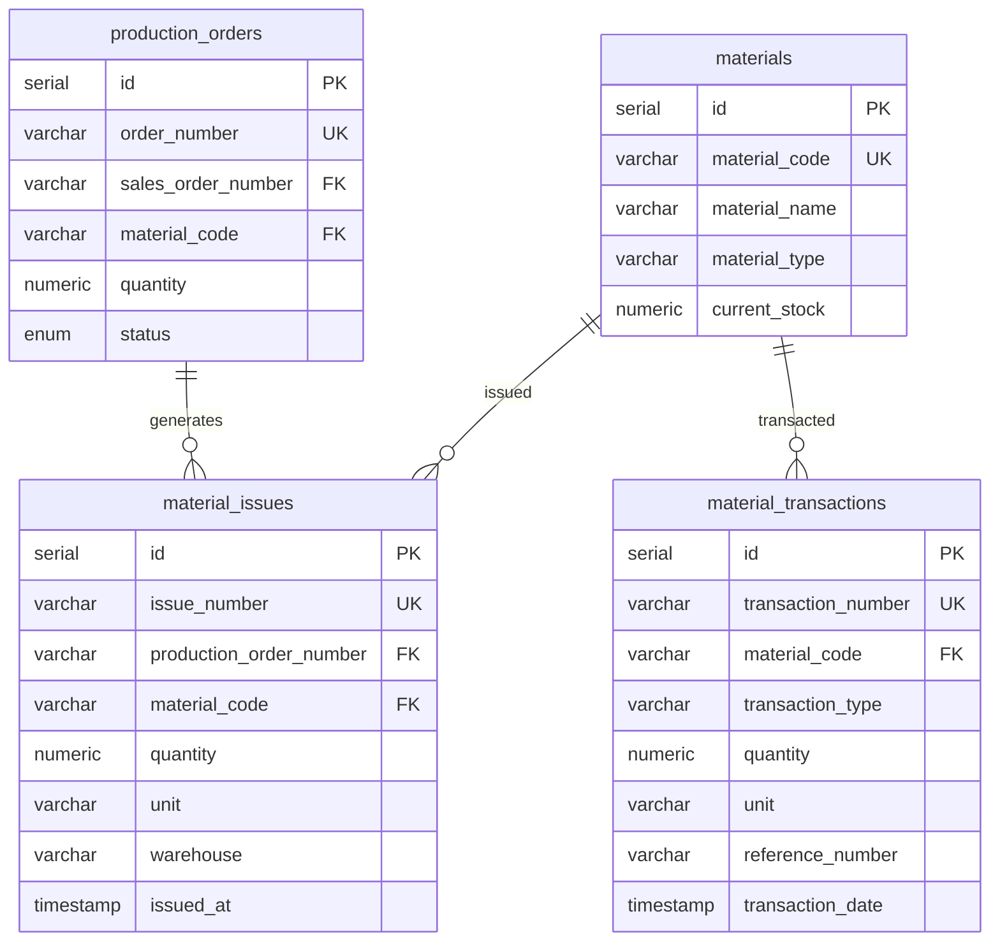
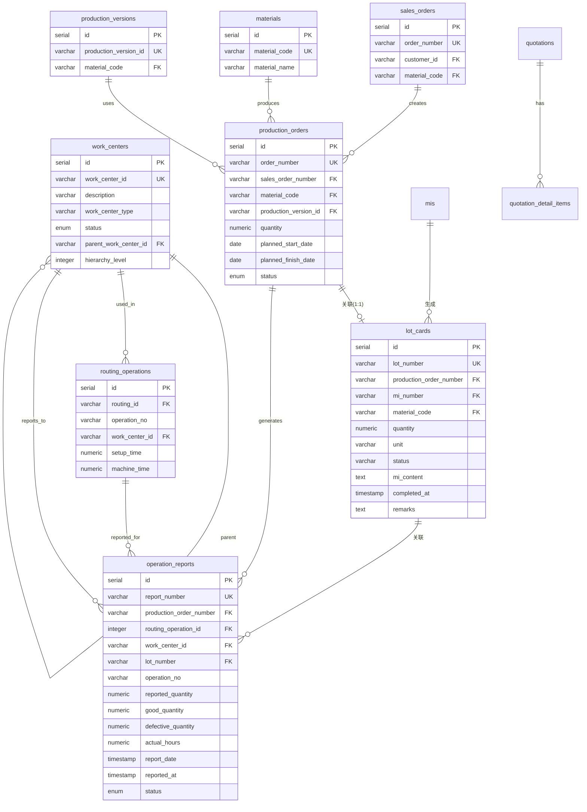
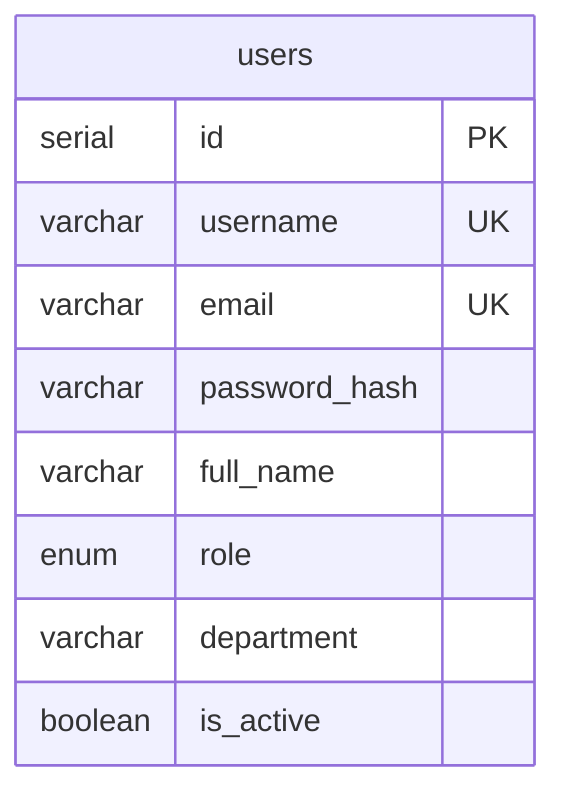
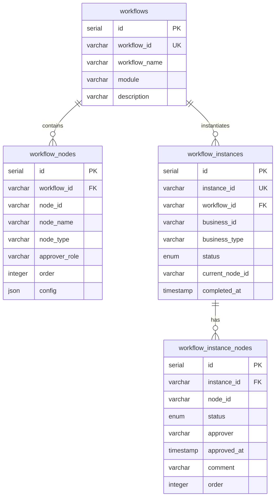
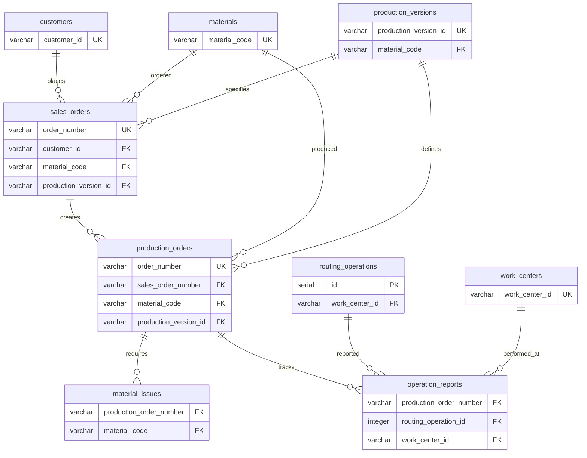

# 某某ERP系统 - 数据模型（ER）

## 文档说明

**版本：** v1.5  
**创建日期：** 2025-12-12  
**最后更新：** 2025-01-XX

**基于**：某某ERP系统MVP版本需求规格说明书 v1.5

本文档描述了某某ERP系统的数据模型（Entity-Relationship Model），包括所有实体、属性、关系、主键、外键和索引。数据模型基于PostgreSQL数据库，使用SQLAlchemy ORM实现。

---

## 一、数据模型概述

### 1.1 数据库系统

- **数据库类型**：PostgreSQL
- **ORM框架**：SQLAlchemy
- **字符编码**：UTF-8
- **时区**：Asia/Shanghai

### 1.2 模型设计原则

1. **规范化设计**：遵循第三范式（3NF），减少数据冗余
2. **软删除**：所有实体都支持软删除（is_deleted字段）
3. **审计追踪**：所有实体都包含创建人、创建时间、更新人、更新时间
4. **外键约束**：使用数据库外键约束保证数据完整性
5. **索引优化**：为常用查询字段创建索引

### 1.3 实体分类

- **配置管理模块（CFG）**：8个实体（客户主数据、物料主数据、工作中心、产品主数据、BOM、工艺路线、MI、生产版本）
- **销售与分销模块（SD）**：10个实体（包含报价单、报价明细工序表等）
- **工程管理模块（ENG）**：0个实体（工程数据查询功能，实体由CFG管理）
- **物料管理模块（MM）**：2个实体（生产领料、物料事务）
- **生产计划与控制模块（PP）**：4个实体（工作中心、生产订单、工序报工、LOT卡）
- **用户与权限管理模块**：1个实体
- **工作流模块**：4个实体
- **基础模型**：1个（BaseModel）

**总计：30个实体**

**说明：** 配置管理子系统（CFG）统一管理所有主数据，包括客户主数据、物料主数据、工作中心、产品主数据、BOM、工艺路线、MI、生产版本等。这些实体原属于ENG模块，现已迁移到CFG模块统一管理。

---

## 二、实体详细定义

### 2.0 配置管理模块（CFG Module）

配置管理子系统统一管理所有主数据，包括客户主数据、物料主数据、工作中心、产品主数据、BOM、工艺路线、MI、生产版本等。这些实体为其他子系统提供基础数据支持。

**配置顺序规则：**
1. **基础数据配置层（配置顺序：1）**：客户主数据、物料主数据、工作中心
2. **产品数据配置层（配置顺序：2）**：产品主数据、BOM、工艺路线、MI（可选）
3. **生产数据配置层（配置顺序：3）**：生产版本

**说明：** 配置管理模块的实体定义与原有模块相同，但管理职责已统一到CFG模块。详细实体定义请参考后续章节。

#### 2.0.1 配置管理模块实体列表

- **customers（客户主数据）**：见2.1.1节
- **materials（物料主数据）**：见2.2.1节
- **work_centers（工作中心）**：见2.4.1节
- **products（产品主数据）**：见2.2.1节（materials表中material_type='FG'的记录）
- **boms（BOM）**：见2.2.2节
- **routings（工艺路线）**：见2.2.4节
- **mis（MI）**：见2.2.6节
- **production_versions（生产版本）**：见2.2.7节

---

### 2.1 销售与分销模块（SD Module）

#### 2.1.1 customers（客户表）

**表名**：`customers`  
**主键**：`id` (SERIAL)  
**唯一约束**：`customer_id` (VARCHAR(50))

| 字段名 | 数据类型 | 约束 | 说明 |
|--------|---------|------|------|
| id | SERIAL | PRIMARY KEY | 自增主键 |
| customer_id | VARCHAR(50) | UNIQUE, NOT NULL, INDEX | 客户ID（业务主键） |
| legal_name | VARCHAR(200) | NOT NULL | 公司法定全称 |
| trade_name | VARCHAR(200) | | 常用商号/简称 |
| tax_id | VARCHAR(50) | | 税号 |
| customer_industry | VARCHAR(50) | | 行业 |
| customer_website | VARCHAR(200) | | 网站 |
| customer_status | ENUM | NOT NULL, DEFAULT 'DRAFT' | 客户状态 |
| credit_limit | NUMERIC(15,2) | | 信用额度 |
| created_by | VARCHAR(50) | | 创建人 |
| created_at | TIMESTAMP | DEFAULT CURRENT_TIMESTAMP | 创建时间 |
| updated_by | VARCHAR(50) | | 更新人 |
| updated_at | TIMESTAMP | DEFAULT CURRENT_TIMESTAMP | 更新时间 |
| is_deleted | BOOLEAN | NOT NULL, DEFAULT FALSE | 是否删除 |

**索引**：
- `idx_customers_customer_id` ON `customer_id`
- `idx_customers_status` ON `customer_status`

**关联关系**：
- 一对多：`customer_addresses`, `customer_contacts`, `customer_partner_functions`, `customer_sales_data`, `quotations`, `sales_orders`, `factory_product_mappings`

---

#### 2.1.2 customer_addresses（客户地址表）

**表名**：`customer_addresses`  
**主键**：`id` (SERIAL)  
**复合唯一约束**：`(customer_id, address_type)`

| 字段名 | 数据类型 | 约束 | 说明 |
|--------|---------|------|------|
| id | SERIAL | PRIMARY KEY | 自增主键 |
| customer_id | VARCHAR(50) | FOREIGN KEY → customers.customer_id, NOT NULL | 客户ID |
| address_type | VARCHAR(50) | NOT NULL | 地址类型（HEADQUARTERS, PLANT, WAREHOUSE, BILLING） |
| detail_address | VARCHAR(500) | NOT NULL | 详细地址 |
| location | VARCHAR(100) | | 位置 |
| postal_code | VARCHAR(20) | | 邮编 |
| country | VARCHAR(50) | DEFAULT '中国' | 国家 |
| province | VARCHAR(50) | | 省份 |
| city | VARCHAR(50) | | 城市 |
| district | VARCHAR(50) | | 区县 |
| is_default_shipping | BOOLEAN | DEFAULT FALSE | 是否默认发货地址 |
| is_default_billing | BOOLEAN | DEFAULT FALSE | 是否默认账单地址 |
| created_by | VARCHAR(50) | | 创建人 |
| created_at | TIMESTAMP | DEFAULT CURRENT_TIMESTAMP | 创建时间 |
| updated_by | VARCHAR(50) | | 更新人 |
| updated_at | TIMESTAMP | DEFAULT CURRENT_TIMESTAMP | 更新时间 |
| is_deleted | BOOLEAN | NOT NULL, DEFAULT FALSE | 是否删除 |

**外键**：
- `fk_customer_addresses_customer` FOREIGN KEY (`customer_id`) REFERENCES `customers`(`customer_id`)

**索引**：
- `idx_customer_addresses_customer` ON `customer_id`

---

#### 2.1.3 customer_contacts（客户联系人表）

**表名**：`customer_contacts`  
**主键**：`id` (SERIAL)

| 字段名 | 数据类型 | 约束 | 说明 |
|--------|---------|------|------|
| id | SERIAL | PRIMARY KEY | 自增主键 |
| customer_id | VARCHAR(50) | FOREIGN KEY → customers.customer_id, NOT NULL | 客户ID |
| is_primary_contact | BOOLEAN | DEFAULT FALSE | 是否主要联系人 |
| contact_name | VARCHAR(100) | NOT NULL | 联系人姓名 |
| contact_role | VARCHAR(100) | | 联系人角色 |
| contact_department | VARCHAR(100) | | 部门 |
| contact_phone | VARCHAR(20) | | 电话 |
| contact_email | VARCHAR(100) | | 邮箱 |
| created_by | VARCHAR(50) | | 创建人 |
| created_at | TIMESTAMP | DEFAULT CURRENT_TIMESTAMP | 创建时间 |
| updated_by | VARCHAR(50) | | 更新人 |
| updated_at | TIMESTAMP | DEFAULT CURRENT_TIMESTAMP | 更新时间 |
| is_deleted | BOOLEAN | NOT NULL, DEFAULT FALSE | 是否删除 |

**外键**：
- `fk_customer_contacts_customer` FOREIGN KEY (`customer_id`) REFERENCES `customers`(`customer_id`)

**索引**：
- `idx_customer_contacts_customer` ON `customer_id`

---

#### 2.1.4 customer_partner_functions（客户合作属性表）

**表名**：`customer_partner_functions`  
**主键**：`id` (SERIAL)

| 字段名 | 数据类型 | 约束 | 说明 |
|--------|---------|------|------|
| id | SERIAL | PRIMARY KEY | 自增主键 |
| customer_id | VARCHAR(50) | FOREIGN KEY → customers.customer_id, NOT NULL | 客户ID |
| partner_function_type | VARCHAR(50) | NOT NULL | 合作类型 |
| partner_start_date | DATE | | 合作开始日期 |
| partner_name | VARCHAR(200) | | 合作方名称 |
| partnership_description | VARCHAR(500) | | 合作描述 |
| created_by | VARCHAR(50) | | 创建人 |
| created_at | TIMESTAMP | DEFAULT CURRENT_TIMESTAMP | 创建时间 |
| updated_by | VARCHAR(50) | | 更新人 |
| updated_at | TIMESTAMP | DEFAULT CURRENT_TIMESTAMP | 更新时间 |
| is_deleted | BOOLEAN | NOT NULL, DEFAULT FALSE | 是否删除 |

**外键**：
- `fk_customer_partner_functions_customer` FOREIGN KEY (`customer_id`) REFERENCES `customers`(`customer_id`)

**索引**：
- `idx_customer_partner_functions_customer` ON `customer_id`

---

#### 2.1.5 customer_sales_data（客户销售数据表）

**表名**：`customer_sales_data`  
**主键**：`id` (SERIAL)

| 字段名 | 数据类型 | 约束 | 说明 |
|--------|---------|------|------|
| id | SERIAL | PRIMARY KEY | 自增主键 |
| customer_id | VARCHAR(50) | FOREIGN KEY → customers.customer_id, NOT NULL | 客户ID |
| sales_organization | VARCHAR(50) | | 销售组织 |
| account_manager_name | VARCHAR(100) | | 客户经理姓名 |
| sales_assistant_name | VARCHAR(100) | | 销售助理姓名 |
| trading_currency | VARCHAR(10) | DEFAULT 'CNY' | 交易货币 |
| primary_trade_country | VARCHAR(50) | | 主要贸易国家 |
| incoterms | VARCHAR(50) | | 贸易条款 |
| shipping_conditions | VARCHAR(100) | | 运输条件 |
| created_by | VARCHAR(50) | | 创建人 |
| created_at | TIMESTAMP | DEFAULT CURRENT_TIMESTAMP | 创建时间 |
| updated_by | VARCHAR(50) | | 更新人 |
| updated_at | TIMESTAMP | DEFAULT CURRENT_TIMESTAMP | 更新时间 |
| is_deleted | BOOLEAN | NOT NULL, DEFAULT FALSE | 是否删除 |

**外键**：
- `fk_customer_sales_data_customer` FOREIGN KEY (`customer_id`) REFERENCES `customers`(`customer_id`)

**索引**：
- `idx_customer_sales_data_customer` ON `customer_id`

---

#### 2.1.6 factory_product_mappings（本厂编号映射表）

**表名**：`factory_product_mappings`  
**主键**：`id` (SERIAL)  
**复合唯一约束**：`(customer_id, factory_product_number, effective_date)`

| 字段名 | 数据类型 | 约束 | 说明 |
|--------|---------|------|------|
| id | SERIAL | PRIMARY KEY | 自增主键 |
| customer_id | VARCHAR(50) | FOREIGN KEY → customers.customer_id, NOT NULL | 客户ID |
| factory_product_number | VARCHAR(50) | NOT NULL | 本厂编号 |
| material_code | VARCHAR(50) | FOREIGN KEY → materials.material_code, NOT NULL | 物料编码 |
| production_version_id | VARCHAR(50) | FOREIGN KEY → production_versions.production_version_id | 生产版本ID |
| is_default | BOOLEAN | DEFAULT TRUE | 是否默认映射 |
| effective_date | TIMESTAMP | NOT NULL | 生效日期 |
| expiry_date | TIMESTAMP | | 失效日期 |
| created_by | VARCHAR(50) | | 创建人 |
| created_at | TIMESTAMP | DEFAULT CURRENT_TIMESTAMP | 创建时间 |
| updated_by | VARCHAR(50) | | 更新人 |
| updated_at | TIMESTAMP | DEFAULT CURRENT_TIMESTAMP | 更新时间 |
| is_deleted | BOOLEAN | NOT NULL, DEFAULT FALSE | 是否删除 |

**外键**：
- `fk_factory_product_mappings_customer` FOREIGN KEY (`customer_id`) REFERENCES `customers`(`customer_id`)
- `fk_factory_product_mappings_material` FOREIGN KEY (`material_code`) REFERENCES `materials`(`material_code`)
- `fk_factory_product_mappings_production_version` FOREIGN KEY (`production_version_id`) REFERENCES `production_versions`(`production_version_id`)

**索引**：
- `idx_factory_product_mapping_customer` ON `customer_id`
- `idx_factory_product_mapping_product` ON `factory_product_number`
- `idx_factory_product_mapping_material` ON `material_code`
- `idx_factory_product_mapping_version` ON `production_version_id`

---

#### 2.1.7 quotations（报价单表）

**表名**：`quotations`  
**主键**：`id` (SERIAL)  
**唯一约束**：`quotation_number` (VARCHAR(50))

**基本信息字段：**

| 字段名 | 数据类型 | 约束 | 说明 |
|--------|---------|------|------|
| id | SERIAL | PRIMARY KEY | 自增主键 |
| quotation_number | VARCHAR(50) | UNIQUE, NOT NULL, INDEX | 报价单号 |
| customer_id | VARCHAR(50) | FOREIGN KEY → customers.customer_id, NOT NULL | 客户ID |
| product_number | VARCHAR(50) | | 产品编号（14位本厂编号） |
| product_name | VARCHAR(200) | | 产品名称 |
| product_series | VARCHAR(50) | | 产品系列 |
| layers | INTEGER | | 层数 |
| quantity | NUMERIC(15,2) | NOT NULL | 订单数量 |
| unit_price | NUMERIC(15,2) | | 单价 |
| total_amount | NUMERIC(15,2) | | 总金额 |
| currency | VARCHAR(10) | DEFAULT 'CNY' | 货币 |
| valid_until | DATE | | 有效期至 |
| status | ENUM | NOT NULL, DEFAULT 'DRAFT' | 状态 |

**价格明细字段（兼容旧数据）：**

| 字段名 | 数据类型 | 约束 | 说明 |
|--------|---------|------|------|
| engineering_fee | NUMERIC(15,2) | | 工程费 |
| board_material_fee_amount | NUMERIC(15,2) | | 板材费（金额） |
| via_fee | NUMERIC(15,2) | | 过孔费 |
| estimated_total_price | NUMERIC(15,2) | | 预估总价 |

**板规格参数字段：**

| 字段名 | 数据类型 | 约束 | 说明 |
|--------|---------|------|------|
| utilization_rate | NUMERIC(10,4) | | 利用率 (%) |
| delivery_length | NUMERIC(10,2) | | 出货长 (mm) |
| delivery_width | NUMERIC(10,2) | | 出货宽 (mm) |
| set_per_unit | INTEGER | DEFAULT 1 | SET=U（默认1） |
| material_type | VARCHAR(50) | | 板材类型 |
| tg_value | VARCHAR(50) | | TG值 |
| finished_board_thickness | VARCHAR(50) | | 完成板厚 |
| large_material_spec | VARCHAR(50) | | 大料规格 |
| large_material_pnl_count | INTEGER | | 大料开PNL数 |
| pnl_set_count | INTEGER | | PNL含SET数 |
| pnl_length_mm | NUMERIC(10,2) | | PNL尺寸MM - 长度 |
| pnl_width_mm | NUMERIC(10,2) | | PNL尺寸MM - 宽度 |
| core_board_count | INTEGER | | 芯板张数 |
| core_board_spec | VARCHAR(200) | | 芯板规格 |
| inner_layer_thickening | BOOLEAN | DEFAULT FALSE | 内层加厚 |
| outer_line_width_spacing_limit | BOOLEAN | DEFAULT FALSE | 外层线宽/距<=3.5mil 完成-基铜>=35 |
| solder_mask_color_detail | VARCHAR(50) | | 阻焊颜色（明细用） |
| times | INTEGER | DEFAULT 1 | 次数（默认1） |
| specify_sun | BOOLEAN | DEFAULT FALSE | 指定太阳 |
| board_thickness_tolerance | BOOLEAN | DEFAULT FALSE | 板厚公差<+/-10% |
| via_plugging | VARCHAR(50) | | 过孔塞孔 |
| character_color_detail | VARCHAR(50) | | 字符颜色（明细用） |
| min_drill_bit | VARCHAR(50) | | 最小钻咀 |
| set_hole_count | INTEGER | | SET孔数 |
| pcs_conversion | NUMERIC(10,2) | | PCS换算 |
| pnl_conversion | NUMERIC(10,2) | | PNL换算 |
| acceptance_standard | VARCHAR(50) | | 验收标准 |
| routing_process | NUMERIC(10,2) | | 锣程 (MM) |
| v_score_process | NUMERIC(10,2) | | V程 (MM/SET) |
| hard_gold | BOOLEAN | DEFAULT FALSE | 硬金(金手指) |
| no_positioning_hole_routing | BOOLEAN | DEFAULT FALSE | 无定位孔锣 |
| test_points | INTEGER | DEFAULT 0 | 测试点数 |

**工艺参数字段：**

| 字段名 | 数据类型 | 约束 | 说明 |
|--------|---------|------|------|
| board_thickness | VARCHAR(50) | | 板厚 |
| copper_thickness | VARCHAR(50) | | 铜厚 |
| line_width_spacing | VARCHAR(50) | | 线宽线距 |
| surface_treatment | VARCHAR(50) | | 表面处理 |
| min_aperture | VARCHAR(50) | | 最小孔径 |

**加价选项字段：**

| 字段名 | 数据类型 | 约束 | 说明 |
|--------|---------|------|------|
| regular_surcharges | JSON | | 常规加价选项（JSON格式，包含碳油、蓝胶、高温胶、阻抗要求等） |
| special_surcharges | JSON | | 特殊加价选项（JSON格式，包含跳刀V、沉头孔、额外PP张数等） |
| additional_surcharge_per_m2 | NUMERIC(15,2) | DEFAULT 0 | 额外加价/M² |
| customer_provides_hf_board | BOOLEAN | DEFAULT FALSE | 客户提供高频板 |
| min_customer_consumption | NUMERIC(15,2) | DEFAULT 0 | 收客户最低消费 |
| market_quote_remarks | VARCHAR(500) | | 市场报价备注 |

**计算结果字段：**

| 字段名 | 数据类型 | 约束 | 说明 |
|--------|---------|------|------|
| actual_p_input | INTEGER | | 实际投P |
| delivery_area | NUMERIC(15,4) | | 交货面积 (m²) |
| cost_per_pcs | NUMERIC(15,4) | | 成本PCS |
| cost_per_m2 | NUMERIC(15,4) | | 成本平米 |
| quote_price_per_pcs | NUMERIC(15,4) | | 报价pcs价 |
| quote_price_per_m2 | NUMERIC(15,4) | | 报价平米价 |
| test_fixture | NUMERIC(15,2) | DEFAULT 0 | 测试架 |
| other_costs | NUMERIC(15,2) | DEFAULT 0 | 其他费用 |
| final_total_price | NUMERIC(15,2) | | 最终总价 |

**审核字段（三级审核流程）：**

| 字段名 | 数据类型 | 约束 | 说明 |
|--------|---------|------|------|
| sales_approver | VARCHAR(50) | | 一级审核人（销售经理SALES_MANAGER） |
| sales_approved_at | TIMESTAMP | | 一级审核时间 |
| engineer_approver | VARCHAR(50) | | 二级审核人（工程师ENGINEER） |
| engineer_approved_at | TIMESTAMP | | 二级审核时间 |
| account_manager_approver | VARCHAR(50) | | 三级审核人（客户经理ACCOUNT_MANAGER） |
| general_manager_approver | VARCHAR(50) | | 三级审核人（总经理GENERAL_MANAGER，与客户经理二选一） |
| account_manager_approved_at | TIMESTAMP | | 三级审核时间 |
| customer_confirmed | BOOLEAN | DEFAULT FALSE | 客户确认（销售员标记） |
| customer_confirmed_at | TIMESTAMP | | 客户确认时间 |
| customer_confirmed_by | VARCHAR(50) | | 客户确认人（销售员） |

**审计字段：**

| 字段名 | 数据类型 | 约束 | 说明 |
|--------|---------|------|------|
| created_by | VARCHAR(50) | | 创建人 |
| created_at | TIMESTAMP | DEFAULT CURRENT_TIMESTAMP | 创建时间 |
| updated_by | VARCHAR(50) | | 更新人 |
| updated_at | TIMESTAMP | DEFAULT CURRENT_TIMESTAMP | 更新时间 |
| is_deleted | BOOLEAN | NOT NULL, DEFAULT FALSE | 是否删除 |

**外键**：
- `fk_quotations_customer` FOREIGN KEY (`customer_id`) REFERENCES `customers`(`customer_id`)

**索引**：
- `idx_quotations_quotation_number` ON `quotation_number`
- `idx_quotations_customer` ON `customer_id`
- `idx_quotations_status` ON `status`

**关联关系**：
- 多对一：`customers`
- 一对多：`quotation_items`, `quotation_detail_items`, `sales_orders`

**状态枚举**：
- `DRAFT`：草稿
- `PENDING_SALES`：待一级审核（销售经理）
- `PENDING_ENGINEER`：待二级审核（工程师）
- `PENDING_ACCOUNT_MANAGER`：待三级审核（客户经理/总经理）
- `APPROVED`：已审核通过
- `REJECTED`：已拒绝
- `CUSTOMER_CONFIRMED`：客户已确认
- `LINKED`：已转订单
- `CANCELLED`：已取消

**业务规则**：
- 三级审核流程为串行流程：一级审核（销售经理）→ 二级审核（工程师）→ 三级审核（客户经理或总经理）
- 三级审核通过后，销售员经客户确认报价单（客户确认是线下确认，销售员在系统中标记"客户已确认"）
- 客户确认后可以转为销售订单

---

#### 2.1.8 quotation_items（报价单明细表）

**表名**：`quotation_items`  
**主键**：`id` (SERIAL)  
**复合唯一约束**：`(quotation_number, line_number)`

| 字段名 | 数据类型 | 约束 | 说明 |
|--------|---------|------|------|
| id | SERIAL | PRIMARY KEY | 自增主键 |
| quotation_number | VARCHAR(50) | FOREIGN KEY → quotations.quotation_number, NOT NULL | 报价单号 |
| line_number | INTEGER | NOT NULL | 行号 |
| material_code | VARCHAR(50) | | 物料编码 |
| material_name | VARCHAR(200) | | 物料名称 |
| quantity | NUMERIC(15,2) | | 数量 |
| unit_price | NUMERIC(15,2) | | 单价 |
| total_price | NUMERIC(15,2) | | 总价 |
| remarks | VARCHAR(500) | | 备注 |
| created_by | VARCHAR(50) | | 创建人 |
| created_at | TIMESTAMP | DEFAULT CURRENT_TIMESTAMP | 创建时间 |
| updated_by | VARCHAR(50) | | 更新人 |
| updated_at | TIMESTAMP | DEFAULT CURRENT_TIMESTAMP | 更新时间 |
| is_deleted | BOOLEAN | NOT NULL, DEFAULT FALSE | 是否删除 |

---

#### 2.1.9 quotation_detail_items（报价明细工序表）

**表名**：`quotation_detail_items`  
**主键**：`id` (SERIAL)  
**复合唯一约束**：`(quotation_number, process_order)`

存储工序成本明细信息，用于报价计算的工序成本分摊。

| 字段名 | 数据类型 | 约束 | 说明 |
|--------|---------|------|------|
| id | SERIAL | PRIMARY KEY | 自增主键 |
| quotation_number | VARCHAR(50) | FOREIGN KEY → quotations.quotation_number, NOT NULL | 报价单编号 |
| process_name | VARCHAR(200) | NOT NULL | 工序名称 |
| process_order | INTEGER | NOT NULL | 工序顺序 |
| p_cost_calculation_info | TEXT | | P成本计算信息 |
| p_price | NUMERIC(15,4) | | P价格 |
| delivery_area | NUMERIC(15,4) | | 出货面积 (m²) |
| process_cost_share | NUMERIC(10,4) | | 工序成本占 (%) |
| remarks | VARCHAR(500) | | 备注 |
| created_by | VARCHAR(50) | | 创建人 |
| created_at | TIMESTAMP | DEFAULT CURRENT_TIMESTAMP | 创建时间 |
| updated_by | VARCHAR(50) | | 更新人 |
| updated_at | TIMESTAMP | DEFAULT CURRENT_TIMESTAMP | 更新时间 |
| is_deleted | BOOLEAN | NOT NULL, DEFAULT FALSE | 是否删除 |

**外键**：
- `fk_quotation_detail_items_quotation` FOREIGN KEY (`quotation_number`) REFERENCES `quotations`(`quotation_number`)

**索引**：
- `idx_quotation_detail_items_quotation` ON `quotation_number`
- `idx_quotation_detail_items_process_order` ON `(quotation_number, process_order)`

**外键**：
- `fk_quotation_items_quotation` FOREIGN KEY (`quotation_number`) REFERENCES `quotations`(`quotation_number`)

**索引**：
- `idx_quotation_items_quotation` ON `quotation_number`

---

#### 2.1.9 sales_orders（销售订单表）

**表名**：`sales_orders`  
**主键**：`id` (SERIAL)  
**唯一约束**：`order_number` (VARCHAR(50))

| 字段名 | 数据类型 | 约束 | 说明 |
|--------|---------|------|------|
| id | SERIAL | PRIMARY KEY | 自增主键 |
| order_number | VARCHAR(50) | UNIQUE, NOT NULL, INDEX | 销售订单号 |
| quotation_number | VARCHAR(50) | FOREIGN KEY → quotations.quotation_number | 报价单号 |
| customer_id | VARCHAR(50) | FOREIGN KEY → customers.customer_id, NOT NULL | 客户ID |
| product_number | VARCHAR(50) | | 本厂编号 |
| material_code | VARCHAR(50) | FOREIGN KEY → materials.material_code | 物料编码 |
| production_version_id | VARCHAR(50) | FOREIGN KEY → production_versions.production_version_id | 生产版本ID |
| quantity | NUMERIC(15,2) | NOT NULL | 销售数量 |
| sales_unit | VARCHAR(20) | | 销售单位 |
| production_quantity | NUMERIC(15,2) | | 生产数量 |
| production_unit | VARCHAR(20) | | 生产单位 |
| conversion_factor | NUMERIC(15,4) | | 单位转换系数 |
| delivery_date | DATE | | 交货日期 |
| status | ENUM | NOT NULL, DEFAULT 'DRAFT' | 状态 |
| is_return_order | BOOLEAN | DEFAULT FALSE | 是否返单 |
| review_status | VARCHAR(20) | | 评审状态 |
| created_by | VARCHAR(50) | | 创建人 |
| created_at | TIMESTAMP | DEFAULT CURRENT_TIMESTAMP | 创建时间 |
| updated_by | VARCHAR(50) | | 更新人 |
| updated_at | TIMESTAMP | DEFAULT CURRENT_TIMESTAMP | 更新时间 |
| is_deleted | BOOLEAN | NOT NULL, DEFAULT FALSE | 是否删除 |

**外键**：
- `fk_sales_orders_quotation` FOREIGN KEY (`quotation_number`) REFERENCES `quotations`(`quotation_number`)
- `fk_sales_orders_customer` FOREIGN KEY (`customer_id`) REFERENCES `customers`(`customer_id`)
- `fk_sales_orders_material` FOREIGN KEY (`material_code`) REFERENCES `materials`(`material_code`)
- `fk_sales_orders_production_version` FOREIGN KEY (`production_version_id`) REFERENCES `production_versions`(`production_version_id`)

**索引**：
- `idx_sales_orders_order_number` ON `order_number`
- `idx_sales_orders_customer` ON `customer_id`
- `idx_sales_orders_quotation` ON `quotation_number`
- `idx_sales_orders_material` ON `material_code`
- `idx_sales_orders_production_version` ON `production_version_id`
- `idx_sales_orders_status` ON `status`

**关联关系**：
- 多对一：`customers`, `quotations`, `materials`, `production_versions`
- 一对多：`contract_reviews`, `production_orders`

---

#### 2.1.10 contract_reviews（订单评审表）

**表名**：`contract_reviews`  
**主键**：`id` (SERIAL)

| 字段名 | 数据类型 | 约束 | 说明 |
|--------|---------|------|------|
| id | SERIAL | PRIMARY KEY | 自增主键 |
| sales_order_number | VARCHAR(50) | FOREIGN KEY → sales_orders.order_number, NOT NULL | 销售订单号 |
| reviewer_role | VARCHAR(50) | NOT NULL | 评审人角色 |
| reviewer | VARCHAR(50) | NOT NULL | 评审人 |
| review_result | VARCHAR(20) | NOT NULL | 评审结果（APPROVED, REJECTED） |
| review_comment | TEXT | | 评审意见 |
| reviewed_at | TIMESTAMP | NOT NULL | 评审时间 |
| created_by | VARCHAR(50) | | 创建人 |
| created_at | TIMESTAMP | DEFAULT CURRENT_TIMESTAMP | 创建时间 |
| updated_by | VARCHAR(50) | | 更新人 |
| updated_at | TIMESTAMP | DEFAULT CURRENT_TIMESTAMP | 更新时间 |
| is_deleted | BOOLEAN | NOT NULL, DEFAULT FALSE | 是否删除 |

**外键**：
- `fk_contract_reviews_sales_order` FOREIGN KEY (`sales_order_number`) REFERENCES `sales_orders`(`order_number`)

**索引**：
- `idx_contract_reviews_sales_order` ON `sales_order_number`
- `idx_contract_reviews_reviewer` ON `reviewer`

---

### 2.2 工程管理模块（ENG Module）

#### 2.2.1 materials（物料表）

**表名**：`materials`  
**主键**：`id` (SERIAL)  
**唯一约束**：`material_code` (VARCHAR(50))

| 字段名 | 数据类型 | 约束 | 说明 |
|--------|---------|------|------|
| id | SERIAL | PRIMARY KEY | 自增主键 |
| material_code | VARCHAR(50) | UNIQUE, NOT NULL, INDEX | 物料编码 |
| material_name | VARCHAR(200) | NOT NULL | 物料名称 |
| material_type | VARCHAR(20) | NOT NULL | 物料类型（FG/RAW/SEMI） |
| status | VARCHAR(20) | DEFAULT 'ACTIVE' | 状态 |
| base_unit | VARCHAR(20) | NOT NULL | 基础单位 |
| production_unit | VARCHAR(20) | | 生产单位 |
| conversion_factor | NUMERIC(15,4) | | 单位转换系数 |
| current_stock | NUMERIC(15,2) | DEFAULT 0 | 当前库存 |
| safety_stock | NUMERIC(15,2) | | 安全库存 |
| ... (PCB工程属性字段) | | | 见领域模型文档 |
| created_by | VARCHAR(50) | | 创建人 |
| created_at | TIMESTAMP | DEFAULT CURRENT_TIMESTAMP | 创建时间 |
| updated_by | VARCHAR(50) | | 更新人 |
| updated_at | TIMESTAMP | DEFAULT CURRENT_TIMESTAMP | 更新时间 |
| is_deleted | BOOLEAN | NOT NULL, DEFAULT FALSE | 是否删除 |

**索引**：
- `idx_materials_material_code` ON `material_code`
- `idx_materials_material_type` ON `material_type`
- `idx_materials_status` ON `status`

**关联关系**：
- 一对多：`boms`, `bom_items`, `routings`, `routing_operations`, `mis`, `production_versions`, `material_issues`, `material_transactions`, `sales_orders`, `production_orders`

---

#### 2.2.2 boms（BOM表）

**表名**：`boms`  
**主键**：`id` (SERIAL)  
**唯一约束**：`bom_number` (VARCHAR(50))

| 字段名 | 数据类型 | 约束 | 说明 |
|--------|---------|------|------|
| id | SERIAL | PRIMARY KEY | 自增主键 |
| bom_number | VARCHAR(50) | UNIQUE, NOT NULL, INDEX | BOM编号 |
| version | VARCHAR(20) | NOT NULL | 版本号 |
| parent_material_code | VARCHAR(50) | FOREIGN KEY → materials.material_code, NOT NULL | 父物料编码 |
| base_quantity | NUMERIC(15,2) | DEFAULT 1 | 基数 |
| base_uom | VARCHAR(20) | DEFAULT 'PNL' | 基础单位 |
| status | ENUM | NOT NULL, DEFAULT 'NEW' | 状态 |
| effective_date | DATE | NOT NULL | 生效日期 |
| expiry_date | DATE | | 失效日期 |
| created_by | VARCHAR(50) | | 创建人 |
| created_at | TIMESTAMP | DEFAULT CURRENT_TIMESTAMP | 创建时间 |
| updated_by | VARCHAR(50) | | 更新人 |
| updated_at | TIMESTAMP | DEFAULT CURRENT_TIMESTAMP | 更新时间 |
| is_deleted | BOOLEAN | NOT NULL, DEFAULT FALSE | 是否删除 |

**外键**：
- `fk_boms_material` FOREIGN KEY (`parent_material_code`) REFERENCES `materials`(`material_code`)

**索引**：
- `idx_boms_bom_number` ON `bom_number`
- `idx_boms_parent_material` ON `parent_material_code`
- `idx_boms_status` ON `status`

**关联关系**：
- 多对一：`materials`
- 一对多：`bom_items`, `production_versions`

---

#### 2.2.3 bom_items（BOM明细表）

**表名**：`bom_items`  
**主键**：`id` (SERIAL)  
**复合主键**：`(bom_number, line_number)`

| 字段名 | 数据类型 | 约束 | 说明 |
|--------|---------|------|------|
| id | SERIAL | PRIMARY KEY | 自增主键 |
| bom_number | VARCHAR(50) | FOREIGN KEY → boms.bom_number, NOT NULL | BOM编号 |
| line_number | INTEGER | NOT NULL | 行号 |
| material_code | VARCHAR(50) | FOREIGN KEY → materials.material_code, NOT NULL | 子物料编码 |
| item_category | VARCHAR(50) | | 物料类别 |
| quantity | NUMERIC(15,4) | NOT NULL | 单机用量 |
| unit | VARCHAR(20) | NOT NULL | 单位 |
| scrap_rate | NUMERIC(5,2) | | 损耗率% |
| layer_code | VARCHAR(50) | | PCB层码 |
| material_type | VARCHAR(50) | | 物料类型 |
| process_step | VARCHAR(50) | | 后工序步骤 |
| created_by | VARCHAR(50) | | 创建人 |
| created_at | TIMESTAMP | DEFAULT CURRENT_TIMESTAMP | 创建时间 |
| updated_by | VARCHAR(50) | | 更新人 |
| updated_at | TIMESTAMP | DEFAULT CURRENT_TIMESTAMP | 更新时间 |
| is_deleted | BOOLEAN | NOT NULL, DEFAULT FALSE | 是否删除 |

**外键**：
- `fk_bom_items_bom` FOREIGN KEY (`bom_number`) REFERENCES `boms`(`bom_number`)
- `fk_bom_items_material` FOREIGN KEY (`material_code`) REFERENCES `materials`(`material_code`)

**索引**：
- `idx_bom_items_bom` ON `bom_number`
- `idx_bom_items_material` ON `material_code`

---

#### 2.2.4 routings（工艺路线表）

**表名**：`routings`  
**主键**：`id` (SERIAL)  
**唯一约束**：`routing_id` (VARCHAR(50))

| 字段名 | 数据类型 | 约束 | 说明 |
|--------|---------|------|------|
| id | SERIAL | PRIMARY KEY | 自增主键 |
| routing_id | VARCHAR(50) | UNIQUE, NOT NULL, INDEX | 工艺路线ID |
| version | VARCHAR(20) | NOT NULL | 版本号 |
| material_code | VARCHAR(50) | FOREIGN KEY → materials.material_code, NOT NULL | 物料编码 |
| base_unit | VARCHAR(20) | DEFAULT 'PNL' | 基础单位 |
| base_quantity | NUMERIC(15,2) | DEFAULT 1 | 基数 |
| units_per_panel | INTEGER | DEFAULT 1 | 每拼板单元数 |
| panel_size | VARCHAR(50) | | 拼板尺寸 |
| status | ENUM | NOT NULL, DEFAULT 'DRAFT' | 状态 |
| effective_date | DATE | NOT NULL | 生效日期 |
| expiry_date | DATE | | 失效日期 |
| change_request_no | VARCHAR(50) | | 工程变更单号 |
| created_by | VARCHAR(50) | | 创建人 |
| created_at | TIMESTAMP | DEFAULT CURRENT_TIMESTAMP | 创建时间 |
| updated_by | VARCHAR(50) | | 更新人 |
| updated_at | TIMESTAMP | DEFAULT CURRENT_TIMESTAMP | 更新时间 |
| is_deleted | BOOLEAN | NOT NULL, DEFAULT FALSE | 是否删除 |

**外键**：
- `fk_routings_material` FOREIGN KEY (`material_code`) REFERENCES `materials`(`material_code`)

**索引**：
- `idx_routings_routing_id` ON `routing_id`
- `idx_routings_material` ON `material_code`
- `idx_routings_status` ON `status`

**关联关系**：
- 多对一：`materials`
- 一对多：`routing_operations`, `production_versions`

---

#### 2.2.5 routing_operations（工艺路线工序表）

**表名**：`routing_operations`  
**主键**：`id` (SERIAL)  
**复合主键**：`(routing_id, operation_no)`

| 字段名 | 数据类型 | 约束 | 说明 |
|--------|---------|------|------|
| id | SERIAL | PRIMARY KEY | 自增主键 |
| routing_id | VARCHAR(50) | FOREIGN KEY → routings.routing_id, NOT NULL | 工艺路线ID |
| operation_no | VARCHAR(20) | NOT NULL | 工序号 |
| operation_code | VARCHAR(50) | NOT NULL | 工序代码 |
| operation_name | VARCHAR(200) | NOT NULL | 工序名称 |
| operation_type | VARCHAR(50) | NOT NULL | 工序类型 |
| work_center_id | VARCHAR(50) | FOREIGN KEY → work_centers.work_center_id, NOT NULL | 工作中心ID |
| sop_link | VARCHAR(255) | | 作业指导书链接 |
| setup_time | NUMERIC(10,2) | DEFAULT 0 | 调机时间（分钟） |
| machine_time | NUMERIC(10,2) | DEFAULT 0 | 机器时间（分钟） |
| labor_time | NUMERIC(10,2) | DEFAULT 0 | 人工时间（分钟） |
| queue_time | NUMERIC(10,2) | DEFAULT 0 | 排队缓冲（分钟） |
| cost_relevant | BOOLEAN | DEFAULT TRUE | 成本相关 |
| scheduling_relevant | BOOLEAN | DEFAULT TRUE | 排程相关 |
| needs_reporting | BOOLEAN | DEFAULT TRUE | 需报工 |
| auto_deduct_material | BOOLEAN | DEFAULT FALSE | 自动倒扣料 |
| trigger_quality_check | BOOLEAN | DEFAULT FALSE | 触发质检 |
| ... (外协参数、质检参数字段) | | | 见领域模型文档 |
| created_by | VARCHAR(50) | | 创建人 |
| created_at | TIMESTAMP | DEFAULT CURRENT_TIMESTAMP | 创建时间 |
| updated_by | VARCHAR(50) | | 更新人 |
| updated_at | TIMESTAMP | DEFAULT CURRENT_TIMESTAMP | 更新时间 |
| is_deleted | BOOLEAN | NOT NULL, DEFAULT FALSE | 是否删除 |

**外键**：
- `fk_routing_operations_routing` FOREIGN KEY (`routing_id`) REFERENCES `routings`(`routing_id`)
- `fk_routing_operations_work_center` FOREIGN KEY (`work_center_id`) REFERENCES `work_centers`(`work_center_id`)

**索引**：
- `idx_routing_operations_routing` ON `routing_id`
- `idx_routing_operations_work_center` ON `work_center_id`

---

#### 2.2.6 mis（MI表）

**表名**：`mis`  
**主键**：`id` (SERIAL)  
**唯一约束**：`mi_number` (VARCHAR(50))

| 字段名 | 数据类型 | 约束 | 说明 |
|--------|---------|------|------|
| id | SERIAL | PRIMARY KEY | 自增主键 |
| mi_number | VARCHAR(50) | UNIQUE, NOT NULL, INDEX | MI编号 |
| version | VARCHAR(20) | NOT NULL | 版本号 |
| material_code | VARCHAR(50) | FOREIGN KEY → materials.material_code, NOT NULL | 物料编码 |
| description | VARCHAR(500) | | 描述 |
| status | ENUM | NOT NULL, DEFAULT 'DRAFT' | 状态 |
| effective_date | DATE | NOT NULL | 生效日期 |
| expiry_date | DATE | | 失效日期 |
| content | TEXT | | MI内容（JSON格式） |
| created_by | VARCHAR(50) | | 创建人 |
| created_at | TIMESTAMP | DEFAULT CURRENT_TIMESTAMP | 创建时间 |
| updated_by | VARCHAR(50) | | 更新人 |
| updated_at | TIMESTAMP | DEFAULT CURRENT_TIMESTAMP | 更新时间 |
| is_deleted | BOOLEAN | NOT NULL, DEFAULT FALSE | 是否删除 |

**外键**：
- `fk_mis_material` FOREIGN KEY (`material_code`) REFERENCES `materials`(`material_code`)

**索引**：
- `idx_mis_mi_number` ON `mi_number`
- `idx_mis_material` ON `material_code`
- `idx_mis_status` ON `status`

**关联关系**：
- 多对一：`materials`
- 一对多：`production_versions`

---

#### 2.2.7 production_versions（生产版本表）

**表名**：`production_versions`  
**主键**：`id` (SERIAL)  
**唯一约束**：`production_version_id` (VARCHAR(50))

| 字段名 | 数据类型 | 约束 | 说明 |
|--------|---------|------|------|
| id | SERIAL | PRIMARY KEY | 自增主键 |
| production_version_id | VARCHAR(50) | UNIQUE, NOT NULL, INDEX | 生产版本ID |
| version | VARCHAR(20) | NOT NULL | 版本号 |
| material_code | VARCHAR(50) | FOREIGN KEY → materials.material_code, NOT NULL | 物料编码 |
| bom_number | VARCHAR(50) | FOREIGN KEY → boms.bom_number, NOT NULL | BOM编号 |
| routing_id | VARCHAR(50) | FOREIGN KEY → routings.routing_id, NOT NULL | 工艺路线ID |
| mi_number | VARCHAR(50) | FOREIGN KEY → mis.mi_number | MI编号 |
| status | VARCHAR(20) | DEFAULT 'ACTIVE' | 状态 |
| effective_date | DATE | NOT NULL | 生效日期 |
| expiry_date | DATE | | 失效日期 |
| created_by | VARCHAR(50) | | 创建人 |
| created_at | TIMESTAMP | DEFAULT CURRENT_TIMESTAMP | 创建时间 |
| updated_by | VARCHAR(50) | | 更新人 |
| updated_at | TIMESTAMP | DEFAULT CURRENT_TIMESTAMP | 更新时间 |
| is_deleted | BOOLEAN | NOT NULL, DEFAULT FALSE | 是否删除 |

**外键**：
- `fk_production_versions_material` FOREIGN KEY (`material_code`) REFERENCES `materials`(`material_code`)
- `fk_production_versions_bom` FOREIGN KEY (`bom_number`) REFERENCES `boms`(`bom_number`)
- `fk_production_versions_routing` FOREIGN KEY (`routing_id`) REFERENCES `routings`(`routing_id`)
- `fk_production_versions_mi` FOREIGN KEY (`mi_number`) REFERENCES `mis`(`mi_number`)

**索引**：
- `idx_production_versions_production_version_id` ON `production_version_id`
- `idx_production_versions_material` ON `material_code`
- `idx_production_versions_bom` ON `bom_number`
- `idx_production_versions_routing` ON `routing_id`

**关联关系**：
- 多对一：`materials`, `boms`, `routings`, `mis`
- 一对多：`sales_orders`, `production_orders`, `factory_product_mappings`

---

### 2.3 物料管理模块（MM Module）

#### 2.3.1 material_issues（生产领料表）

**表名**：`material_issues`  
**主键**：`id` (SERIAL)  
**唯一约束**：`issue_number` (VARCHAR(50))

| 字段名 | 数据类型 | 约束 | 说明 |
|--------|---------|------|------|
| id | SERIAL | PRIMARY KEY | 自增主键 |
| issue_number | VARCHAR(50) | UNIQUE, NOT NULL, INDEX | 领料单号 |
| production_order_number | VARCHAR(50) | FOREIGN KEY → production_orders.order_number, NOT NULL | 生产订单号 |
| material_code | VARCHAR(50) | FOREIGN KEY → materials.material_code, NOT NULL | 物料编码 |
| quantity | NUMERIC(15,2) | NOT NULL | 领料数量 |
| unit | VARCHAR(20) | NOT NULL | 单位 |
| warehouse | VARCHAR(50) | | 仓库 |
| issued_by | VARCHAR(50) | | 领料人 |
| issued_at | TIMESTAMP | DEFAULT CURRENT_TIMESTAMP | 领料时间 |
| created_by | VARCHAR(50) | | 创建人 |
| created_at | TIMESTAMP | DEFAULT CURRENT_TIMESTAMP | 创建时间 |
| updated_by | VARCHAR(50) | | 更新人 |
| updated_at | TIMESTAMP | DEFAULT CURRENT_TIMESTAMP | 更新时间 |
| is_deleted | BOOLEAN | NOT NULL, DEFAULT FALSE | 是否删除 |

**外键**：
- `fk_material_issues_production_order` FOREIGN KEY (`production_order_number`) REFERENCES `production_orders`(`order_number`)
- `fk_material_issues_material` FOREIGN KEY (`material_code`) REFERENCES `materials`(`material_code`)

**索引**：
- `idx_material_issues_issue_number` ON `issue_number`
- `idx_material_issues_production_order` ON `production_order_number`
- `idx_material_issues_material` ON `material_code`

---

#### 2.3.2 material_transactions（物料事务表）

**表名**：`material_transactions`  
**主键**：`id` (SERIAL)  
**唯一约束**：`transaction_number` (VARCHAR(50))

| 字段名 | 数据类型 | 约束 | 说明 |
|--------|---------|------|------|
| id | SERIAL | PRIMARY KEY | 自增主键 |
| transaction_number | VARCHAR(50) | UNIQUE, NOT NULL, INDEX | 事务编号 |
| material_code | VARCHAR(50) | FOREIGN KEY → materials.material_code, NOT NULL | 物料编码 |
| transaction_type | VARCHAR(20) | NOT NULL | 事务类型（ISSUE, RECEIPT, ADJUSTMENT） |
| quantity | NUMERIC(15,2) | NOT NULL | 数量（正数表示入库，负数表示出库） |
| unit | VARCHAR(20) | NOT NULL | 单位 |
| reference_number | VARCHAR(50) | | 关联单据号 |
| reference_type | VARCHAR(50) | | 关联单据类型 |
| transaction_date | TIMESTAMP | DEFAULT CURRENT_TIMESTAMP | 事务日期 |
| operator | VARCHAR(50) | | 操作人 |
| created_by | VARCHAR(50) | | 创建人 |
| created_at | TIMESTAMP | DEFAULT CURRENT_TIMESTAMP | 创建时间 |
| updated_by | VARCHAR(50) | | 更新人 |
| updated_at | TIMESTAMP | DEFAULT CURRENT_TIMESTAMP | 更新时间 |
| is_deleted | BOOLEAN | NOT NULL, DEFAULT FALSE | 是否删除 |

**外键**：
- `fk_material_transactions_material` FOREIGN KEY (`material_code`) REFERENCES `materials`(`material_code`)

**索引**：
- `idx_material_transactions_transaction_number` ON `transaction_number`
- `idx_material_transactions_material` ON `material_code`
- `idx_material_transactions_type` ON `transaction_type`
- `idx_material_transactions_date` ON `transaction_date`

---

### 2.4 生产计划与控制模块（PP Module）

#### 2.4.1 work_centers（工作中心表）

**表名**：`work_centers`  
**主键**：`id` (SERIAL)  
**唯一约束**：`work_center_id` (VARCHAR(50))

| 字段名 | 数据类型 | 约束 | 说明 |
|--------|---------|------|------|
| id | SERIAL | PRIMARY KEY | 自增主键 |
| work_center_id | VARCHAR(50) | UNIQUE, NOT NULL, INDEX | 工作中心ID |
| description | VARCHAR(200) | | 描述 |
| work_center_type | VARCHAR(50) | NOT NULL | 工作中心类型 |
| plant_id | VARCHAR(50) | | 所属工厂 |
| status | ENUM | NOT NULL, DEFAULT 'ACTIVE' | 状态 |
| parent_work_center_id | VARCHAR(50) | FOREIGN KEY → work_centers.work_center_id | 父工作中心ID |
| hierarchy_level | INTEGER | | 层级 |
| ... (基础与调度数据、产能数据、成本核算数据、PCB行业特定数据字段) | | | 见领域模型文档 |
| created_by | VARCHAR(50) | | 创建人 |
| created_at | TIMESTAMP | DEFAULT CURRENT_TIMESTAMP | 创建时间 |
| updated_by | VARCHAR(50) | | 更新人 |
| updated_at | TIMESTAMP | DEFAULT CURRENT_TIMESTAMP | 更新时间 |
| is_deleted | BOOLEAN | NOT NULL, DEFAULT FALSE | 是否删除 |

**外键**：
- `fk_work_centers_parent` FOREIGN KEY (`parent_work_center_id`) REFERENCES `work_centers`(`work_center_id`)

**索引**：
- `idx_work_centers_work_center_id` ON `work_center_id`
- `idx_work_centers_parent` ON `parent_work_center_id`
- `idx_work_centers_status` ON `status`

**关联关系**：
- 自引用：`work_centers` (parent_work_center_id)
- 一对多：`routing_operations`, `operation_reports`

---

#### 2.4.2 production_orders（生产订单表）

**表名**：`production_orders`  
**主键**：`id` (SERIAL)  
**唯一约束**：`order_number` (VARCHAR(50))

| 字段名 | 数据类型 | 约束 | 说明 |
|--------|---------|------|------|
| id | SERIAL | PRIMARY KEY | 自增主键 |
| order_number | VARCHAR(50) | UNIQUE, NOT NULL, INDEX | 生产订单号 |
| sales_order_number | VARCHAR(50) | FOREIGN KEY → sales_orders.order_number, NOT NULL | 销售订单号 |
| material_code | VARCHAR(50) | FOREIGN KEY → materials.material_code, NOT NULL | 物料编码 |
| production_version_id | VARCHAR(50) | FOREIGN KEY → production_versions.production_version_id | 生产版本ID |
| quantity | NUMERIC(15,2) | NOT NULL | 生产数量 |
| unit | VARCHAR(20) | NOT NULL | 生产单位 |
| sales_quantity | NUMERIC(15,2) | | 关联的销售订单数量 |
| sales_unit | VARCHAR(20) | | 关联的销售订单单位 |
| conversion_factor | NUMERIC(15,4) | | 单位转换系数 |
| planned_start_date | DATE | | 计划开始日期 |
| planned_finish_date | DATE | | 计划完成日期 |
| actual_start_date | DATE | | 实际开始日期 |
| actual_finish_date | DATE | | 实际完成日期 |
| status | ENUM | NOT NULL, DEFAULT 'DRAFT' | 状态 |
| lot_number | VARCHAR(50) | | LOT卡号 |
| remarks | TEXT | | 备注 |
| created_by | VARCHAR(50) | | 创建人 |
| created_at | TIMESTAMP | DEFAULT CURRENT_TIMESTAMP | 创建时间 |
| updated_by | VARCHAR(50) | | 更新人 |
| updated_at | TIMESTAMP | DEFAULT CURRENT_TIMESTAMP | 更新时间 |
| is_deleted | BOOLEAN | NOT NULL, DEFAULT FALSE | 是否删除 |

**外键**：
- `fk_production_orders_sales_order` FOREIGN KEY (`sales_order_number`) REFERENCES `sales_orders`(`order_number`)
- `fk_production_orders_material` FOREIGN KEY (`material_code`) REFERENCES `materials`(`material_code`)
- `fk_production_orders_production_version` FOREIGN KEY (`production_version_id`) REFERENCES `production_versions`(`production_version_id`)

**索引**：
- `idx_production_orders_order_number` ON `order_number`
- `idx_production_orders_sales_order` ON `sales_order_number`
- `idx_production_orders_material` ON `material_code`
- `idx_production_orders_production_version` ON `production_version_id`
- `idx_production_orders_status` ON `status`

**关联关系**：
- 多对一：`sales_orders`, `materials`, `production_versions`
- 一对多：`operation_reports`, `material_issues`
- 一对一：`lot_cards`（如果关联了MI，则存在1:1关系的LOT卡）

---

#### 2.4.3 operation_reports（工序报工表）

**表名**：`operation_reports`  
**主键**：`id` (SERIAL)  
**唯一约束**：`report_number` (VARCHAR(50))

| 字段名 | 数据类型 | 约束 | 说明 |
|--------|---------|------|------|
| id | SERIAL | PRIMARY KEY | 自增主键 |
| report_number | VARCHAR(50) | UNIQUE, NOT NULL, INDEX | 报工单号 |
| production_order_number | VARCHAR(50) | FOREIGN KEY → production_orders.order_number, NOT NULL | 生产订单号 |
| routing_operation_id | INTEGER | FOREIGN KEY → routing_operations.id | 工艺路线工序ID |
| work_center_id | VARCHAR(50) | FOREIGN KEY → work_centers.work_center_id, NOT NULL | 工作中心ID |
| operation_no | VARCHAR(20) | NOT NULL | 工序号 |
| operation_name | VARCHAR(200) | | 工序名称 |
| lot_number | VARCHAR(50) | FOREIGN KEY → lot_cards.lot_number | LOT卡号（自动填充，不可修改） |
| reported_quantity | NUMERIC(15,2) | NOT NULL | 报工数量 |
| good_quantity | NUMERIC(15,2) | NOT NULL | 良品数量 |
| defective_quantity | NUMERIC(15,2) | DEFAULT 0 | 不良品数量 |
| actual_hours | NUMERIC(10,2) | | 实际工时（小时） |
| report_date | TIMESTAMP | DEFAULT CURRENT_TIMESTAMP | 报工日期 |
| reported_by | VARCHAR(50) | | 报工人 |
| reported_at | TIMESTAMP | DEFAULT CURRENT_TIMESTAMP | 报工时间 |
| status | ENUM | NOT NULL, DEFAULT 'PENDING' | 状态 |
| created_by | VARCHAR(50) | | 创建人 |
| created_at | TIMESTAMP | DEFAULT CURRENT_TIMESTAMP | 创建时间 |
| updated_by | VARCHAR(50) | | 更新人 |
| updated_at | TIMESTAMP | DEFAULT CURRENT_TIMESTAMP | 更新时间 |
| is_deleted | BOOLEAN | NOT NULL, DEFAULT FALSE | 是否删除 |

**外键**：
- `fk_operation_reports_production_order` FOREIGN KEY (`production_order_number`) REFERENCES `production_orders`(`order_number`)
- `fk_operation_reports_routing_operation` FOREIGN KEY (`routing_operation_id`) REFERENCES `routing_operations`(`id`)
- `fk_operation_reports_work_center` FOREIGN KEY (`work_center_id`) REFERENCES `work_centers`(`work_center_id`)
- `fk_operation_reports_lot_card` FOREIGN KEY (`lot_number`) REFERENCES `lot_cards`(`lot_number`)

**索引**：
- `idx_operation_reports_report_number` ON `report_number`
- `idx_operation_reports_production_order` ON `production_order_number`
- `idx_operation_reports_work_center` ON `work_center_id`
- `idx_operation_reports_lot_number` ON `lot_number`
- `idx_operation_reports_status` ON `status`

**关联关系**：
- 多对一：`production_orders`, `routing_operations`, `work_centers`, `lot_cards`
- 系统根据生产订单/工单自动读取LOT卡号并填充到报工单中，LOT卡号不可修改

---

#### 2.4.4 lot_cards（LOT卡表）

**表名**：`lot_cards`  
**主键**：`id` (SERIAL)  
**唯一约束**：`lot_number` (VARCHAR(50))

| 字段名 | 数据类型 | 约束 | 说明 |
|--------|---------|------|------|
| id | SERIAL | PRIMARY KEY | 自增主键 |
| lot_number | VARCHAR(50) | UNIQUE, NOT NULL, INDEX | LOT卡号（业务主键） |
| production_order_number | VARCHAR(50) | FOREIGN KEY → production_orders.order_number, NOT NULL, UNIQUE | 生产订单号（1:1关系） |
| mi_number | VARCHAR(50) | FOREIGN KEY → mis.mi_number, NOT NULL | MI编号 |
| material_code | VARCHAR(50) | FOREIGN KEY → materials.material_code, NOT NULL | 物料编码 |
| quantity | NUMERIC(15,2) | NOT NULL | 数量 |
| unit | VARCHAR(20) | NOT NULL | 单位 |
| status | VARCHAR(50) | NOT NULL | 状态 |
| mi_content | JSON | | MI内容（JSON格式，包含instructions数组） |
| completed_at | TIMESTAMP | | 完成时间 |
| remarks | TEXT | | 备注 |
| created_by | VARCHAR(50) | | 创建人 |
| created_at | TIMESTAMP | DEFAULT CURRENT_TIMESTAMP | 创建时间 |
| updated_by | VARCHAR(50) | | 更新人 |
| updated_at | TIMESTAMP | DEFAULT CURRENT_TIMESTAMP | 更新时间 |
| is_deleted | BOOLEAN | NOT NULL, DEFAULT FALSE | 是否删除 |

**mi_content字段格式说明：**

MI内容采用JSON格式，包含instructions数组，每个指令包含以下字段：

```json
{
  "instructions": [
    {
      "sequence": 1,
      "instruction_type": "开料",
      "instruction_content": "工序内容...",
      "description": "说明"
    }
  ]
}
```

- `sequence`：序号（INTEGER）
- `instruction_type`：指令类型（VARCHAR，如：开料、钻孔、电镀等）
- `instruction_content`：指令内容（TEXT）
- `description`：说明（VARCHAR）

**外键**：
- `fk_lot_cards_production_order` FOREIGN KEY (`production_order_number`) REFERENCES `production_orders`(`order_number`)
- `fk_lot_cards_mi` FOREIGN KEY (`mi_number`) REFERENCES `mis`(`mi_number`)
- `fk_lot_cards_material` FOREIGN KEY (`material_code`) REFERENCES `materials`(`material_code`)

**索引**：
- `idx_lot_cards_lot_number` ON `lot_number`
- `idx_lot_cards_production_order` ON `production_order_number`
- `idx_lot_cards_mi` ON `mi_number`
- `idx_lot_cards_status` ON `status`

**关联关系**：
- 多对一：`production_orders`, `mis`, `materials`
- 一对多：`operation_reports`
- 一个生产订单/工单对应一个LOT卡（1:1关系，通过production_order_number唯一约束保证）

**业务规则**：
- 在生产订单/工单创建时，如果关联了MI，系统根据MI自动生成LOT卡（1:1关系）
- 系统自动复制MI内容到LOT卡的mi_content字段，并将lot_number写回生产订单
- 如果MI不存在，不允许创建生产订单/工单或提示用户先创建MI
- LOT卡支持编辑MI内容（mi_content）和备注（remarks），支持JSON格式解析为列表，每一条指令/属性项可单独编辑
- 工序报工时，系统根据生产订单/工单自动查询关联的LOT卡（1:1关系），自动填充报工单中的LOT卡号字段（只读、不可修改）

---

### 2.5 用户与权限管理模块

#### 2.5.1 users（用户表）

**表名**：`users`  
**主键**：`id` (SERIAL)  
**唯一约束**：`username` (VARCHAR(50)), `email` (VARCHAR(100))

| 字段名 | 数据类型 | 约束 | 说明 |
|--------|---------|------|------|
| id | SERIAL | PRIMARY KEY | 自增主键 |
| username | VARCHAR(50) | UNIQUE, NOT NULL, INDEX | 用户名 |
| email | VARCHAR(100) | UNIQUE, NOT NULL | 邮箱 |
| password_hash | VARCHAR(255) | NOT NULL | 密码哈希 |
| full_name | VARCHAR(100) | | 全名 |
| role | ENUM | NOT NULL | 角色 |
| department | VARCHAR(50) | | 部门 |
| is_active | BOOLEAN | NOT NULL, DEFAULT TRUE | 是否激活 |
| phone | VARCHAR(20) | | 电话 |
| created_by | VARCHAR(50) | | 创建人 |
| created_at | TIMESTAMP | DEFAULT CURRENT_TIMESTAMP | 创建时间 |
| updated_by | VARCHAR(50) | | 更新人 |
| updated_at | TIMESTAMP | DEFAULT CURRENT_TIMESTAMP | 更新时间 |
| is_deleted | BOOLEAN | NOT NULL, DEFAULT FALSE | 是否删除 |

**索引**：
- `idx_users_username` ON `username`
- `idx_users_email` ON `email`
- `idx_users_role` ON `role`

---

### 2.6 工作流模块

#### 2.6.1 workflows（工作流定义表）

**表名**：`workflows`  
**主键**：`id` (SERIAL)  
**唯一约束**：`workflow_id` (VARCHAR(50))

| 字段名 | 数据类型 | 约束 | 说明 |
|--------|---------|------|------|
| id | SERIAL | PRIMARY KEY | 自增主键 |
| workflow_id | VARCHAR(50) | UNIQUE, NOT NULL, INDEX | 工作流ID |
| workflow_name | VARCHAR(200) | NOT NULL | 工作流名称 |
| module | VARCHAR(50) | | 所属模块 |
| description | VARCHAR(500) | | 描述 |
| created_by | VARCHAR(50) | | 创建人 |
| created_at | TIMESTAMP | DEFAULT CURRENT_TIMESTAMP | 创建时间 |
| updated_by | VARCHAR(50) | | 更新人 |
| updated_at | TIMESTAMP | DEFAULT CURRENT_TIMESTAMP | 更新时间 |
| is_deleted | BOOLEAN | NOT NULL, DEFAULT FALSE | 是否删除 |

**索引**：
- `idx_workflows_workflow_id` ON `workflow_id`

**关联关系**：
- 一对多：`workflow_nodes`, `workflow_instances`

---

#### 2.6.2 workflow_nodes（工作流节点表）

**表名**：`workflow_nodes`  
**主键**：`id` (SERIAL)  
**复合主键**：`(workflow_id, node_id)`

| 字段名 | 数据类型 | 约束 | 说明 |
|--------|---------|------|------|
| id | SERIAL | PRIMARY KEY | 自增主键 |
| workflow_id | VARCHAR(50) | FOREIGN KEY → workflows.workflow_id, NOT NULL | 工作流ID |
| node_id | VARCHAR(50) | NOT NULL | 节点ID |
| node_name | VARCHAR(200) | NOT NULL | 节点名称 |
| node_type | VARCHAR(50) | NOT NULL | 节点类型 |
| approver_role | VARCHAR(50) | | 审批人角色 |
| order | INTEGER | NOT NULL | 节点顺序 |
| config | JSON | | 节点配置 |
| created_by | VARCHAR(50) | | 创建人 |
| created_at | TIMESTAMP | DEFAULT CURRENT_TIMESTAMP | 创建时间 |
| updated_by | VARCHAR(50) | | 更新人 |
| updated_at | TIMESTAMP | DEFAULT CURRENT_TIMESTAMP | 更新时间 |
| is_deleted | BOOLEAN | NOT NULL, DEFAULT FALSE | 是否删除 |

**外键**：
- `fk_workflow_nodes_workflow` FOREIGN KEY (`workflow_id`) REFERENCES `workflows`(`workflow_id`)

**索引**：
- `idx_workflow_nodes_workflow` ON `workflow_id`

---

#### 2.6.3 workflow_instances（工作流实例表）

**表名**：`workflow_instances`  
**主键**：`id` (SERIAL)  
**唯一约束**：`instance_id` (VARCHAR(50))

| 字段名 | 数据类型 | 约束 | 说明 |
|--------|---------|------|------|
| id | SERIAL | PRIMARY KEY | 自增主键 |
| instance_id | VARCHAR(50) | UNIQUE, NOT NULL, INDEX | 实例ID |
| workflow_id | VARCHAR(50) | FOREIGN KEY → workflows.workflow_id, NOT NULL | 工作流ID |
| business_id | VARCHAR(50) | NOT NULL | 业务对象ID |
| business_type | VARCHAR(50) | NOT NULL | 业务类型 |
| status | ENUM | NOT NULL, DEFAULT 'PENDING' | 状态 |
| current_node_id | VARCHAR(50) | | 当前节点ID |
| created_by | VARCHAR(50) | | 创建人 |
| created_at | TIMESTAMP | DEFAULT CURRENT_TIMESTAMP | 创建时间 |
| completed_at | TIMESTAMP | | 完成时间 |
| is_deleted | BOOLEAN | NOT NULL, DEFAULT FALSE | 是否删除 |

**外键**：
- `fk_workflow_instances_workflow` FOREIGN KEY (`workflow_id`) REFERENCES `workflows`(`workflow_id`)

**索引**：
- `idx_workflow_instances_instance_id` ON `instance_id`
- `idx_workflow_instances_business` ON `(business_id, business_type)`
- `idx_workflow_instances_status` ON `status`

**关联关系**：
- 多对一：`workflows`
- 一对多：`workflow_instance_nodes`

---

#### 2.6.4 workflow_instance_nodes（工作流节点实例表）

**表名**：`workflow_instance_nodes`  
**主键**：`id` (SERIAL)  
**复合主键**：`(instance_id, node_id)`

| 字段名 | 数据类型 | 约束 | 说明 |
|--------|---------|------|------|
| id | SERIAL | PRIMARY KEY | 自增主键 |
| instance_id | VARCHAR(50) | FOREIGN KEY → workflow_instances.instance_id, NOT NULL | 实例ID |
| node_id | VARCHAR(50) | NOT NULL | 节点ID |
| status | ENUM | NOT NULL, DEFAULT 'PENDING' | 状态 |
| approver | VARCHAR(50) | | 审批人 |
| approved_at | TIMESTAMP | | 审批时间 |
| comment | VARCHAR(500) | | 审批意见 |
| order | INTEGER | NOT NULL | 节点顺序 |
| created_by | VARCHAR(50) | | 创建人 |
| created_at | TIMESTAMP | DEFAULT CURRENT_TIMESTAMP | 创建时间 |
| updated_by | VARCHAR(50) | | 更新人 |
| updated_at | TIMESTAMP | DEFAULT CURRENT_TIMESTAMP | 更新时间 |
| is_deleted | BOOLEAN | NOT NULL, DEFAULT FALSE | 是否删除 |

**外键**：
- `fk_workflow_instance_nodes_instance` FOREIGN KEY (`instance_id`) REFERENCES `workflow_instances`(`instance_id`)

**索引**：
- `idx_workflow_instance_nodes_instance` ON `instance_id`
- `idx_workflow_instance_nodes_node` ON `node_id`

---

## 三、实体关系图（ER Diagram）

### 3.1 销售与分销模块（SD Module）



### 3.2 工程管理模块（ENG Module）



### 3.3 物料管理模块（MM Module）



### 3.4 生产计划与控制模块（PP Module）



### 3.5 用户与权限管理模块



### 3.6 工作流模块



### 3.7 跨模块关系图



---

## 四、主键和外键总结

### 4.1 主键

所有表都使用 `id` (SERIAL) 作为主键，部分表还有业务主键（如 `customer_id`, `order_number` 等）。

### 4.2 外键关系

| 子表 | 外键字段 | 父表 | 父表主键 | 说明 |
|------|---------|------|---------|------|
| customer_addresses | customer_id | customers | customer_id | 客户地址 |
| customer_contacts | customer_id | customers | customer_id | 客户联系人 |
| customer_partner_functions | customer_id | customers | customer_id | 客户合作属性 |
| customer_sales_data | customer_id | customers | customer_id | 客户销售数据 |
| factory_product_mappings | customer_id | customers | customer_id | 本厂编号映射 |
| factory_product_mappings | material_code | materials | material_code | 本厂编号映射 |
| factory_product_mappings | production_version_id | production_versions | production_version_id | 本厂编号映射 |
| quotations | customer_id | customers | customer_id | 报价单 |
| quotation_items | quotation_number | quotations | quotation_number | 报价单明细 |
| quotation_detail_items | quotation_number | quotations | quotation_number | 报价明细工序表 |
| sales_orders | customer_id | customers | customer_id | 销售订单 |
| sales_orders | quotation_number | quotations | quotation_number | 销售订单 |
| sales_orders | material_code | materials | material_code | 销售订单 |
| sales_orders | production_version_id | production_versions | production_version_id | 销售订单 |
| contract_reviews | sales_order_number | sales_orders | order_number | 订单评审 |
| boms | parent_material_code | materials | material_code | BOM |
| bom_items | bom_number | boms | bom_number | BOM明细 |
| bom_items | material_code | materials | material_code | BOM明细 |
| routings | material_code | materials | material_code | 工艺路线 |
| routing_operations | routing_id | routings | routing_id | 工艺路线工序 |
| routing_operations | work_center_id | work_centers | work_center_id | 工艺路线工序 |
| mis | material_code | materials | material_code | MI |
| production_versions | material_code | materials | material_code | 生产版本 |
| production_versions | bom_number | boms | bom_number | 生产版本 |
| production_versions | routing_id | routings | routing_id | 生产版本 |
| production_versions | mi_number | mis | mi_number | 生产版本 |
| material_issues | production_order_number | production_orders | order_number | 生产领料 |
| material_issues | material_code | materials | material_code | 生产领料 |
| material_transactions | material_code | materials | material_code | 物料事务 |
| work_centers | parent_work_center_id | work_centers | work_center_id | 工作中心（自引用） |
| production_orders | sales_order_number | sales_orders | order_number | 生产订单 |
| production_orders | material_code | materials | material_code | 生产订单 |
| production_orders | production_version_id | production_versions | production_version_id | 生产订单 |
| operation_reports | production_order_number | production_orders | order_number | 工序报工 |
| operation_reports | routing_operation_id | routing_operations | id | 工序报工 |
| operation_reports | work_center_id | work_centers | work_center_id | 工序报工 |
| operation_reports | lot_number | lot_cards | lot_number | 工序报工（关联LOT卡） |
| workflow_nodes | workflow_id | workflows | workflow_id | 工作流节点 |
| workflow_instances | workflow_id | workflows | workflow_id | 工作流实例 |
| workflow_instance_nodes | instance_id | workflow_instances | instance_id | 工作流节点实例 |

---

## 五、索引总结

### 5.1 主键索引

所有表的主键 `id` 自动创建主键索引。

### 5.2 唯一索引

- `customers.customer_id`
- `quotations.quotation_number`
- `sales_orders.order_number`
- `materials.material_code`
- `boms.bom_number`
- `routings.routing_id`
- `mis.mi_number`
- `production_versions.production_version_id`
- `work_centers.work_center_id`
- `production_orders.order_number`
- `operation_reports.report_number`
- `material_issues.issue_number`
- `material_transactions.transaction_number`
- `users.username`, `users.email`
- `workflows.workflow_id`
- `workflow_instances.instance_id`

### 5.3 外键索引

所有外键字段都创建了索引，用于提高关联查询性能。

### 5.4 状态索引

为常用查询的状态字段创建索引：
- `customers.customer_status`
- `quotations.status`
- `sales_orders.status`
- `boms.status`
- `routings.status`
- `mis.status`
- `production_orders.status`
- `operation_reports.status`
- `work_centers.status`
- `workflow_instances.status`

---

## 六、数据类型说明

### 6.1 字符串类型

- **VARCHAR(n)**：可变长度字符串，n为最大长度
- **TEXT**：长文本，无长度限制

### 6.2 数值类型

- **SERIAL**：自增整数，用于主键
- **INTEGER**：整数
- **NUMERIC(p,s)**：精确数值，p为精度，s为小数位数
  - `NUMERIC(15,2)`：金额、数量
  - `NUMERIC(15,4)`：转换系数
  - `NUMERIC(10,2)`：时间（分钟）

### 6.3 日期时间类型

- **DATE**：日期
- **TIMESTAMP**：日期时间，包含时区信息

### 6.4 布尔类型

- **BOOLEAN**：布尔值（TRUE/FALSE）

### 6.5 枚举类型

- **ENUM**：枚举类型，用于状态、类型等字段

### 6.6 JSON类型

- **JSON**：JSON格式数据，用于存储复杂结构

---

## 七、约束说明

### 7.1 主键约束

所有表都有 `id` (SERIAL) 作为主键，部分表还有业务主键。

### 7.2 唯一约束

- 业务主键字段（如 `customer_id`, `order_number` 等）
- 复合唯一约束（如 `(customer_id, factory_product_number, effective_date)`）

### 7.3 外键约束

所有外键都设置了外键约束，保证数据完整性。

### 7.4 非空约束

关键字段设置为 NOT NULL，如：
- 业务主键字段
- 外键字段
- 状态字段
- 必填业务字段

### 7.5 默认值

- `is_deleted`：默认 FALSE
- `created_at`：默认 CURRENT_TIMESTAMP
- `updated_at`：默认 CURRENT_TIMESTAMP
- 状态字段：默认初始状态
- 数值字段：默认 0 或 1

---

## 八、软删除机制

所有表都包含 `is_deleted` 字段，用于软删除：

- **is_deleted = FALSE**：正常记录
- **is_deleted = TRUE**：已删除记录（逻辑删除）

查询时默认过滤 `is_deleted = FALSE` 的记录。

---

## 九、审计追踪

所有表都包含审计字段：

- **created_by**：创建人
- **created_at**：创建时间
- **updated_by**：更新人
- **updated_at**：更新时间

用于追踪数据的创建和修改历史。

---

## 十、数据模型统计

### 10.1 实体统计

| 模块 | 实体数量 | 说明 |
|------|---------|------|
| 配置管理（CFG） | 8 | 统一管理所有主数据（客户、物料、工作中心、产品、BOM、工艺路线、MI、生产版本） |
| 销售与分销（SD） | 11 | 包含报价单、报价明细工序表、销售订单等 |
| 工程管理（ENG） | 0 | 工程数据查询功能，实体由CFG管理 |
| 物料管理（MM） | 2 | 生产领料、物料事务 |
| 生产计划与控制（PP） | 4 | 工作中心、生产订单、工序报工、LOT卡 |
| 用户与权限管理 | 1 | 用户表 |
| 工作流 | 4 | 工作流定义、节点、实例等 |
| **总计** | **30** |

**说明：** 配置管理子系统（CFG）统一管理所有主数据，包括客户主数据、物料主数据、工作中心、产品主数据、BOM、工艺路线、MI、生产版本等。这些实体原属于ENG模块，现已迁移到CFG模块统一管理。

### 10.2 关系统计

- **一对多关系**：50+
- **多对一关系**：50+
- **自引用关系**：1（work_centers）

### 10.3 索引统计

- **主键索引**：28
- **唯一索引**：20+
- **外键索引**：40+
- **状态索引**：10+
- **总计**：100+

---

## 十一、数据库设计最佳实践

### 11.1 命名规范

- **表名**：小写，复数形式（如 `customers`, `sales_orders`）
- **字段名**：小写，下划线分隔（如 `customer_id`, `order_number`）
- **主键**：统一使用 `id` (SERIAL)
- **外键**：使用 `表名_id` 格式（如 `customer_id`）

### 11.2 数据类型选择

- **字符串**：根据实际长度选择 VARCHAR 或 TEXT
- **数值**：金额和数量使用 NUMERIC，确保精度
- **日期时间**：使用 TIMESTAMP，支持时区
- **枚举**：使用 ENUM 类型，限制取值范围

### 11.3 索引策略

- **主键**：自动创建主键索引
- **唯一字段**：创建唯一索引
- **外键**：创建普通索引
- **查询字段**：为常用查询字段创建索引
- **复合索引**：为复合查询条件创建复合索引

### 11.4 约束策略

- **主键约束**：保证唯一性
- **外键约束**：保证引用完整性
- **唯一约束**：保证业务唯一性
- **非空约束**：保证必填字段
- **检查约束**：限制取值范围（通过 ENUM 实现）

---

## 十二、总结

### 12.1 数据模型特点

1. **规范化设计**：遵循第三范式，减少数据冗余
2. **完整性保证**：使用外键约束保证数据完整性
3. **性能优化**：为常用查询字段创建索引
4. **审计追踪**：所有表都包含审计字段
5. **软删除**：支持逻辑删除，保留历史数据
6. **扩展性**：使用 JSON 字段存储复杂结构

### 12.2 关键设计决策

1. **统一主键**：所有表使用 `id` (SERIAL) 作为主键
2. **业务主键**：关键业务表保留业务主键（如 `customer_id`, `order_number`）
3. **软删除**：所有表支持软删除，便于数据恢复和审计
4. **审计字段**：所有表包含创建和更新信息
5. **状态管理**：使用 ENUM 类型管理状态，保证数据一致性

---

**文档版本：** v1.5  
**最后更新：** 2025-01-XX  
**维护者：** 开发团队

---

## 更新日志

### v1.5 (2025-01-XX)
- 添加配置管理子系统（CFG）实体分类说明
- 更新报价单表（quotations），添加板规格参数、工艺参数、加价选项、计算结果等字段
- 新增报价明细工序表（quotation_detail_items）
- 更新LOT卡表（lot_cards），mi_content字段改为JSON格式，支持instructions数组
- 更新报价单审核字段，支持三级审核流程（销售经理→工程师→客户经理/总经理）
- 更新实体统计，反映最新的模块划分

### v1.4 (2025-12-12)
- 初始版本

