# 某某ERP系统 - 状态机模型（State Machine）

## 文档说明

**版本：** v1.4  
**创建日期：** 2025-12-12  
**最后更新：** 2025-01-XX

**基于**：某某ERP系统MVP版本需求规格说明书 v1.4

本文档描述了某某ERP系统中各个业务实体的状态机模型，包括状态定义、状态转换规则、触发条件、权限控制和异常处理。状态机模型采用有限状态自动机（Finite State Automaton）理论，确保业务状态转换的准确性和一致性。

---

## 一、状态机模型概述

### 1.1 设计原则

1. **状态唯一性**：每个实体在任意时刻只能处于一个状态
2. **转换确定性**：状态转换必须明确定义，不允许模糊转换
3. **可追溯性**：所有状态转换都需要记录操作人和操作时间
4. **权限控制**：状态转换需要验证操作人的权限
5. **业务规则**：状态转换必须符合业务规则和约束条件
6. **回滚支持**：部分状态支持回滚操作（如拒绝、取消）

### 1.2 状态机组件

每个状态机包含以下组件：

- **状态（State）**：实体可能处于的状态集合
- **初始状态（Initial State）**：实体创建时的默认状态
- **终态（Final State）**：流程结束时的状态
- **转换（Transition）**：从一个状态到另一个状态的变化
- **触发事件（Event）**：导致状态转换的操作或事件
- **守卫条件（Guard）**：状态转换需要满足的条件
- **动作（Action）**：状态转换时执行的操作

### 1.3 状态机分类

根据业务模块，状态机分为以下几类：

- **销售与分销模块（SD）**：客户、报价单、销售订单
- **工程管理模块（ENG）**：BOM、工艺路线、MI、生产版本
- **生产计划与控制模块（PP）**：工作中心、生产订单、工序报工
- **工作流模块**：工作流实例、工作流节点

---

## 二、销售与分销模块状态机

### 2.1 客户状态机（Customer State Machine）

#### 2.1.1 状态定义

| 状态代码 | 状态名称 | 说明 |
|---------|---------|------|
| DRAFT | 草稿 | 客户信息创建但未提交审批 |
| PENDING_APPROVAL | 待审批 | 已提交审批，等待审批人审批 |
| ACTIVE | 激活 | 审批通过，客户处于激活状态 |
| BLOCKED | 冻结 | 客户被冻结，不能进行业务操作 |
| INACTIVE | 未激活 | 客户处于未激活状态 |

#### 2.1.2 状态转换图

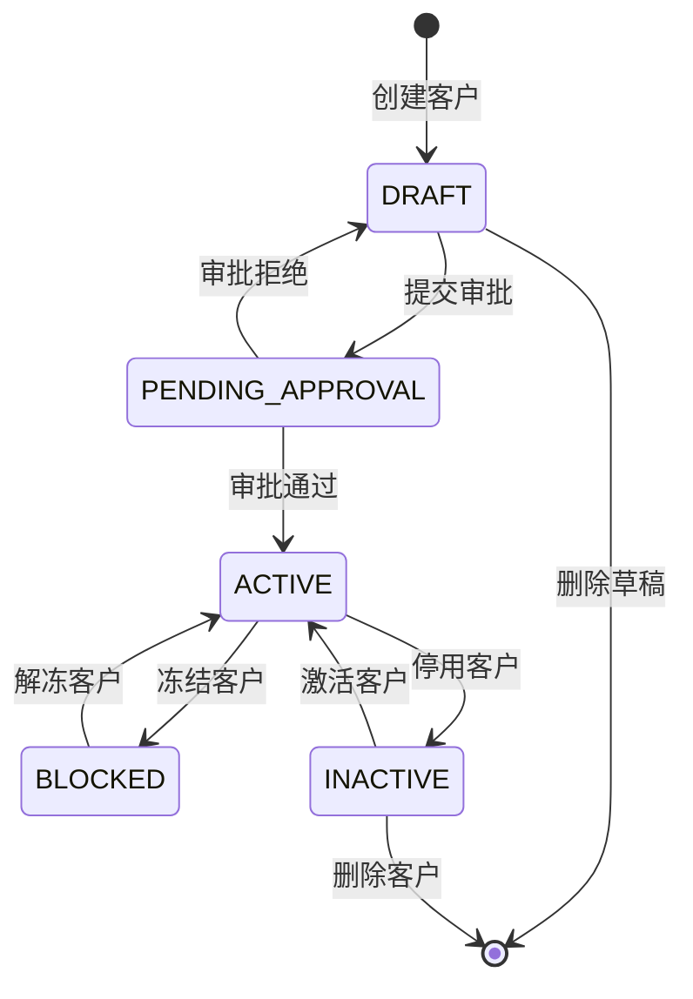

#### 2.1.3 状态转换规则

| 源状态 | 目标状态 | 触发事件 | 守卫条件 | 操作人角色 |
|--------|---------|---------|---------|-----------|
| DRAFT | PENDING_APPROVAL | submit | 客户信息完整 | SALES |
| PENDING_APPROVAL | ACTIVE | approve | 无 | SALES_MANAGER |
| PENDING_APPROVAL | DRAFT | reject | 无 | SALES_MANAGER |
| ACTIVE | BLOCKED | block | 无 | SALES_MANAGER, ADMIN |
| ACTIVE | INACTIVE | deactivate | 无关联订单 | SALES_MANAGER, ADMIN |
| BLOCKED | ACTIVE | unblock | 无 | SALES_MANAGER, ADMIN |
| INACTIVE | ACTIVE | activate | 无 | SALES_MANAGER, ADMIN |

#### 2.1.4 状态转换动作

**提交审批（submit）**：
- 验证客户信息完整性（必填字段、格式校验）
- 设置 `updated_by` 和 `updated_at`
- 创建审批工作流实例

**审批通过（approve）**：
- 记录审批人和审批时间
- 更新客户状态为 ACTIVE
- 完成审批工作流实例

**审批拒绝（reject）**：
- 记录拒绝原因
- 更新客户状态为 DRAFT
- 完成审批工作流实例

**冻结客户（block）**：
- 记录冻结原因
- 更新客户状态为 BLOCKED
- 禁止该客户创建新订单

**解冻客户（unblock）**：
- 清除冻结标记
- 更新客户状态为 ACTIVE
- 恢复客户业务权限

---

### 2.2 报价单状态机（Quotation State Machine）

#### 2.2.1 状态定义

| 状态代码 | 状态名称 | 说明 |
|---------|---------|------|
| DRAFT | 草稿 | 报价单创建但未提交 |
| PENDING_SALES | 待一级审核 | 已提交，等待销售经理（SALES_MANAGER）一级审核 |
| PENDING_ENGINEER | 待二级审核 | 一级审核通过，等待工程师（ENGINEER）二级审核 |
| PENDING_ACCOUNT_MANAGER | 待三级审核 | 二级审核通过，等待客户经理（ACCOUNT_MANAGER）或总经理（GENERAL_MANAGER）三级审核 |
| APPROVED | 已审批 | 所有三级审批通过 |
| REJECTED | 已拒绝 | 任一审批节点被拒绝，退回草稿状态 |
| CUSTOMER_CONFIRMED | 客户已确认 | 客户确认报价单（销售员代客户操作） |
| LINKED | 已关联 | 已关联到销售订单 |
| CANCELLED | 已取消 | 报价单被取消 |

#### 2.2.2 状态转换图

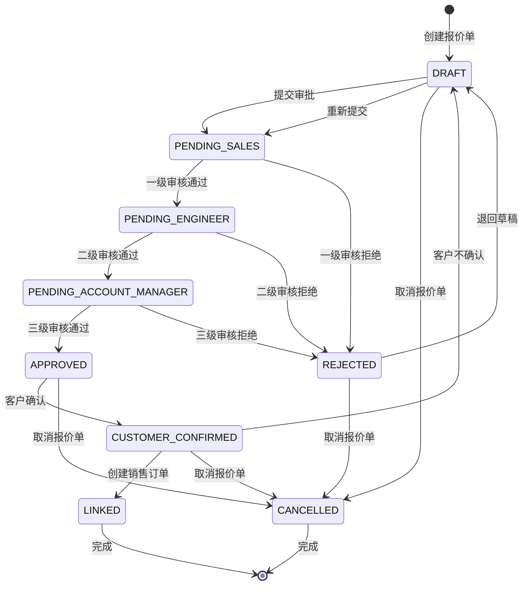

#### 2.2.3 状态转换规则

| 源状态 | 目标状态 | 触发事件 | 守卫条件 | 操作人角色 |
|--------|---------|---------|---------|-----------|
| DRAFT | PENDING_SALES | submit | 报价单信息完整 | SALES |
| PENDING_SALES | PENDING_ENGINEER | approve | 无 | SALES_MANAGER |
| PENDING_SALES | REJECTED | reject | 无 | SALES_MANAGER |
| PENDING_ENGINEER | PENDING_ACCOUNT_MANAGER | approve | 无 | ENGINEER |
| PENDING_ENGINEER | REJECTED | reject | 无 | ENGINEER |
| PENDING_ACCOUNT_MANAGER | APPROVED | approve | 无 | ACCOUNT_MANAGER, GENERAL_MANAGER |
| PENDING_ACCOUNT_MANAGER | REJECTED | reject | 无 | ACCOUNT_MANAGER, GENERAL_MANAGER |
| REJECTED | DRAFT | 自动转换 | 拒绝后自动退回 | 系统自动 |
| DRAFT | PENDING_SALES | resubmit | 已修改报价单 | SALES |
| APPROVED | CUSTOMER_CONFIRMED | confirm | 无 | SALES（代客户操作） |
| APPROVED | CANCELLED | cancel | 未关联订单 | SALES, SALES_MANAGER |
| CUSTOMER_CONFIRMED | LINKED | link | 创建销售订单 | SALES |
| CUSTOMER_CONFIRMED | DRAFT | reject | 客户不确认 | SALES |
| CUSTOMER_CONFIRMED | CANCELLED | cancel | 未关联订单 | SALES, SALES_MANAGER |
| DRAFT | CANCELLED | cancel | 未关联订单 | SALES, SALES_MANAGER |
| REJECTED | CANCELLED | cancel | 未关联订单 | SALES, SALES_MANAGER |

#### 2.2.4 状态转换动作

**提交审批（submit）**：
- 验证报价单必填信息
- 计算总金额
- 创建审批工作流实例（销售→财务→总经办）

**一级审核通过（sales_approve）**：
- 记录销售经理审批人和审批时间
- 更新状态为 PENDING_ENGINEER
- 通知工程部门

**二级审核通过（engineer_approve）**：
- 记录工程师审批人和审批时间
- 更新状态为 PENDING_ACCOUNT_MANAGER
- 通知客户经理或总经理

**三级审核通过（account_manager_approve/gm_approve）**：
- 记录客户经理或总经理审批人和审批时间
- 更新状态为 APPROVED
- 完成审批工作流

**客户确认（confirm）**：
- 设置 `customer_confirmed = True`
- 记录确认时间
- 更新状态为 CUSTOMER_CONFIRMED

**关联销售订单（link）**：
- 检查报价单是否已确认
- 创建销售订单并关联报价单
- 更新状态为 LINKED

---

### 2.3 销售订单状态机（Sales Order State Machine）

#### 2.3.1 状态定义

| 状态代码 | 状态名称 | 说明 |
|---------|---------|------|
| DRAFT | 草稿 | 销售订单创建但未提交 |
| PENDING_REVIEW | 待评审 | 已提交，等待订单评审 |
| REVIEWING | 评审中 | 正在进行多部门评审（串行：销售→工程→物料→财务） |
| APPROVED | 已审批 | 所有部门评审通过 |
| REJECTED | 已拒绝 | 任一部门评审拒绝，退回草稿状态 |
| IN_PRODUCTION | 生产中 | 已创建生产订单，正在生产 |
| COMPLETED | 已完成 | 生产完成 |
| SHIPPED | 已发货 | 货物已发出 |
| DELIVERED | 已交付 | 客户已签收 |
| RECONCILED | 已对账 | 财务已对账 |
| CLOSED | 已关闭 | 订单流程结束 |
| CANCELLED | 已取消 | 订单被取消 |

#### 2.3.2 状态转换图

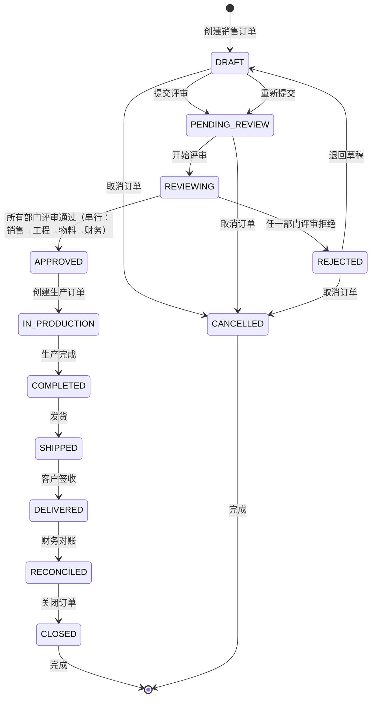

#### 2.3.3 状态转换规则

| 源状态 | 目标状态 | 触发事件 | 守卫条件 | 操作人角色 |
|--------|---------|---------|---------|-----------|
| DRAFT | PENDING_REVIEW | submit | 订单信息完整 | SALES |
| PENDING_REVIEW | REVIEWING | start_review | 无 | 系统自动 |
| REVIEWING | APPROVED | all_approved | 所有部门评审通过（串行：销售→工程→物料→财务） | 系统自动 |
| REVIEWING | REJECTED | reject | 任一部门拒绝 | SALES_MANAGER, SALES, ENGINEER, WAREHOUSE, FINANCE |
| REJECTED | DRAFT | 自动转换 | 拒绝后自动退回 | 系统自动 |
| DRAFT | PENDING_REVIEW | resubmit | 已修改订单 | SALES |
| APPROVED | IN_PRODUCTION | create_production_order | 已创建生产订单 | PLANNER, PRODUCTION |
| IN_PRODUCTION | COMPLETED | production_complete | 所有生产订单完成 | 系统自动 |
| COMPLETED | SHIPPED | ship | 无 | SALES |
| SHIPPED | DELIVERED | deliver | 客户签收 | SALES |
| DELIVERED | RECONCILED | reconcile | 财务对账 | FINANCE |
| RECONCILED | CLOSED | close | 无 | SALES, FINANCE |
| DRAFT | CANCELLED | cancel | 未开始生产 | SALES, SALES_MANAGER |
| PENDING_REVIEW | CANCELLED | cancel | 未开始生产 | SALES, SALES_MANAGER |
| REJECTED | CANCELLED | cancel | 未开始生产 | SALES, SALES_MANAGER |

#### 2.3.4 订单评审流程

订单评审采用串行评审模式，按以下顺序依次进行：

1. **销售部门评审**：评审人角色 SALES_MANAGER 或 SALES
2. **工程部门评审**：评审人角色 ENGINEER（销售部门通过后才能进行）
3. **物料部门评审**：评审人角色 WAREHOUSE（工程部门通过后才能进行）
4. **财务部门评审**：评审人角色 FINANCE（物料部门通过后才能进行）

**评审状态转换逻辑**：
- 当任一部门拒绝时，订单状态转为 REJECTED，然后自动退回 DRAFT
- 当所有部门都通过时，订单状态转为 APPROVED
- 评审过程中，订单状态为 REVIEWING
- 拒绝后，销售员可以修改订单并重新提交评审

---

## 三、工程管理模块状态机

### 3.1 BOM状态机（BOM State Machine）

#### 3.1.1 状态定义

| 状态代码 | 状态名称 | 说明 |
|---------|---------|------|
| NEW | 新建 | BOM刚创建 |
| REVIEWING | 审核中 | 正在审核 |
| RELEASED | 已发布 | 审核通过，已发布 |
| PRODUCING | 生产中 | 正在被生产订单使用 |
| OBSOLETE | 已废弃 | 已废弃，不再使用 |

#### 3.1.2 状态转换图

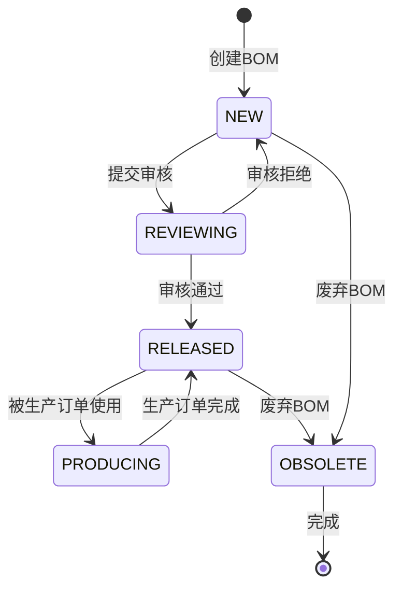

#### 3.1.3 状态转换规则

| 源状态 | 目标状态 | 触发事件 | 守卫条件 | 操作人角色 |
|--------|---------|---------|---------|-----------|
| NEW | REVIEWING | submit | BOM明细完整 | ENGINEER |
| REVIEWING | RELEASED | approve | 无 | ENGINEER |
| REVIEWING | NEW | reject | 无 | ENGINEER |
| RELEASED | PRODUCING | use | 被生产订单引用 | 系统自动 |
| PRODUCING | RELEASED | release | 生产订单完成 | 系统自动 |
| * | OBSOLETE | obsolete | 无生产订单使用 | ENGINEER |

---

### 3.2 工艺路线状态机（Routing State Machine）

#### 3.2.1 状态定义

| 状态代码 | 状态名称 | 说明 |
|---------|---------|------|
| DRAFT | 草稿 | 工艺路线创建但未发布 |
| RELEASED | 已发布 | 已发布，可用于生产 |
| OBSOLETE | 已废弃 | 已废弃，不再使用 |

#### 3.2.2 状态转换图

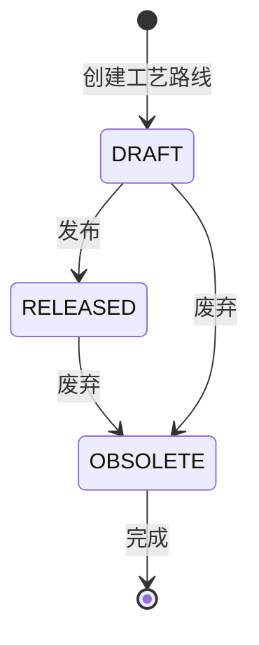

#### 3.2.3 状态转换规则

| 源状态 | 目标状态 | 触发事件 | 守卫条件 | 操作人角色 |
|--------|---------|---------|---------|-----------|
| DRAFT | RELEASED | release | 工序配置完整 | ENGINEER |
| * | OBSOLETE | obsolete | 无生产订单使用 | ENGINEER |

---

### 3.3 MI状态机（MI State Machine）

#### 3.3.1 状态定义

| 状态代码 | 状态名称 | 说明 |
|---------|---------|------|
| DRAFT | 草稿 | MI创建但未提交 |
| REVIEWING | 审核中 | 正在审核 |
| APPROVED | 已审批 | 审核通过 |
| RELEASED | 已发布 | 已发布，可用于生产 |
| OBSOLETE | 已废弃 | 已废弃，不再使用 |

#### 3.3.2 状态转换图

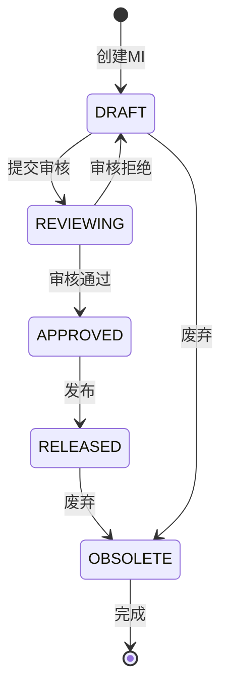

#### 3.3.3 状态转换规则

| 源状态 | 目标状态 | 触发事件 | 守卫条件 | 操作人角色 |
|--------|---------|---------|---------|-----------|
| DRAFT | REVIEWING | submit | MI内容完整 | ENGINEER |
| REVIEWING | APPROVED | approve | 无 | ENGINEER |
| REVIEWING | DRAFT | reject | 无 | ENGINEER |
| APPROVED | RELEASED | release | 无 | ENGINEER |
| * | OBSOLETE | obsolete | 无生产版本使用 | ENGINEER |

---

### 3.4 生产版本状态机（Production Version State Machine）

#### 3.4.1 状态定义

| 状态代码 | 状态名称 | 说明 |
|---------|---------|------|
| ACTIVE | 激活 | 生产版本已创建，处于激活状态 |
| RELEASED | 已发布 | 生产版本已发布，可用于生产订单/工单下达 |

#### 3.4.2 状态转换图

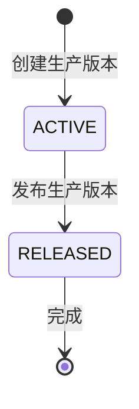

#### 3.4.3 状态转换规则

| 源状态 | 目标状态 | 触发事件 | 守卫条件 | 操作人角色 |
|--------|---------|---------|---------|-----------|
| ACTIVE | RELEASED | release | BOM和工艺路线为RELEASED，MI为RELEASED（发布时必选） | ENGINEER |

#### 3.4.4 状态转换动作

**创建生产版本（create）**：
- 验证BOM状态为RELEASED
- 验证工艺路线状态为RELEASED
- 验证BOM和工艺路线的物料匹配
- MI可选，但如果选择则验证MI状态为RELEASED
- 创建生产版本记录，状态为ACTIVE

**发布生产版本（release）**：
- 验证MI已关联（发布时MI是必选的）
- 验证MI状态为RELEASED
- 更新状态为RELEASED
- 记录发布时间和发布人
- 发布后的生产版本可用于生产订单/工单下达

**特殊说明**：
- 创建生产版本时，BOM和工艺路线是必选的，MI是可选的
- 发布生产版本时，MI是必选的
- 只有RELEASED状态的BOM和工艺路线才能用于生产版本
- 若需替换BOM/工艺路线/MI，应通过创建新生产版本处理

---

## 四、生产计划与控制模块状态机

### 4.1 工作中心状态机（Work Center State Machine）

#### 4.1.1 状态定义

| 状态代码 | 状态名称 | 说明 |
|---------|---------|------|
| ACTIVE | 激活 | 工作中心正常使用中 |
| INACTIVE | 未激活 | 工作中心未激活，不可用 |
| IN_MAINTENANCE | 维护中 | 工作中心正在维护，暂停使用 |

#### 4.1.2 状态转换图

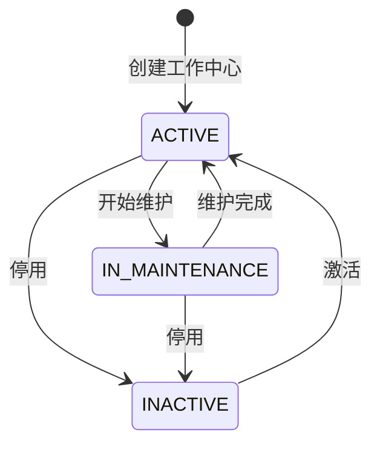

#### 4.1.3 状态转换规则

| 源状态 | 目标状态 | 触发事件 | 守卫条件 | 操作人角色 |
|--------|---------|---------|---------|-----------|
| ACTIVE | IN_MAINTENANCE | start_maintenance | 无生产任务 | ENGINEER, ADMIN |
| IN_MAINTENANCE | ACTIVE | complete_maintenance | 维护完成 | ENGINEER, ADMIN |
| ACTIVE | INACTIVE | deactivate | 无生产任务 | ENGINEER, ADMIN |
| INACTIVE | ACTIVE | activate | 无 | ENGINEER, ADMIN |
| IN_MAINTENANCE | INACTIVE | deactivate | 无 | ENGINEER, ADMIN |

#### 4.1.4 状态转换动作

**开始维护（start_maintenance）**：
- 检查是否有正在执行的生产任务
- 记录维护开始时间
- 更新状态为 IN_MAINTENANCE
- 禁止分配新的生产任务

**维护完成（complete_maintenance）**：
- 记录维护完成时间
- 更新状态为 ACTIVE
- 恢复工作中心可用性

**停用（deactivate）**：
- 检查是否有正在执行的生产任务
- 记录停用原因
- 更新状态为 INACTIVE
- 禁止分配新的生产任务

**激活（activate）**：
- 更新状态为 ACTIVE
- 恢复工作中心可用性

---

### 4.2 生产订单状态机（Production Order State Machine）

#### 4.2.1 状态定义

| 状态代码 | 状态名称 | 说明 |
|---------|---------|------|
| DRAFT | 草稿 | 生产订单创建但未下达 |
| RELEASED | 已下达 | 生产订单已下达，可以开始生产 |
| IN_PRODUCTION | 生产中 | 正在生产 |
| COMPLETED | 已完成 | 生产完成 |
| CLOSED | 已关闭 | 生产订单已关闭 |
| CANCELLED | 已取消 | 生产订单被取消 |

#### 4.2.2 状态转换图

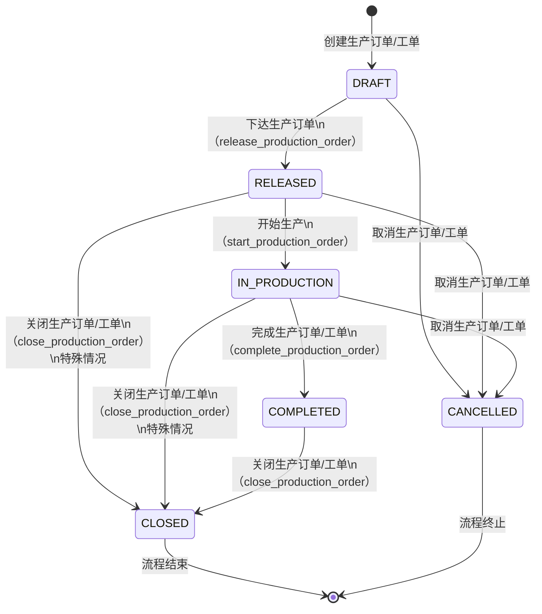

#### 4.2.3 状态转换规则

| 源状态 | 目标状态 | 触发事件 | 守卫条件 | 操作人角色 |
|--------|---------|---------|---------|-----------|
| DRAFT | RELEASED | release_production_order | 生产订单状态必须为DRAFT | PLANNER, PRODUCTION |
| DRAFT | CANCELLED | cancel | 无 | PLANNER, PRODUCTION |
| RELEASED | IN_PRODUCTION | start_production_order | 生产订单状态必须为RELEASED | PRODUCTION |
| RELEASED | CANCELLED | cancel | 无 | PLANNER, PRODUCTION |
| RELEASED | CLOSED | close_production_order | 特殊情况 | PLANNER, PRODUCTION |
| IN_PRODUCTION | COMPLETED | complete_production_order | 生产订单状态必须为IN_PRODUCTION，所有工序完成 | 系统自动 |
| IN_PRODUCTION | CANCELLED | cancel | 无 | PLANNER, PRODUCTION |
| IN_PRODUCTION | CLOSED | close_production_order | 特殊情况 | PLANNER, PRODUCTION |
| COMPLETED | CLOSED | close_production_order | 生产订单状态必须为RELEASED、IN_PRODUCTION或COMPLETED | PLANNER, PRODUCTION |

#### 4.2.4 状态转换动作

**下达生产订单（release_production_order）**：
- 前置条件：生产订单状态必须为DRAFT
- 验证生产版本（BOM、工艺路线、MI）是否完整
- 如果关联了MI，系统根据MI自动生成LOT卡（1:1关系），复制MI内容，并将lot_number写回生产订单
- 如果MI不存在，不允许创建生产订单/工单或提示用户先创建MI
- 检查物料库存是否充足
- 检查工作中心是否可用
- 更新状态为 RELEASED
- 记录下达时间和下达人
- 由于生产订单承担工单职责，工单状态与生产订单状态一致

**开始生产（start_production_order）**：
- 前置条件：生产订单状态必须为RELEASED
- 记录实际开始时间
- 更新状态为 IN_PRODUCTION
- 同步销售订单状态为IN_PRODUCTION
- 创建第一道工序的报工记录

**完成生产订单（complete_production_order）**：
- 前置条件：生产订单状态必须为IN_PRODUCTION
- 检查所有工序是否已完成
- 记录实际完成时间
- 更新状态为 COMPLETED
- 当所有生产订单/工单状态为COMPLETED或CLOSED时，更新销售订单状态为COMPLETED
- 更新物料库存（成品入库）

**关闭生产订单（close_production_order）**：
- 前置条件：生产订单状态必须为RELEASED、IN_PRODUCTION或COMPLETED
- 后置条件：状态更新为CLOSED，记录实际完成时间，同步销售订单状态
- 验证订单是否已完成
- 更新状态为 CLOSED
- 归档生产订单数据

**取消生产订单（cancel）**：
- 前置条件：生产订单状态必须为DRAFT、RELEASED或IN_PRODUCTION
- 检查是否已开始生产
- 如果已开始生产，需要先停止所有工序
- 更新状态为 CANCELLED
- 释放已分配的物料

---

### 4.3 工序报工状态机（Operation Report State Machine）

#### 4.3.1 状态定义

| 状态代码 | 状态名称 | 说明 |
|---------|---------|------|
| PENDING | 待报工 | 工序报工记录创建，等待报工 |
| IN_PROGRESS | 进行中 | 正在报工 |
| COMPLETED | 已完成 | 报工完成 |
| REJECTED | 已拒绝 | 报工被拒绝（如质检不合格） |

#### 4.3.2 状态转换图

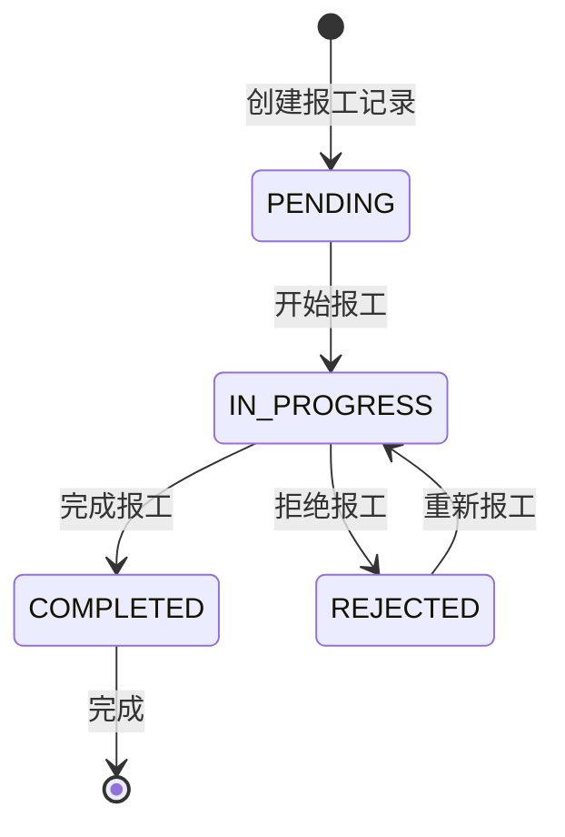

#### 4.3.3 状态转换规则

| 源状态 | 目标状态 | 触发事件 | 守卫条件 | 操作人角色 |
|--------|---------|---------|---------|-----------|
| PENDING | IN_PROGRESS | start | 无 | PRODUCTION |
| IN_PROGRESS | COMPLETED | complete | 报工数量、时间完整 | PRODUCTION |
| IN_PROGRESS | REJECTED | reject | 质检不合格或其他原因 | PRODUCTION, QUALITY |
| REJECTED | IN_PROGRESS | restart | 已处理问题 | PRODUCTION |

#### 4.3.4 状态转换动作

**开始报工（start）**：
- 记录报工开始时间
- 更新状态为 IN_PROGRESS
- 记录报工人

**完成报工（complete）**：
- 验证报工数量（良品、报废）
- 验证报工时间（调机、机器、人工时间）
- 更新状态为 COMPLETED
- 记录报工完成时间
- 更新生产进度
- 如果工序配置了自动倒扣料，则扣减物料库存

**拒绝报工（reject）**：
- 记录拒绝原因
- 更新状态为 REJECTED
- 记录拒绝人和拒绝时间
- 如果触发质检，记录质检结果

**重新报工（restart）**：
- 清除之前的报工数据
- 更新状态为 IN_PROGRESS
- 重新开始报工流程

---

## 五、工作流模块状态机

### 5.1 工作流实例状态机（Workflow Instance State Machine）

#### 5.1.1 状态定义

| 状态代码 | 状态名称 | 说明 |
|---------|---------|------|
| DRAFT | 草稿 | 工作流实例创建但未启动 |
| PENDING | 待审核 | 等待当前节点审批人审核 |
| APPROVED | 已审核 | 工作流已完成，所有节点通过 |
| REJECTED | 已拒绝 | 工作流被拒绝 |
| CANCELLED | 已取消 | 工作流被取消 |
| COMPLETED | 已完成 | 工作流正常完成 |

#### 5.1.2 状态转换图

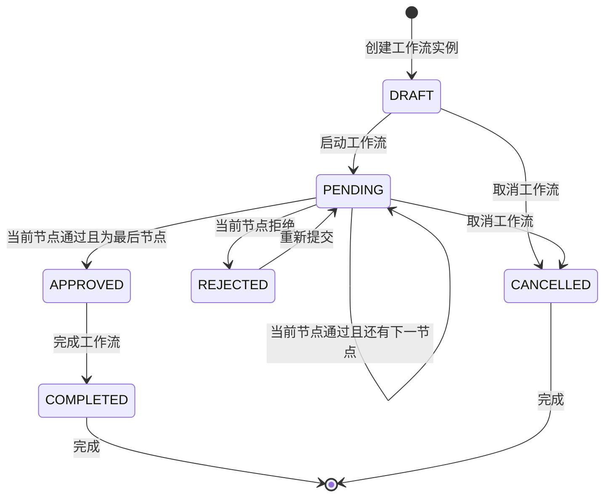

#### 5.1.3 状态转换规则

| 源状态 | 目标状态 | 触发事件 | 守卫条件 | 操作人角色 |
|--------|---------|---------|---------|-----------|
| DRAFT | PENDING | start | 无 | 创建人 |
| PENDING | PENDING | approve | 当前节点通过，还有下一节点 | 当前节点审批人 |
| PENDING | APPROVED | approve | 当前节点通过，且为最后节点 | 当前节点审批人 |
| PENDING | REJECTED | reject | 当前节点拒绝 | 当前节点审批人 |
| REJECTED | PENDING | resubmit | 业务对象已修改 | 创建人 |
| * | CANCELLED | cancel | 无 | 创建人、管理员 |

#### 5.1.4 状态转换动作

**启动工作流（start）**：
- 激活第一个节点
- 更新状态为 PENDING
- 通知第一个节点的审批人

**节点通过（approve）**：
- 记录审批人和审批时间
- 更新当前节点状态为 APPROVED
- 如果还有下一节点，激活下一节点，状态保持 PENDING
- 如果是最后节点，更新工作流状态为 APPROVED

**节点拒绝（reject）**：
- 记录拒绝原因和拒绝人
- 更新当前节点状态为 REJECTED
- 更新工作流状态为 REJECTED
- 通知创建人

**重新提交（resubmit）**：
- 重置所有节点状态
- 激活第一个节点
- 更新工作流状态为 PENDING

**完成工作流（complete）**：
- 更新状态为 COMPLETED
- 记录完成时间
- 更新关联业务对象状态

---

### 5.2 工作流节点实例状态机（Workflow Instance Node State Machine）

#### 5.2.1 状态定义

| 状态代码 | 状态名称 | 说明 |
|---------|---------|------|
| PENDING | 待审核 | 节点等待审批 |
| APPROVED | 已通过 | 节点审批通过 |
| REJECTED | 已拒绝 | 节点审批被拒绝 |

#### 5.2.2 状态转换图

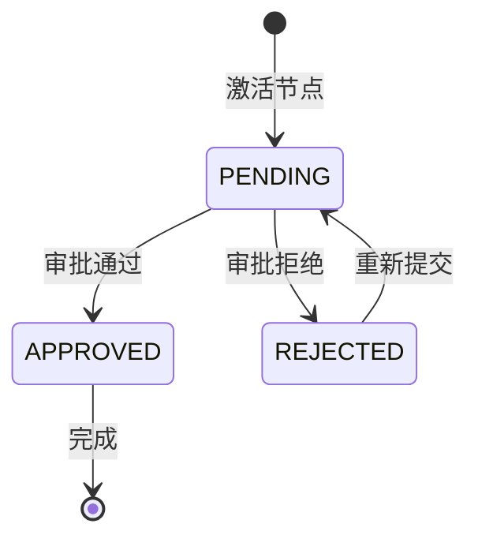

#### 5.2.3 状态转换规则

| 源状态 | 目标状态 | 触发事件 | 守卫条件 | 操作人角色 |
|--------|---------|---------|---------|-----------|
| PENDING | APPROVED | approve | 无 | 节点审批人 |
| PENDING | REJECTED | reject | 无 | 节点审批人 |
| REJECTED | PENDING | resubmit | 业务对象已修改 | 创建人 |

---

## 六、状态机实现参考

### 6.1 状态机基类设计

```python
from enum import Enum
from typing import Dict, List, Optional, Callable
from dataclasses import dataclass
from datetime import datetime

@dataclass
class StateTransition:
    """状态转换定义"""
    from_state: str
    to_state: str
    event: str
    guard: Optional[Callable] = None
    action: Optional[Callable] = None
    allowed_roles: List[str] = None

class StateMachine:
    """状态机基类"""
    
    def __init__(self, initial_state: str, transitions: List[StateTransition]):
        self.current_state = initial_state
        self.transitions = {t.event: t for t in transitions}
        self.state_history = []
    
    def can_transition(self, event: str, user_role: str, context: Dict = None) -> bool:
        """检查是否可以执行状态转换"""
        if event not in self.transitions:
            return False
        
        transition = self.transitions[event]
        
        # 检查当前状态
        if transition.from_state != self.current_state:
            return False
        
        # 检查角色权限
        if transition.allowed_roles and user_role not in transition.allowed_roles:
            return False
        
        # 检查守卫条件
        if transition.guard and not transition.guard(context):
            return False
        
        return True
    
    def transition(self, event: str, user_role: str, user_id: str, context: Dict = None) -> bool:
        """执行状态转换"""
        if not self.can_transition(event, user_role, context):
            return False
        
        transition = self.transitions[event]
        
        # 执行动作
        if transition.action:
            transition.action(context)
        
        # 记录状态历史
        self.state_history.append({
            "from_state": self.current_state,
            "to_state": transition.to_state,
            "event": event,
            "user_id": user_id,
            "user_role": user_role,
            "timestamp": datetime.now()
        })
        
        # 更新状态
        self.current_state = transition.to_state
        return True
```

### 6.2 报价单状态机实现示例

```python
from backend.common.models.sd import Quotation, QuotationStatus

class QuotationStateMachine(StateMachine):
    """报价单状态机"""
    
    def __init__(self, quotation: Quotation):
        transitions = [
            StateTransition(
                from_state=QuotationStatus.DRAFT,
                to_state=QuotationStatus.PENDING_SALES,
                event="submit",
                guard=self._check_quotation_complete,
                action=self._on_submit,
                allowed_roles=["SALES"]
            ),
            StateTransition(
                from_state=QuotationStatus.PENDING_SALES,
                to_state=QuotationStatus.PENDING_FINANCE,
                event="sales_approve",
                action=self._on_sales_approve,
                allowed_roles=["SALES_MANAGER"]
            ),
            StateTransition(
                from_state=QuotationStatus.PENDING_SALES,
                to_state=QuotationStatus.REJECTED,
                event="sales_reject",
                action=self._on_reject,
                allowed_roles=["SALES_MANAGER"]
            ),
            StateTransition(
                from_state=QuotationStatus.PENDING_FINANCE,
                to_state=QuotationStatus.PENDING_GENERAL_MANAGER,
                event="finance_approve",
                action=self._on_finance_approve,
                allowed_roles=["FINANCE"]
            ),
            StateTransition(
                from_state=QuotationStatus.PENDING_FINANCE,
                to_state=QuotationStatus.REJECTED,
                event="finance_reject",
                action=self._on_reject,
                allowed_roles=["FINANCE"]
            ),
            StateTransition(
                from_state=QuotationStatus.PENDING_GENERAL_MANAGER,
                to_state=QuotationStatus.APPROVED,
                event="gm_approve",
                action=self._on_gm_approve,
                allowed_roles=["GENERAL_MANAGER"]
            ),
            StateTransition(
                from_state=QuotationStatus.PENDING_GENERAL_MANAGER,
                to_state=QuotationStatus.REJECTED,
                event="gm_reject",
                action=self._on_reject,
                allowed_roles=["GENERAL_MANAGER"]
            ),
            StateTransition(
                from_state=QuotationStatus.REJECTED,
                to_state=QuotationStatus.DRAFT,
                event="resubmit",
                action=self._on_resubmit,
                allowed_roles=["SALES"]
            ),
            StateTransition(
                from_state=QuotationStatus.APPROVED,
                to_state=QuotationStatus.CUSTOMER_CONFIRMED,
                event="confirm",
                action=self._on_confirm,
                allowed_roles=["SALES"]
            ),
            StateTransition(
                from_state=QuotationStatus.CUSTOMER_CONFIRMED,
                to_state=QuotationStatus.LINKED,
                event="link",
                action=self._on_link,
                allowed_roles=["SALES"]
            ),
        ]
        
        super().__init__(quotation.status, transitions)
        self.quotation = quotation
    
    def _check_quotation_complete(self, context: Dict) -> bool:
        """检查报价单信息是否完整"""
        return (
            self.quotation.customer_id and
            self.quotation.quantity and
            self.quotation.unit_price and
            len(self.quotation.items) > 0
        )
    
    def _on_submit(self, context: Dict):
        """提交审批动作"""
        # 计算总金额
        self.quotation.total_amount = sum(
            item.total_price for item in self.quotation.items
        )
        # 创建审批工作流
        # create_workflow_instance(...)
    
    def _on_sales_approve(self, context: Dict):
        """销售审批通过动作"""
        self.quotation.sales_approver = context.get("user_id")
        self.quotation.sales_approved_at = datetime.now()
    
    def _on_finance_approve(self, context: Dict):
        """财务审批通过动作"""
        self.quotation.finance_approver = context.get("user_id")
        self.quotation.finance_approved_at = datetime.now()
    
    def _on_gm_approve(self, context: Dict):
        """总经办审批通过动作"""
        self.quotation.general_manager_approver = context.get("user_id")
        self.quotation.general_manager_approved_at = datetime.now()
    
    def _on_reject(self, context: Dict):
        """审批拒绝动作"""
        # 记录拒绝原因
        pass
    
    def _on_resubmit(self, context: Dict):
        """重新提交动作"""
        # 重置审批信息
        self.quotation.sales_approver = None
        self.quotation.sales_approved_at = None
        # ...
    
    def _on_confirm(self, context: Dict):
        """客户确认动作"""
        self.quotation.customer_confirmed = True
        self.quotation.customer_confirmed_at = datetime.now()
    
    def _on_link(self, context: Dict):
        """关联销售订单动作"""
        # 创建销售订单
        pass
```

### 6.3 状态转换服务

```python
from fastapi import Depends, HTTPException
from sqlalchemy.orm import Session

class StateTransitionService:
    """状态转换服务"""
    
    def __init__(self, db: Session):
        self.db = db
    
    def transition_quotation(
        self,
        quotation_id: str,
        event: str,
        user_id: str,
        user_role: str,
        context: Dict = None
    ) -> bool:
        """执行报价单状态转换"""
        quotation = self.db.query(Quotation).filter(
            Quotation.quotation_number == quotation_id
        ).first()
        
        if not quotation:
            raise HTTPException(status_code=404, detail="报价单不存在")
        
        state_machine = QuotationStateMachine(quotation)
        
        if not state_machine.can_transition(event, user_role, context):
            raise HTTPException(
                status_code=400,
                detail=f"无法执行状态转换：当前状态 {quotation.status}，事件 {event}"
            )
        
        # 执行状态转换
        success = state_machine.transition(event, user_role, user_id, context)
        
        if success:
            quotation.status = state_machine.current_state
            quotation.updated_by = user_id
            quotation.updated_at = datetime.now()
            self.db.commit()
            
            # 记录状态历史
            # save_state_history(...)
        
        return success
```

### 6.4 状态历史记录

```python
from sqlalchemy import Column, String, DateTime, Text, ForeignKey
from backend.common.models.base import BaseModel

class StateHistory(BaseModel):
    """状态历史记录表"""
    __tablename__ = "state_histories"
    
    entity_type = Column(String(50), nullable=False)  # 实体类型：QUOTATION, SALES_ORDER等
    entity_id = Column(String(50), nullable=False)  # 实体ID
    from_state = Column(String(50))
    to_state = Column(String(50), nullable=False)
    event = Column(String(50), nullable=False)
    user_id = Column(String(50), nullable=False)
    user_role = Column(String(50))
    comment = Column(Text)  # 备注
    transition_time = Column(DateTime, nullable=False, default=datetime.now)
    
    # 索引
    __table_args__ = (
        Index('idx_state_histories_entity', 'entity_type', 'entity_id'),
        Index('idx_state_histories_time', 'transition_time'),
    )
```

---

## 七、状态机最佳实践

### 7.1 设计原则

1. **状态定义清晰**：
   - 每个状态应该有明确的业务含义
   - 避免状态重叠和模糊定义
   - 使用枚举类型定义状态，避免硬编码字符串

2. **转换规则明确**：
   - 每个状态转换都应该有明确的触发条件
   - 定义守卫条件，防止非法转换
   - 记录所有可能的转换路径

3. **权限控制严格**：
   - 每个状态转换都应该验证操作人权限
   - 使用角色而非用户ID进行权限控制
   - 记录操作人信息，便于审计

4. **异常处理完善**：
   - 处理状态转换失败的情况
   - 提供回滚机制（如拒绝、取消）
   - 记录异常信息，便于排查

### 7.2 实现建议

1. **使用状态机模式**：
   - 将状态机逻辑封装在独立的类中
   - 避免在业务逻辑中直接修改状态
   - 使用状态机基类，统一管理状态转换

2. **状态历史记录**：
   - 记录所有状态转换历史
   - 包含转换时间、操作人、原因等信息
   - 支持状态转换的追溯和审计

3. **异步处理**：
   - 对于复杂的状态转换动作，使用异步处理
   - 避免长时间阻塞用户请求
   - 使用消息队列处理状态转换后的通知

4. **测试覆盖**：
   - 为每个状态转换编写单元测试
   - 测试正常流程和异常流程
   - 测试权限控制和守卫条件

### 7.3 常见问题处理

#### 7.3.1 并发状态转换

**问题**：多个用户同时尝试转换同一实体的状态

**解决方案**：
- 使用数据库锁（悲观锁或乐观锁）
- 使用分布式锁（如Redis）
- 在状态转换前再次检查当前状态

```python
from sqlalchemy import select, update
from sqlalchemy.orm import with_for_update

def transition_with_lock(db, entity_id, event, user_id, user_role):
    """带锁的状态转换"""
    # 使用悲观锁
    entity = db.query(Entity).with_for_update().filter(
        Entity.id == entity_id
    ).first()
    
    state_machine = EntityStateMachine(entity)
    if state_machine.can_transition(event, user_role):
        state_machine.transition(event, user_role, user_id)
        entity.status = state_machine.current_state
        db.commit()
        return True
    return False
```

#### 7.3.2 状态转换失败回滚

**问题**：状态转换动作执行失败，需要回滚状态

**解决方案**：
- 使用数据库事务
- 在事务中执行所有相关操作
- 如果任何操作失败，回滚整个事务

```python
from sqlalchemy.exc import SQLAlchemyError

def safe_transition(db, entity, event, user_id, user_role):
    """安全的状态转换（带事务）"""
    try:
        state_machine = EntityStateMachine(entity)
        
        if not state_machine.can_transition(event, user_role):
            return False
        
        # 在事务中执行
        with db.begin():
            state_machine.transition(event, user_role, user_id)
            entity.status = state_machine.current_state
            
            # 执行其他相关操作
            # update_related_entities(...)
            # send_notifications(...)
        
        return True
    except SQLAlchemyError as e:
        db.rollback()
        logger.error(f"状态转换失败: {e}")
        return False
```

#### 7.3.3 状态转换通知

**问题**：状态转换后需要通知相关人员

**解决方案**：
- 使用观察者模式
- 在状态转换动作中触发通知
- 使用消息队列异步发送通知

```python
class StateTransitionObserver:
    """状态转换观察者"""
    
    def __init__(self):
        self.observers = []
    
    def attach(self, observer):
        self.observers.append(observer)
    
    def notify(self, entity, from_state, to_state, event):
        for observer in self.observers:
            observer.on_state_changed(entity, from_state, to_state, event)

class NotificationObserver:
    """通知观察者"""
    
    def on_state_changed(self, entity, from_state, to_state, event):
        # 发送通知
        if to_state == "APPROVED":
            send_approval_notification(entity)
        elif to_state == "REJECTED":
            send_rejection_notification(entity)
```

---

## 八、状态机测试

### 8.1 单元测试示例

```python
import pytest
from backend.common.models.sd import Quotation, QuotationStatus
from backend.common.state_machine.quotation import QuotationStateMachine

class TestQuotationStateMachine:
    """报价单状态机测试"""
    
    def test_draft_to_pending_sales(self):
        """测试草稿到待销售审核的转换"""
        quotation = Quotation(
            quotation_number="QT-001",
            customer_id="CUST001",
            quantity=100,
            unit_price=10.0,
            status=QuotationStatus.DRAFT
        )
        
        state_machine = QuotationStateMachine(quotation)
        
        # 测试可以转换
        assert state_machine.can_transition("submit", "SALES")
        
        # 执行转换
        success = state_machine.transition("submit", "SALES", "user001")
        assert success
        assert state_machine.current_state == QuotationStatus.PENDING_SALES
    
    def test_invalid_transition(self):
        """测试无效的状态转换"""
        quotation = Quotation(
            quotation_number="QT-001",
            status=QuotationStatus.DRAFT
        )
        
        state_machine = QuotationStateMachine(quotation)
        
        # 不能从DRAFT直接到APPROVED
        assert not state_machine.can_transition("approve", "SALES_MANAGER")
    
    def test_permission_check(self):
        """测试权限检查"""
        quotation = Quotation(
            quotation_number="QT-001",
            status=QuotationStatus.PENDING_SALES
        )
        
        state_machine = QuotationStateMachine(quotation)
        
        # SALES角色不能审批
        assert not state_machine.can_transition("sales_approve", "SALES")
        
        # SALES_MANAGER角色可以审批
        assert state_machine.can_transition("sales_approve", "SALES_MANAGER")
    
    def test_guard_condition(self):
        """测试守卫条件"""
        quotation = Quotation(
            quotation_number="QT-001",
            status=QuotationStatus.DRAFT,
            customer_id=None,  # 缺少必填字段
            quantity=100,
            unit_price=10.0
        )
        
        state_machine = QuotationStateMachine(quotation)
        
        # 信息不完整，不能提交
        assert not state_machine.can_transition("submit", "SALES")
```

### 8.2 集成测试示例

```python
def test_quotation_approval_workflow(db_session):
    """测试报价单审批流程"""
    # 创建报价单
    quotation = Quotation(
        quotation_number="QT-001",
        customer_id="CUST001",
        quantity=100,
        unit_price=10.0,
        status=QuotationStatus.DRAFT
    )
    db_session.add(quotation)
    db_session.commit()
    
    # 提交审批
    service = StateTransitionService(db_session)
    service.transition_quotation(
        "QT-001", "submit", "sales001", "SALES"
    )
    assert quotation.status == QuotationStatus.PENDING_SALES
    
    # 销售审批通过
    service.transition_quotation(
        "QT-001", "sales_approve", "sales_mgr001", "SALES_MANAGER"
    )
    assert quotation.status == QuotationStatus.PENDING_FINANCE
    
    # 财务审批通过
    service.transition_quotation(
        "QT-001", "finance_approve", "finance001", "FINANCE"
    )
    assert quotation.status == QuotationStatus.PENDING_GENERAL_MANAGER
    
    # 总经办审批通过
    service.transition_quotation(
        "QT-001", "gm_approve", "gm001", "GENERAL_MANAGER"
    )
    assert quotation.status == QuotationStatus.APPROVED
```

---

## 九、状态机模型总结

### 9.1 状态机统计

本文档定义了以下状态机：

| 模块 | 实体 | 状态数量 | 转换数量 |
|------|------|---------|---------|
| SD | 客户 | 5 | 7 |
| SD | 报价单 | 9 | 16 |
| SD | 销售订单 | 11 | 15 |
| ENG | BOM | 5 | 6 |
| ENG | 工艺路线 | 3 | 3 |
| ENG | MI | 5 | 6 |
| ENG | 生产版本 | 2 | 1 |
| PP | 工作中心 | 3 | 5 |
| PP | 生产订单 | 6 | 7 |
| PP | 工序报工 | 4 | 4 |
| Workflow | 工作流实例 | 6 | 7 |
| Workflow | 工作流节点 | 3 | 3 |

**总计**：12个状态机，61个状态，77个状态转换

### 9.2 关键特性

1. **状态唯一性**：每个实体在任意时刻只能处于一个状态
2. **转换确定性**：所有状态转换都有明确的触发条件和规则
3. **权限控制**：每个状态转换都验证操作人权限
4. **可追溯性**：所有状态转换都记录历史
5. **业务规则**：状态转换符合业务逻辑和约束条件

### 9.3 使用建议

1. **开发人员**：
   - 使用状态机基类实现新的状态机
   - 遵循状态转换规则，不要直接修改状态字段
   - 为状态转换编写单元测试

2. **测试人员**：
   - 测试所有可能的状态转换路径
   - 测试权限控制和守卫条件
   - 测试异常情况和边界条件

3. **运维人员**：
   - 监控状态转换失败的情况
   - 定期检查状态历史记录
   - 处理状态转换异常

### 9.4 后续工作

1. **状态机扩展**：
   - 根据业务需求，扩展新的状态机
   - 优化现有状态机的转换规则
   - 添加新的状态转换动作

2. **性能优化**：
   - 优化状态转换的数据库操作
   - 使用缓存减少状态查询
   - 异步处理状态转换后的通知

3. **监控和告警**：
   - 监控状态转换的成功率和失败率
   - 设置状态转换异常的告警
   - 分析状态转换的耗时

---

## 附录：状态机快速参考

### A.1 状态代码速查表

| 状态代码 | 中文名称 | 适用实体 |
|---------|---------|---------|
| DRAFT | 草稿 | 客户、报价单、销售订单、工艺路线、MI、生产订单、工作流实例 |
| PENDING_APPROVAL | 待审批 | 客户 |
| PENDING_SALES | 待一级审核 | 报价单 |
| PENDING_ENGINEER | 待二级审核 | 报价单 |
| PENDING_ACCOUNT_MANAGER | 待三级审核 | 报价单 |
| PENDING_REVIEW | 待评审 | 销售订单 |
| REVIEWING | 评审中 | 销售订单、BOM、MI |
| APPROVED | 已审批 | 报价单、销售订单、MI、工作流实例 |
| REJECTED | 已拒绝 | 报价单、销售订单、工作流实例 |
| ACTIVE | 激活 | 客户、工作中心、生产版本 |
| BLOCKED | 冻结 | 客户 |
| INACTIVE | 未激活 | 客户、工作中心 |
| IN_MAINTENANCE | 维护中 | 工作中心 |
| RELEASED | 已发布 | BOM、工艺路线、MI、生产订单 |
| PRODUCING | 生产中 | BOM、生产订单 |
| OBSOLETE | 已废弃 | BOM、工艺路线、MI |
| IN_PRODUCTION | 生产中 | 销售订单 |
| COMPLETED | 已完成 | 销售订单、生产订单、工序报工、工作流实例 |
| SHIPPED | 已发货 | 销售订单 |
| DELIVERED | 已交付 | 销售订单 |
| RECONCILED | 已对账 | 销售订单 |
| CLOSED | 已关闭 | 销售订单、生产订单 |
| CANCELLED | 已取消 | 报价单、销售订单、生产订单、工作流实例 |
| CUSTOMER_CONFIRMED | 客户已确认 | 报价单 |
| LINKED | 已关联 | 报价单 |
| PENDING | 待审核 | 工序报工、工作流实例、工作流节点 |
| IN_PROGRESS | 进行中 | 工序报工 |

### A.2 状态转换事件速查表

| 事件代码 | 中文名称 | 说明 |
|---------|---------|------|
| submit | 提交 | 提交审批或评审 |
| approve | 审批通过 | 审批人同意 |
| reject | 审批拒绝 | 审批人拒绝 |
| resubmit | 重新提交 | 被拒绝后重新提交 |
| cancel | 取消 | 取消流程 |
| block | 冻结 | 冻结实体 |
| unblock | 解冻 | 解冻实体 |
| activate | 激活 | 激活实体 |
| deactivate | 停用 | 停用实体 |
| release | 发布/下达 | 发布或下达 |
| obsolete | 废弃 | 废弃实体 |
| start | 开始 | 开始执行 |
| complete | 完成 | 完成执行 |
| close | 关闭 | 关闭流程 |
| confirm | 确认 | 客户确认 |
| link | 关联 | 关联到其他实体 |
| start_maintenance | 开始维护 | 开始维护工作中心 |
| complete_maintenance | 完成维护 | 完成维护工作中心 |
| ship | 发货 | 发货 |
| deliver | 交付 | 客户签收 |
| reconcile | 对账 | 财务对账 |

---

**文档结束**

---

*本文档版本：v1.1*  
*最后更新：2025-01-XX*  
*文档总页数：约55页（基于标准A4格式）*  
*文档总字数：约2.8万字*

## 更新日志

### v1.1 (2025-01-XX)
- 更新报价单状态机：修正三级审核流程状态（PENDING_SALES → PENDING_ENGINEER → PENDING_ACCOUNT_MANAGER → APPROVED）
- 更新销售订单状态机：添加RECONCILED和CLOSED状态，修正评审流程为串行（销售→工程→物料→财务）
- 添加生产版本状态机（ProductionVersion State Machine）
- 确保所有状态转换与最新用例文档一致

### v1.0 (2025-12-12)
- 初始版本