# 某某ERP系统 - 类图（Class Diagram）

## 文档说明

**版本：** v1.4  
**创建日期：** 2025-12-12  
**最后更新：** 2025-01-XX

**基于**：某某ERP系统MVP版本需求规格说明书 v1.4

本文档使用Mermaid语法描述了某某ERP系统的类图（Class Diagram），按模块展示所有实体类及其属性、方法和关系。

---

## 一、销售与分销模块（SD Module）

### 1.1 客户管理类图

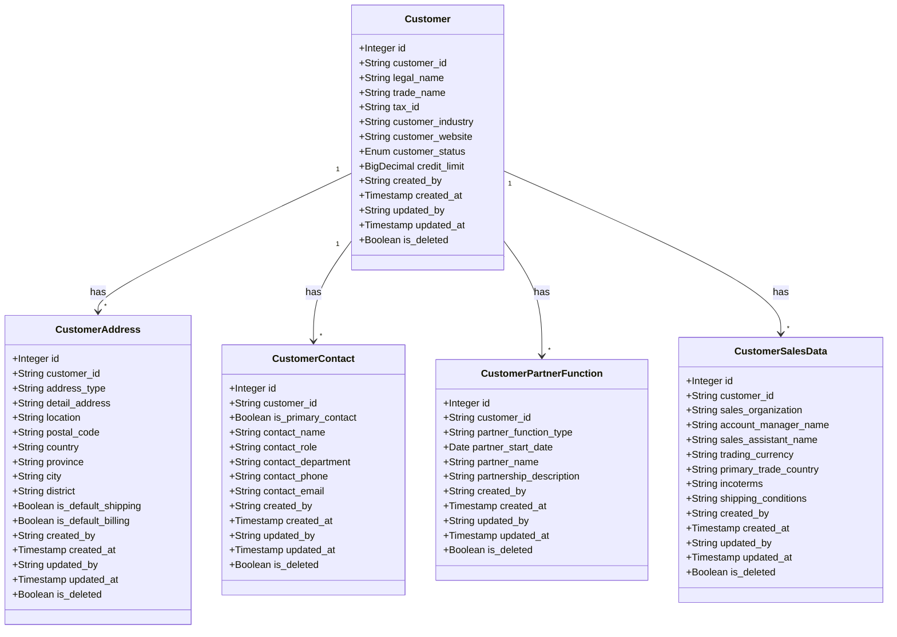

### 1.2 报价与订单类图

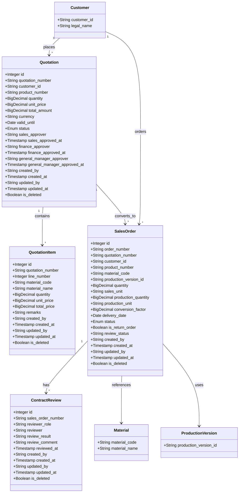

### 1.3 本厂编号映射类图

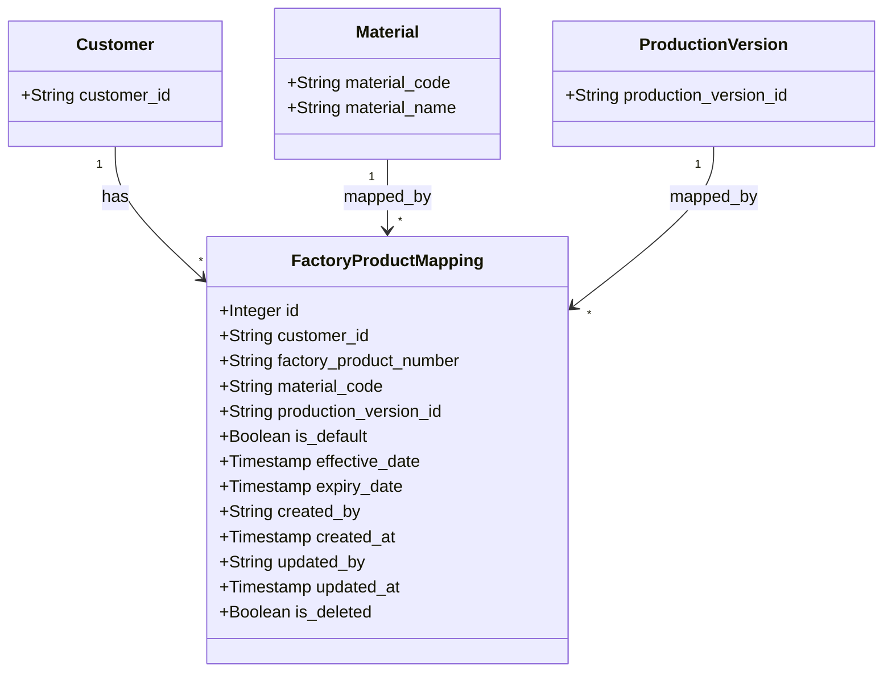

---

## 二、工程管理模块（ENG Module）

### 2.1 物料管理类图

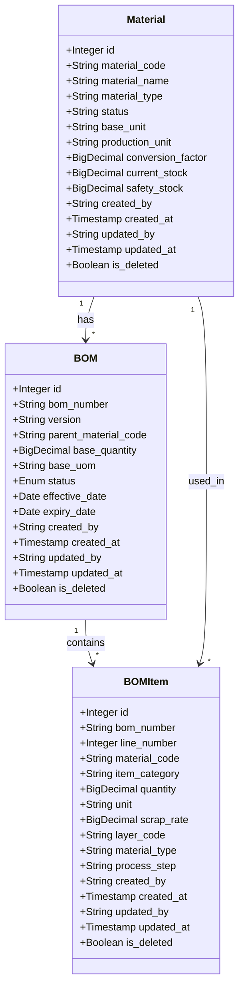

### 2.2 工艺路线类图

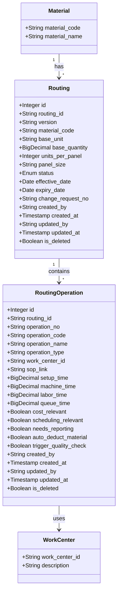

### 2.3 生产版本类图

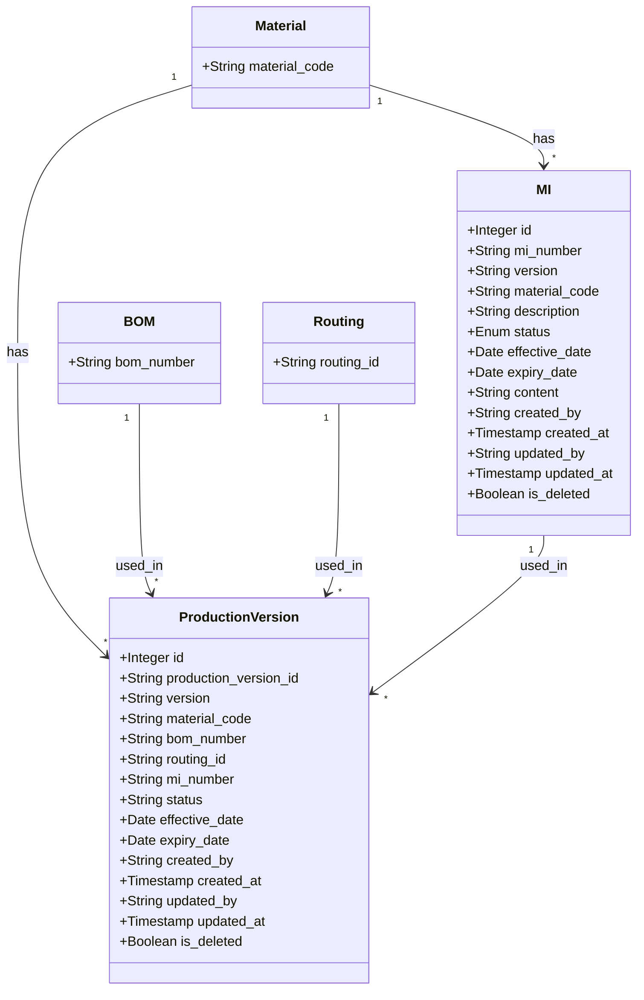

---

## 三、物料管理模块（MM Module）

### 3.1 物料事务类图

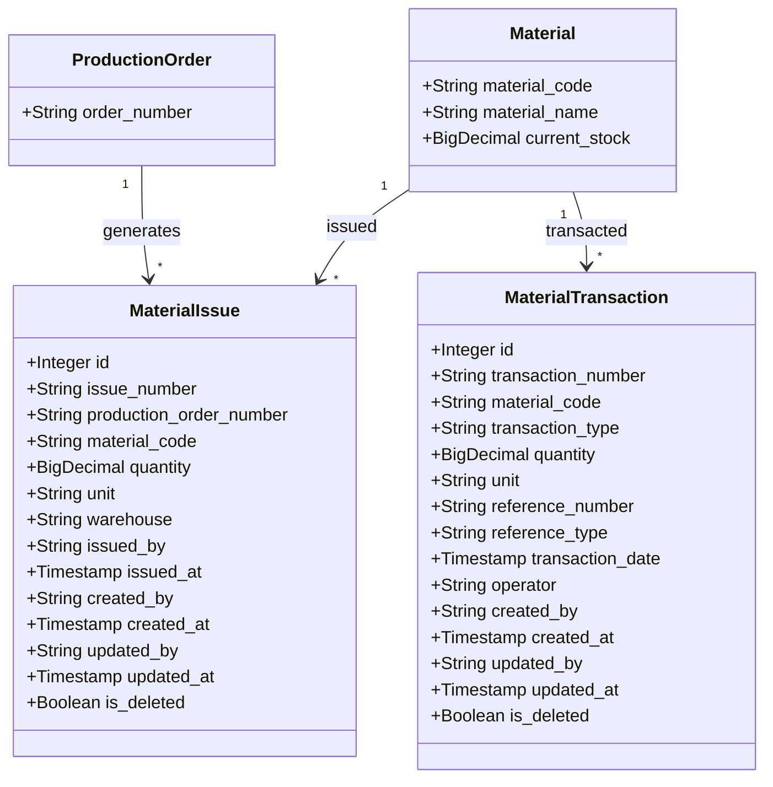

---

## 四、生产计划与控制模块（PP Module）

### 4.1 工作中心类图

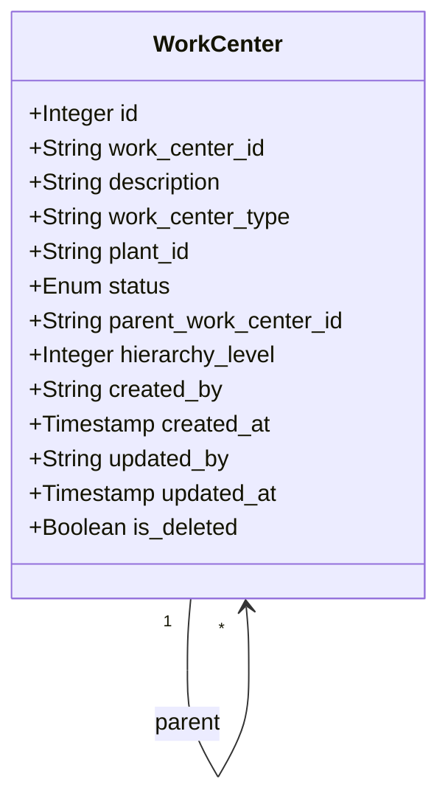

### 4.2 生产订单类图

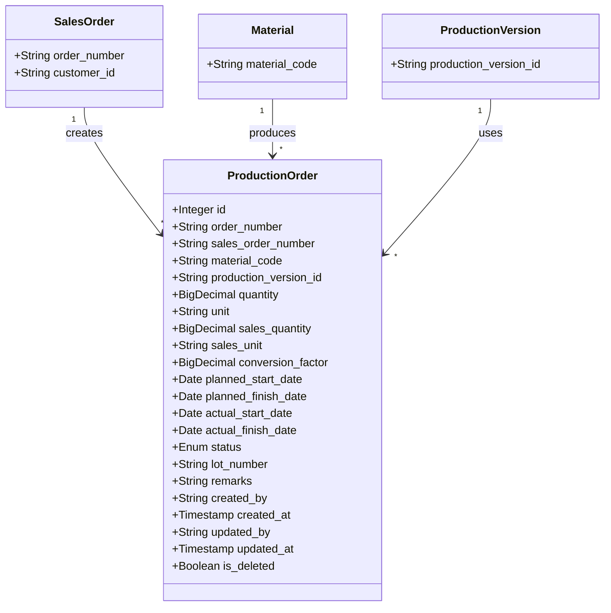

### 4.3 工序报工类图

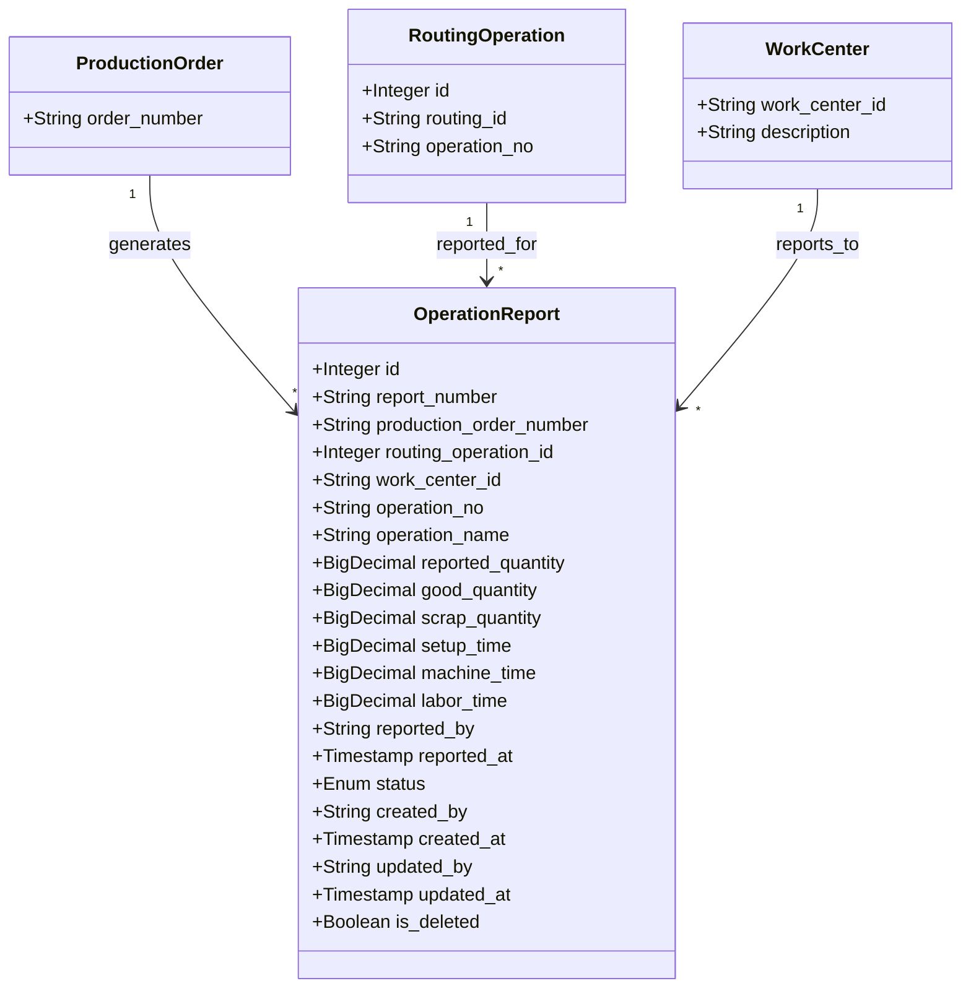

---

## 五、用户与权限管理模块

### 5.1 用户类图

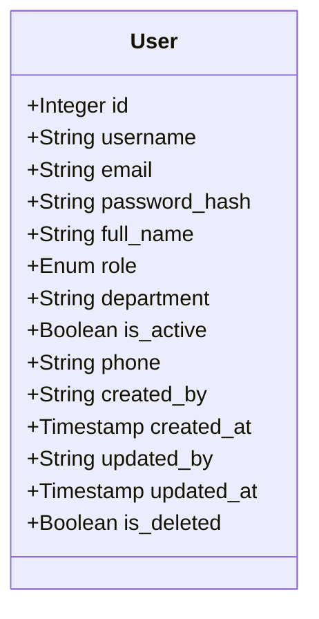

---

## 六、工作流模块

### 6.1 工作流类图

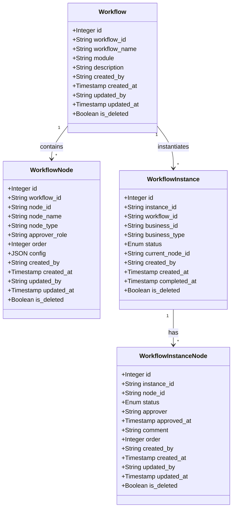

---

## 七、跨模块关系类图

### 7.1 核心业务流程类图

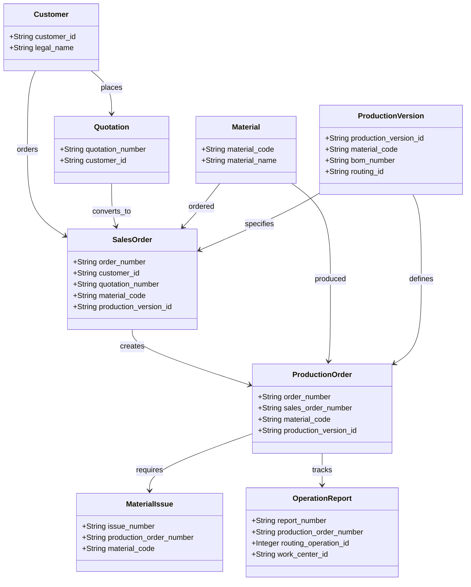

---

## 八、数据类型说明

### 8.1 基本数据类型映射

| 数据库类型 | Java类型 | Python类型 | 说明 |
|-----------|---------|-----------|------|
| SERIAL | Integer | int | 自增整数 |
| VARCHAR(n) | String | str | 字符串 |
| NUMERIC(p,s) | BigDecimal | Decimal | 精确数值 |
| DATE | Date | date | 日期 |
| TIMESTAMP | Timestamp | datetime | 日期时间 |
| BOOLEAN | Boolean | bool | 布尔值 |
| ENUM | Enum | Enum | 枚举类型 |
| TEXT | String | str | 长文本 |
| JSON | JSON | dict | JSON对象 |

### 8.2 关系类型说明

- **1 --> ***: 一对多关系（One-to-Many）
- **1 --> 1**: 一对一关系（One-to-One）
- **-->**: 关联关系（Association）
- **-->**: 依赖关系（Dependency）

---

## 九、类图设计说明

### 9.1 设计原则

1. **单一职责原则**：每个类只负责一个业务实体
2. **关系清晰**：明确展示类之间的关联关系
3. **属性完整**：包含所有业务属性和审计字段
4. **模块化**：按业务模块组织类图

### 9.2 命名规范

- **类名**：使用PascalCase（如 `Customer`, `SalesOrder`）
- **属性名**：使用camelCase（如 `customerId`, `orderNumber`）
- **关系名**：使用动词短语（如 `has`, `contains`, `references`）

### 9.3 关系类型

- **组合关系（Composition）**：强拥有关系，用实心菱形表示
- **聚合关系（Aggregation）**：弱拥有关系，用空心菱形表示
- **关联关系（Association）**：一般关联，用实线箭头表示
- **依赖关系（Dependency）**：使用关系，用虚线箭头表示
- **继承关系（Inheritance）**：泛化关系，用实线三角箭头表示
- **实现关系（Realization）**：接口实现，用虚线三角箭头表示

### 9.4 类图使用说明

1. **属性可见性**：
   - `+` 表示 public（公共）
   - `-` 表示 private（私有）
   - `#` 表示 protected（受保护）
   - `~` 表示 package（包内可见）

2. **关系基数**：
   - `1` 表示一个
   - `*` 表示多个（0或多个）
   - `1..*` 表示一个或多个
   - `0..1` 表示零个或一个

3. **数据类型**：
   - 使用简化的类型表示（如 String, Integer, BigDecimal）
   - 枚举类型用 Enum 表示
   - 日期时间用 Timestamp 或 Date 表示

---

## 十、模块类图总结

### 10.1 模块统计

| 模块 | 类数量 | 主要类 |
|------|--------|--------|
| 销售与分销（SD） | 10 | Customer, Quotation, SalesOrder, ContractReview |
| 工程管理（ENG） | 7 | Material, BOM, Routing, ProductionVersion |
| 物料管理（MM） | 2 | MaterialIssue, MaterialTransaction |
| 生产计划与控制（PP） | 3 | WorkCenter, ProductionOrder, OperationReport |
| 用户与权限管理 | 1 | User |
| 工作流 | 4 | Workflow, WorkflowNode, WorkflowInstance |
| **总计** | **27** | |

### 10.2 核心类关系

1. **Customer（客户）**：作为销售模块的核心实体，关联多个子实体
2. **Material（物料）**：作为工程模块的核心实体，关联BOM、Routing、MI等
3. **ProductionVersion（生产版本）**：整合BOM、Routing、MI，连接销售和生产
4. **SalesOrder（销售订单）**：连接客户和生产的桥梁
5. **ProductionOrder（生产订单）**：连接销售和生产执行

### 10.3 关键业务流程类关系链

```
Customer → Quotation → SalesOrder → ProductionOrder → OperationReport
                ↓
         MaterialIssue
                ↓
         MaterialTransaction
```

---

## 十一、类图与ER图对比

### 11.1 相同点

- 都展示实体/类及其属性
- 都展示实体/类之间的关系
- 都按模块组织

### 11.2 不同点

| 特性 | ER图 | 类图 |
|------|------|------|
| 关注点 | 数据模型、表结构 | 对象模型、类结构 |
| 关系表示 | 外键关系 | 对象引用关系 |
| 属性类型 | 数据库类型 | 编程语言类型 |
| 用途 | 数据库设计 | 代码设计 |

### 11.3 使用场景

- **ER图**：用于数据库设计、数据建模、DBA工作
- **类图**：用于面向对象设计、代码开发、架构设计

---

## 十二、扩展说明

### 12.1 未来扩展

1. **服务层类图**：展示Service类的设计
2. **控制器类图**：展示API Controller的设计
3. **DTO类图**：展示数据传输对象的设计
4. **领域模型类图**：展示领域模型的设计

### 12.2 设计模式应用

1. **Repository模式**：数据访问层
2. **Service模式**：业务逻辑层
3. **DTO模式**：数据传输层
4. **Factory模式**：对象创建
5. **Strategy模式**：策略选择

---

## 十三、总结

### 13.1 类图特点

1. **完整性**：覆盖所有业务实体类
2. **清晰性**：关系明确，易于理解
3. **模块化**：按业务模块组织
4. **标准化**：遵循UML类图规范

### 13.2 关键设计决策

1. **实体类设计**：每个数据库表对应一个实体类
2. **关系设计**：使用对象引用而非外键ID
3. **属性设计**：包含业务属性和审计属性
4. **模块划分**：按业务功能模块组织

### 13.3 使用建议

1. **开发阶段**：参考类图进行代码实现
2. **设计阶段**：使用类图进行架构设计
3. **文档阶段**：使用类图进行技术文档编写
4. **培训阶段**：使用类图进行新人培训

---

**文档版本：** v1.0  
**最后更新：** 2025-12-12  
**维护者：** 开发团队