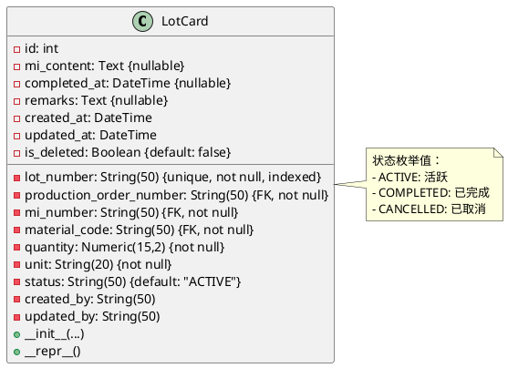
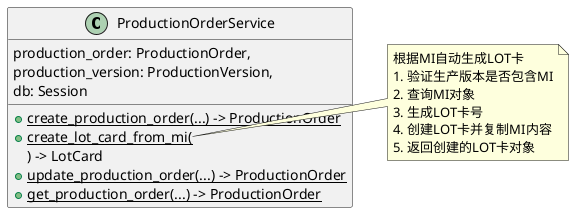
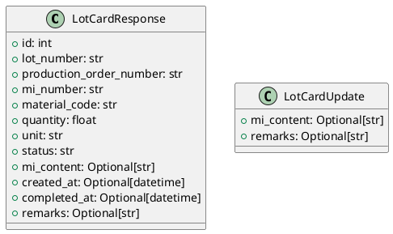
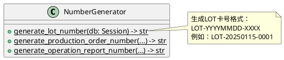
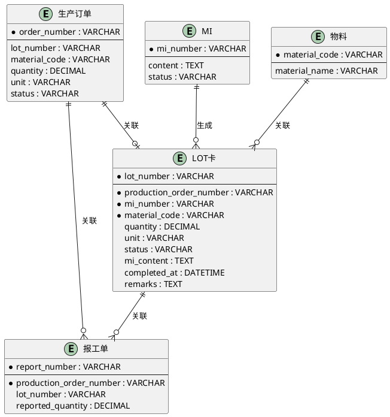
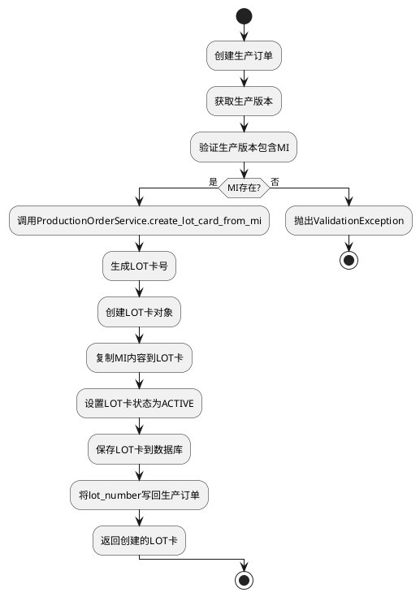
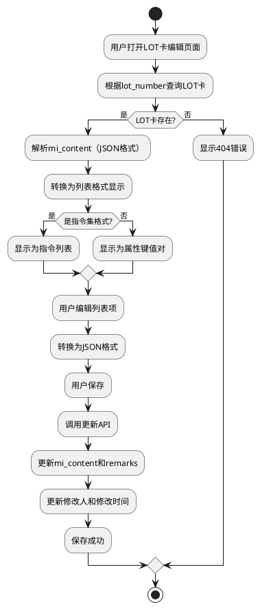
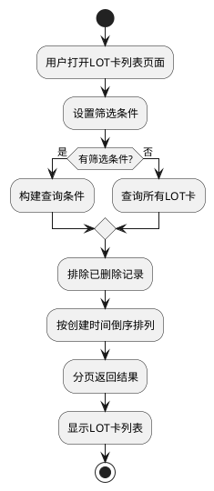
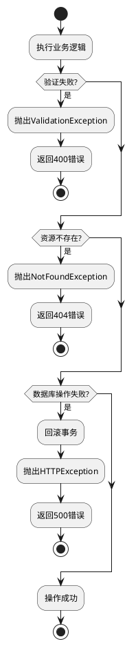

# LOT卡管理功能对象模型设计（Lot Card Management Object Model）

**版本：** v1.0  
**最后更新：** 2025-01-XX  
**维护者：** 开发团队

## 1. 概述

LOT卡管理功能是生产计划与控制（PP）模块的核心功能之一，用于管理生产批次卡的全生命周期。LOT卡由MI（制造指令）自动生成，关联生产订单/工单，是工序报工的批次依据。本文档描述了LOT卡管理功能的完整对象模型设计。

## 2. 类图设计

### 2.1 实体类（Entity Classes）

#### 2.1.1 LotCard（LOT卡实体）



**属性说明：**

| 属性名 | 类型 | 说明 | 约束 |
|--------|------|------|------|
| id | int | 主键ID | 自增 |
| lot_number | String(50) | LOT卡号，唯一标识 | 唯一，非空，索引 |
| production_order_number | String(50) | 生产订单号 | 外键，非空 |
| mi_number | String(50) | MI编号 | 外键，非空 |
| material_code | String(50) | 物料编码 | 外键，非空 |
| quantity | Numeric(15,2) | 数量 | 非空 |
| unit | String(20) | 单位 | 非空 |
| status | String(50) | 状态 | 默认"ACTIVE" |
| mi_content | Text | MI内容（JSON格式） | 可空 |
| completed_at | DateTime | 完成时间 | 可空 |
| remarks | Text | 备注 | 可空 |
| created_at | DateTime | 创建时间 | 自动生成 |
| updated_at | DateTime | 更新时间 | 自动更新 |
| created_by | String(50) | 创建人 | 自动填充 |
| updated_by | String(50) | 更新人 | 自动填充 |
| is_deleted | Boolean | 是否删除（软删除） | 默认false |

**关系：**

- `LotCard` → `ProductionOrder`：多对一（一个生产订单对应一个LOT卡）
- `LotCard` → `MI`：多对一（一个MI可以生成多个LOT卡）
- `LotCard` → `Material`：多对一（一个物料可以有多个LOT卡）
- `LotCard` → `OperationReport`：一对多（一个LOT卡可以有多个报工记录）

### 2.2 服务类（Service Classes）

#### 2.2.1 ProductionOrderService（生产订单服务）



**方法说明：**

| 方法名 | 说明 | 参数 | 返回值 | 异常 |
|--------|------|------|--------|------|
| create_lot_card_from_mi | 根据MI自动生成LOT卡 | production_order, production_version, db | LotCard | ValidationException, NotFoundException |

**业务逻辑：**

1. 验证生产版本是否包含MI编号
2. 根据MI编号查询MI对象
3. 使用NumberGenerator生成LOT卡号（格式：LOT-YYYYMMDD-XXXX）
4. 创建LOT卡对象，复制MI内容
5. 设置LOT卡状态为"ACTIVE"
6. 保存到数据库并返回

### 2.3 API模型类（API Model Classes）

#### 2.3.1 LotCardResponse（LOT卡响应模型）



**属性说明：**

| 类名 | 属性名 | 类型 | 说明 |
|------|--------|------|------|
| LotCardResponse | id | int | 主键ID |
| LotCardResponse | lot_number | str | LOT卡号 |
| LotCardResponse | production_order_number | str | 生产订单号 |
| LotCardResponse | mi_number | str | MI编号 |
| LotCardResponse | material_code | str | 物料编码 |
| LotCardResponse | quantity | float | 数量 |
| LotCardResponse | unit | str | 单位 |
| LotCardResponse | status | str | 状态 |
| LotCardResponse | mi_content | Optional[str] | MI内容（JSON格式） |
| LotCardResponse | created_at | Optional[datetime] | 创建时间 |
| LotCardResponse | completed_at | Optional[datetime] | 完成时间 |
| LotCardResponse | remarks | Optional[str] | 备注 |
| LotCardUpdate | mi_content | Optional[str] | MI内容（可编辑） |
| LotCardUpdate | remarks | Optional[str] | 备注（可编辑） |

### 2.4 工具类（Utility Classes）

#### 2.4.1 NumberGenerator（编号生成器）



**方法说明：**

| 方法名 | 说明 | 参数 | 返回值 | 格式 |
|--------|------|------|--------|------|
| generate_lot_number | 生成LOT卡号 | db: Session | str | LOT-YYYYMMDD-XXXX |

## 3. 实体关系图（ER Diagram）



## 4. API接口设计

### 4.1 接口列表

| 方法 | 路径 | 说明 | 权限 |
|------|------|------|------|
| GET | `/api/pp/lot-cards/{production_order_number}` | 根据生产订单号获取LOT卡 | 所有用户 |
| GET | `/api/pp/lot-cards` | 获取LOT卡列表（支持筛选） | 所有用户 |
| GET | `/api/pp/lot-cards/by-lot-number/{lot_number}` | 根据LOT卡号获取LOT卡 | 所有用户 |
| PUT | `/api/pp/lot-cards/{lot_number}` | 更新LOT卡（MI内容和备注） | 计划员、生产主管 |

### 4.2 接口详细设计

#### 4.2.1 根据生产订单号获取LOT卡

**接口：** `GET /api/pp/lot-cards/{production_order_number}`

**路径参数：**
- `production_order_number`：生产订单号

**响应：** `LotCardResponse`

**异常：**
- `404 Not Found`：生产订单没有关联的LOT卡

**业务逻辑：**
1. 根据生产订单号查询LOT卡
2. 如果不存在，返回404错误
3. 返回LOT卡信息

#### 4.2.2 获取LOT卡列表

**接口：** `GET /api/pp/lot-cards`

**查询参数：**
- `production_order_number`（可选）：生产订单号
- `mi_number`（可选）：MI编号
- `status`（可选）：状态（ACTIVE, COMPLETED, CANCELLED）
- `skip`（可选）：跳过记录数（默认0）
- `limit`（可选）：返回记录数（默认100）

**响应：** `List[LotCardResponse]`

**业务逻辑：**
1. 构建查询条件（排除已删除记录）
2. 根据筛选条件过滤
3. 按创建时间倒序排列
4. 分页返回结果

#### 4.2.3 根据LOT卡号获取LOT卡

**接口：** `GET /api/pp/lot-cards/by-lot-number/{lot_number}`

**路径参数：**
- `lot_number`：LOT卡号

**响应：** `LotCardResponse`

**异常：**
- `404 Not Found`：LOT卡不存在

**业务逻辑：**
1. 根据LOT卡号查询LOT卡（排除已删除）
2. 如果不存在，返回404错误
3. 返回LOT卡信息

#### 4.2.4 更新LOT卡

**接口：** `PUT /api/pp/lot-cards/{lot_number}`

**路径参数：**
- `lot_number`：LOT卡号

**请求体：** `LotCardUpdate`

**响应：** `LotCardResponse`

**权限：** 需要登录，计划员或生产主管角色

**异常：**
- `404 Not Found`：LOT卡不存在
- `500 Internal Server Error`：更新失败

**业务逻辑：**
1. 根据LOT卡号查询LOT卡（排除已删除）
2. 如果不存在，返回404错误
3. 更新允许修改的字段（mi_content, remarks）
4. 更新修改人和修改时间
5. 保存并返回更新后的LOT卡

## 5. 业务逻辑设计

### 5.1 LOT卡生成流程



### 5.2 LOT卡编辑流程



### 5.3 LOT卡查询流程



## 6. 前端组件设计

### 6.1 组件结构

```plantuml
@startuml LOT卡前端组件结构

package "LOT卡管理" {
  component LotCardList {
    - 列表展示
    - 筛选功能
    - 详情查看
    - 编辑导航
  }
  
  component LotCardForm {
    - 表单编辑
    - JSON解析
    - 列表编辑
    - 保存功能
  }
  
  component LotCardDetail {
    - 详情展示
    - 信息查看
  }
}

LotCardList --> LotCardForm : 导航到编辑
LotCardList --> LotCardDetail : 显示详情

@enduml
```

### 6.2 组件说明

#### 6.2.1 LotCardList（LOT卡列表组件）

**功能：**
- 显示LOT卡列表（表格形式）
- 支持按生产订单号、MI编号、状态筛选
- 支持查看详情（Modal弹窗）
- 支持编辑导航（跳转到编辑页面）
- 支持跳转到生产订单详情

**主要属性：**
- `lotCards`: LOT卡列表数据
- `filters`: 筛选条件
- `loading`: 加载状态

**主要方法：**
- `fetchLotCards()`: 获取LOT卡列表
- `handleSearch()`: 执行搜索
- `handleViewDetail()`: 查看详情
- `handleEdit()`: 编辑LOT卡

#### 6.2.2 LotCardForm（LOT卡表单组件）

**功能：**
- 编辑LOT卡的MI内容和备注
- 解析JSON格式的mi_content为列表
- 支持两种显示格式：
  - 指令集格式（sequence, instruction_type, instruction_content, description）
  - 属性键值对格式（key, value）
- 支持编辑列表项（Modal弹窗）
- 将编辑后的列表转换回JSON格式保存

**主要属性：**
- `lotCard`: LOT卡数据
- `lotCardItems`: 解析后的列表项
- `editingItem`: 正在编辑的项

**主要方法：**
- `fetchLotCard()`: 获取LOT卡数据
- `parseContentToItems()`: 解析JSON为列表
- `itemsToJsonString()`: 列表转换为JSON
- `handleSave()`: 保存LOT卡

## 7. 数据流转

### 7.1 LOT卡创建数据流

```
生产订单创建
    ↓
ProductionOrderService.create_production_order()
    ↓
ProductionOrderService.create_lot_card_from_mi()
    ↓
查询MI对象
    ↓
NumberGenerator.generate_lot_number()
    ↓
创建LotCard对象
    ↓
复制MI内容到mi_content
    ↓
保存到数据库
    ↓
写回lot_number到生产订单
    ↓
返回LotCard对象
```

### 7.2 LOT卡查询数据流

```
前端请求
    ↓
API路由处理
    ↓
查询数据库（带筛选条件）
    ↓
转换为LotCardResponse
    ↓
返回JSON响应
    ↓
前端解析并显示
```

### 7.3 LOT卡编辑数据流

```
前端加载LOT卡
    ↓
解析mi_content（JSON）
    ↓
转换为列表格式
    ↓
用户编辑列表项
    ↓
转换回JSON格式
    ↓
调用更新API
    ↓
更新数据库
    ↓
返回更新后的LOT卡
```

## 8. 异常处理

### 8.1 异常类型

| 异常类型 | 错误码 | HTTP状态码 | 说明 |
|---------|--------|-----------|------|
| ValidationException | MI_NOT_FOUND | 400 | 生产版本缺少MI |
| NotFoundException | LOT_CARD_NOT_FOUND | 404 | LOT卡不存在 |
| HTTPException | - | 500 | 更新失败 |

### 8.2 异常处理流程



## 9. 数据库设计

### 9.1 表结构

**表名：** `lot_cards`

**索引：**
- 主键索引：`id`
- 唯一索引：`lot_number`
- 普通索引：
  - `production_order_number`
  - `mi_number`
  - `material_code`
  - `status`
  - `lot_number`

### 9.2 外键约束

- `production_order_number` → `production_orders.order_number`
- `mi_number` → `mis.mi_number`
- `material_code` → `materials.material_code`

## 10. 安全设计

### 10.1 权限控制

| 操作 | 所需权限 | 说明 |
|------|---------|------|
| 查看LOT卡列表 | 所有登录用户 | 可查看所有LOT卡 |
| 查看LOT卡详情 | 所有登录用户 | 可查看LOT卡详细信息 |
| 编辑LOT卡 | 计划员、生产主管 | 可编辑MI内容和备注 |

### 10.2 数据验证

1. **LOT卡号验证**：必须唯一，格式为LOT-YYYYMMDD-XXXX
2. **生产订单号验证**：必须存在
3. **MI编号验证**：必须存在
4. **物料编码验证**：必须存在
5. **数量验证**：必须大于0
6. **状态验证**：必须是ACTIVE、COMPLETED或CANCELLED之一

## 11. 扩展说明

### 11.1 未来扩展方向

1. **LOT卡状态自动更新**：根据生产进度自动更新LOT卡状态
2. **LOT卡历史记录**：记录LOT卡的修改历史
3. **LOT卡批量操作**：支持批量编辑、批量导出
4. **LOT卡统计分析**：提供LOT卡使用情况统计
5. **LOT卡打印功能**：支持打印LOT卡标签

### 11.2 性能优化

1. **查询优化**：使用索引优化查询性能
2. **缓存策略**：对频繁查询的LOT卡进行缓存
3. **分页优化**：使用游标分页替代偏移分页
4. **批量操作**：支持批量创建和更新LOT卡

## 12. 示例

### 12.1 LOT卡创建示例

```python
# 创建生产订单时自动生成LOT卡
production_order = ProductionOrderService.create_production_order(
    sales_order_number="SO-20250115-0001",
    material_code="MAT-001",
    quantity=1000,
    unit="PCS",
    db=db
)

# LOT卡已自动创建并关联到生产订单
lot_card = db.query(LotCard).filter(
    LotCard.production_order_number == production_order.order_number
).first()

print(f"LOT卡号: {lot_card.lot_number}")
print(f"MI编号: {lot_card.mi_number}")
print(f"状态: {lot_card.status}")
```

### 12.2 LOT卡查询示例

```python
# 根据生产订单号查询LOT卡
lot_card = db.query(LotCard).filter(
    LotCard.production_order_number == "PO-20250115-0001"
).first()

# 查询LOT卡列表（带筛选）
lot_cards = db.query(LotCard).filter(
    LotCard.is_deleted == False,
    LotCard.status == "ACTIVE"
).order_by(LotCard.created_at.desc()).all()
```

### 12.3 LOT卡更新示例

```python
# 更新LOT卡的MI内容和备注
lot_card = db.query(LotCard).filter(
    LotCard.lot_number == "LOT-20250115-0001"
).first()

lot_card.mi_content = json.dumps({
    "instructions": [
        {
            "sequence": 1,
            "instruction_type": "钻孔",
            "instruction_content": "孔径0.3mm",
            "description": "钻孔工序"
        }
    ]
})
lot_card.remarks = "已调整钻孔参数"
lot_card.updated_by = current_user.username
lot_card.updated_at = datetime.now()

db.commit()
```
