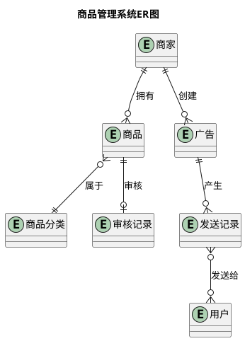
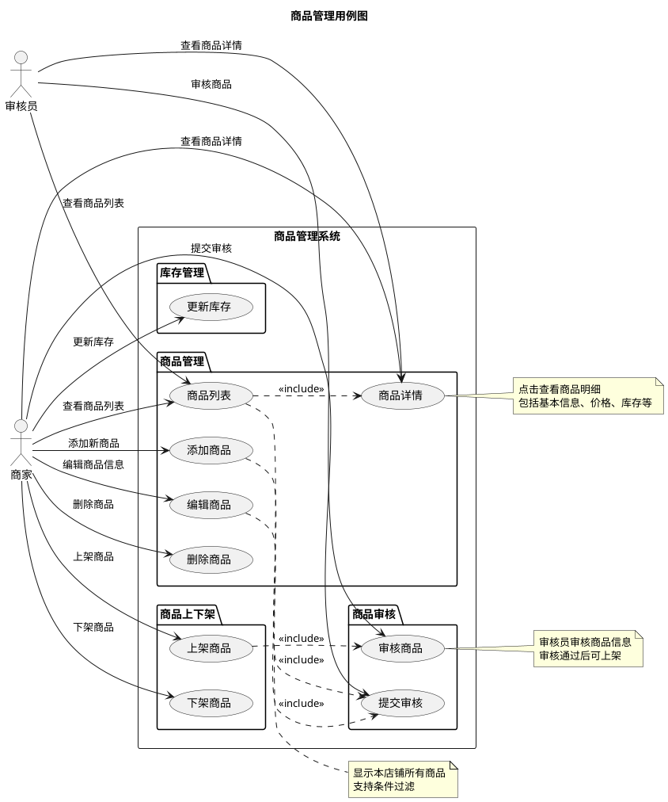
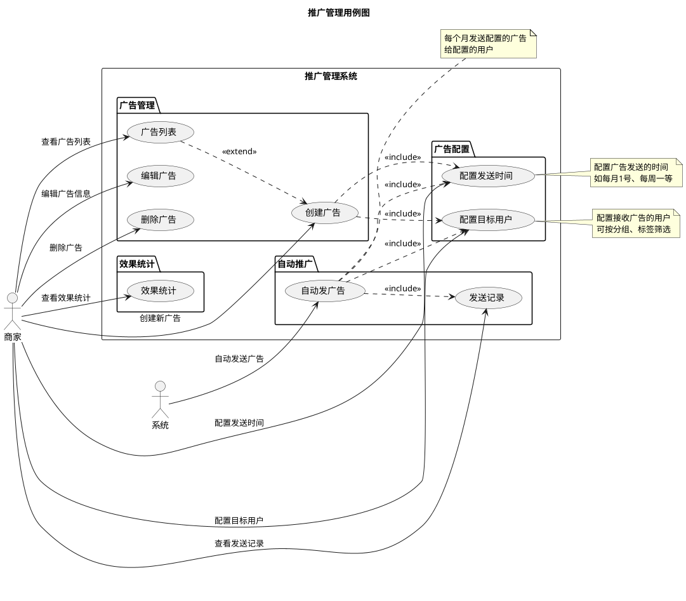
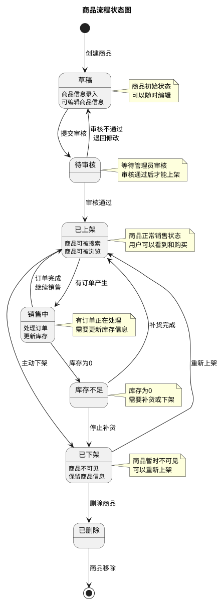

# 需求规格说明书

## 实体

### 实体列表

实体名称|说明
-|-
商品|在电商系统中主要实体，客户可在线浏览并下单购买
...|...

### ER图

## 用例

### 商品管理

#### 用例列表

用例|功能说明
-|-
商品列表|显示本店铺所有商品，支持条件过滤
商品详情|点击查看商品明细
...|...

#### 用例图

### 推广

#### 用例列表

用例|功能说明
-|-
自动发广告|每个月发送配置的广告给配置的用户
...|...

#### 用例图

## 流程说明

### 商品上架流程

#### 流程说明

商品经过上架流程后，可以对外进行展示和销售，包括审核以及下架等...

#### 流程图

