# 某某ERP系统 - 跨模块业务流程

## 文档说明

**版本：** v1.4  
**创建日期：** 2025-01-XX  
**最后更新：** 2025-01-XX  
**模块：** 跨模块

本文档描述了某某ERP系统跨模块的完整业务流程，使用Mermaid流程图格式展示。本文档基于需求规格说明书v1.4编写。

---

## 完整订单到生产流程

### 流程说明

生产执行全流程从销售订单开始，经过订单评审、BOM和工艺路线准备、生产版本建立、MI制作、生产版本发布、生产订单下达、物料领料、工序报工等环节，最终完成生产并入库。

**关键步骤：**

1. **订单评审**：对销售订单进行评审，确认价格、交期等

2. **产品主数据确认**：确认或创建产品主数据，以本厂编号作为唯一标识。如果本厂编号对应的产品主数据不存在，系统提示用户创建。产品主数据由工程管理模块统一管理

3. **BOM和工艺路线准备**：准备产品的BOM和工艺路线（基于产品主数据的本厂编号）。BOM和工艺路线准备可以并行进行，无依赖关系

4. **生产版本建立**：将BOM和工艺路线组合，建立生产版本。生产版本建立必须等待BOM和工艺路线都准备好。如果任一准备失败，生产版本建立失败，提示用户

5. **MI制作**：根据订单创建制造指令，包含技术参数和生产要求。MI制作需要生产版本已建立

6. **生产版本发布**：发布生产版本，使其可用于生产订单下达。生产版本发布需要MI已制作且MI审核通过

7. **生产订单下达**：下达生产订单/工单，如果关联了MI，系统根据MI自动生成LOT卡，LOT卡包含MI内容和生产信息，并将lot_number写回生产订单。如果MI不存在，不允许创建生产订单/工单或提示用户先创建MI。由于生产订单承担工单职责，工单状态与生产订单状态一致

8. **物料领料**：根据生产订单/工单领料

9. **工序报工**：各工序完成后进行报工，系统根据生产订单/工单自动读取LOT卡号并填充到报工单中，LOT卡号不可修改

10. **成品入库**：生产完成后，成品入库

### 流程图

```mermaid
flowchart TD
    Start([开始]) --> OrderReview[订单评审<br/>对销售订单进行评审，确认价格、交期等]
    OrderReview --> ProductConfirm[产品主数据确认<br/>确认或创建产品主数据，以本厂编号作为唯一标识]
    ProductConfirm --> Note1[产品主数据由工程管理模块统一管理]
    
    Note1 --> ForkBOM[并行准备]
    
    ForkBOM --> BOMPrepare[BOM准备<br/>准备产品的BOM，基于产品主数据的本厂编号]
    ForkBOM --> RoutingPrepare[工艺路线准备<br/>准备产品的工艺路线，基于产品主数据的本厂编号]
    
    BOMPrepare --> PVCreate[生产版本建立<br/>将BOM和工艺路线组合，建立生产版本]
    RoutingPrepare --> PVCreate
    
    PVCreate --> Note2[生产版本建立必须等待BOM和工艺路线都准备好<br/>如果任一准备失败，生产版本建立失败，提示用户]
    
    Note2 --> MICreate[MI制作<br/>根据订单创建制造指令，包含技术参数和生产要求]
    MICreate --> Note3[MI制作需要生产版本已建立]
    
    Note3 --> PVRelease[生产版本发布<br/>发布生产版本，使其可用于生产订单下达]
    PVRelease --> Note4[生产版本发布需要MI已制作且MI审核通过]
    
    Note4 --> PODown[生产订单下达<br/>下达生产订单/工单]
    PODown --> CheckMI{是否关联MI?}
    CheckMI -->|是| AutoGenerateLotCard[系统根据MI自动生成LOT卡<br/>1:1关系，自动复制MI内容，<br/>将lot_number写回生产订单]
    CheckMI -->|否| Note5[如果MI不存在，不允许创建生产订单/工单<br/>或提示用户先创建MI]
    
    AutoGenerateLotCard --> Note6[由于生产订单承担工单职责，<br/>工单状态与生产订单状态一致]
    Note5 --> Note6
    
    Note6 --> MaterialIssue[物料领料<br/>根据生产订单/工单领料]
    MaterialIssue --> OperationReport[工序报工<br/>各工序完成后进行报工]
    OperationReport --> Note7[系统根据生产订单/工单自动读取LOT卡号<br/>并填充到报工单中，LOT卡号不可修改]
    
    Note7 --> CheckAllCompleted{所有工序<br/>是否完成?}
    CheckAllCompleted -->|否| OperationReport
    CheckAllCompleted -->|是| ProductIn[成品入库<br/>生产完成后，成品入库]
    ProductIn --> ClosePO[关闭生产订单<br/>状态：CLOSED]
    ClosePO --> UpdateSO[当所有生产订单/工单状态为COMPLETED或CLOSED时，<br/>更新销售订单状态：COMPLETED]
    UpdateSO --> End([结束])
    
    style Start fill:#90EE90
    style End fill:#FFB6C1
    style OrderReview fill:#FFE4B5
    style AutoGenerateLotCard fill:#87CEEB
    style ClosePO fill:#98FB98
```

---

## 流程规则说明

### 审核规则

1. **三级审核（串行）**：报价单审核必须按顺序进行，一级→二级→三级
2. **多部门评审（串行）**：销售订单评审必须按顺序进行，销售→工程→物料→财务
3. **拒绝退回**：任何审核/评审拒绝，都自动退回草稿状态，记录拒绝原因
4. **重新提交**：退回后可以修改并重新提交审核/评审

### 依赖规则

1. **BOM和工艺路线**：只有RELEASED状态的BOM和工艺路线才能用于生产版本
2. **MI依赖**：生产版本发布时需要MI已关联且状态为RELEASED
3. **生产订单依赖**：创建生产订单时，如果关联MI，MI必须存在且RELEASED
4. **LOT卡依赖**：工序报工时必须找到关联的LOT卡，否则不允许保存

### 自动生成规则

1. **产品主数据**：报价单/订单创建时，如果本厂编号不存在，SD模块调用ENG模块的产品主数据创建API自动创建产品主数据（产品编码为本厂编号，产品类型为成品FG，物料分类为成品）。自动创建的产品主数据不需要审核。产品主数据由工程管理模块统一管理

2. **LOT卡**：生产订单创建时，如果关联了MI，系统根据MI自动生成LOT卡（1:1关系），自动复制MI内容到LOT卡，并将lot_number写回生产订单。如果MI不存在，不允许创建生产订单/工单或提示用户先创建MI

3. **领料需求**：生产领料时，系统根据BOM自动生成领料需求

4. **物料事务**：领料后自动创建MaterialTransaction记录

### 状态同步规则

1. **生产订单状态**：工单状态与生产订单状态一致

2. **销售订单状态同步**：
   - 当有生产订单/工单状态变为IN_PRODUCTION时，销售订单状态自动更新为IN_PRODUCTION
   - 当所有生产订单/工单状态为COMPLETED或CLOSED时，销售订单状态自动更新为COMPLETED

3. **库存更新**：领料和报工（自动倒扣料）后自动更新物料库存

---

## 相关文档

- [需求规格说明书](../需求/某某ERP系统MVP版本需求规格说明书1.4.md)
- [用例文档](./某某ERP系统02%20-%20用例（Use%20Cases）.md)
- [报价单流程](./workflow-sd-quotations.md)
- [销售订单流程](./workflow-sd-sales-orders.md)
- [工单管理流程](./workflow-pp-production-orders.md)
- [工序报工流程](./workflow-pp-operation-reports.md)
- [生产领料流程](./workflow-mm-material-issues.md)
- [完整业务流程](./workflow.md)

---

**文档版本：** v1.4  
**最后更新：** 2025-01-XX  
**维护者：** 开发团队

