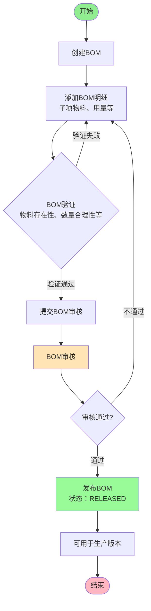

# 某某ERP系统 - BOM管理业务流程

## 文档说明

**版本：** v1.4  
**创建日期：** 2025-01-XX  
**最后更新：** 2025-01-XX  
**模块：** ENG（工程管理）

本文档描述了某某ERP系统BOM管理模块的业务流程，使用Mermaid流程图格式展示。本文档基于需求规格说明书v1.4编写。

---

## BOM管理流程

### 流程说明

BOM创建流程用于定义产品的物料组成结构，包括创建BOM、添加物料、版本管理等环节。

**关键步骤：**

1. **BOM创建**：创建新的BOM，指定父项产品（本厂编号）和版本信息。如果本厂编号对应的产品主数据不存在，系统提示用户创建。产品主数据由工程管理模块创建，以本厂编号作为唯一标识

2. **添加物料**：在BOM中添加子项物料，设置用量等信息

3. **BOM保存**：保存BOM，可以保存为草稿或直接发布

4. **BOM审核**：对BOM进行审核，确认物料清单的准确性。审核不通过时，退回修改，记录审核历史，保存退回原因

5. **BOM发布**：发布BOM，使其可用于生产。只有RELEASED状态的BOM才能用于生产版本

6. **版本管理**：可以基于现有BOM创建新版本

### 流程图

---

## BOM状态说明

- **NEW**：新建
- **REVIEWING**：审核中
- **RELEASED**：已发布
- **PRODUCING**：生产中
- **OBSOLETE**：已废弃

---

## 流程规则说明

### 依赖规则

1. **BOM状态**：只有RELEASED状态的BOM才能用于生产版本
2. **物料验证**：BOM中的子项物料必须存在且有效

---

## 相关文档

- [需求规格说明书](../需求/某某ERP系统MVP版本需求规格说明书1.4.md)
- [用例文档](./某某ERP系统02%20-%20用例（Use%20Cases）.md)
- [生产版本流程](./workflow-eng-production-versions.md)
- [物料主数据流程](./workflow-mm-materials.md)
- [完整业务流程](./workflow.md)

---

**文档版本：** v1.4  
**最后更新：** 2025-01-XX  
**维护者：** 开发团队

