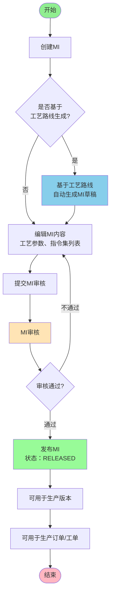

# 某某ERP系统 - MI管理业务流程

## 文档说明

**版本：** v1.4  
**创建日期：** 2025-01-XX  
**最后更新：** 2025-01-XX  
**模块：** ENG（工程管理）

本文档描述了某某ERP系统MI（制造指令）管理模块的业务流程，使用Mermaid流程图格式展示。本文档基于需求规格说明书v1.4编写。

---

## MI管理流程

### 流程说明

MI（制造指令）管理流程包括MI创建、基于工艺路线自动生成、审核、发布等环节。

**关键步骤：**

1. **创建MI**：工程师创建MI，或基于工艺路线自动生成MI草稿

2. **编辑MI内容**：编辑工艺参数与指令集列表（JSON格式）

3. **审核MI**：对MI进行审核，确认技术参数和生产要求。审核不通过时，退回修改，记录审核历史，保存退回原因

4. **发布MI**：审核通过后发布MI，状态更新为"RELEASED"。发布后的MI可用于生产版本发布和生产订单/工单下达

5. **使用MI**：发布后的MI可用于生产版本发布和生产订单/工单下达

### 流程图

---

## MI状态说明

- **DRAFT**：草稿
- **REVIEWING**：审核中
- **APPROVED**：已批准
- **RELEASED**：已发布
- **OBSOLETE**：已废弃

---

## 流程规则说明

### 依赖规则

1. **MI状态**：只有RELEASED状态的MI才能用于生产版本发布和生产订单/工单下达
2. **自动生成**：可以基于工艺路线自动生成MI草稿

---

## 相关文档

- [需求规格说明书](../需求/某某ERP系统MVP版本需求规格说明书1.4.md)
- [用例文档](./某某ERP系统02%20-%20用例（Use%20Cases）.md)
- [工艺路线流程](./workflow-eng-routings.md)
- [生产版本流程](./workflow-eng-production-versions.md)
- [LOT卡管理流程](./workflow-pp-lot-cards.md)
- [完整业务流程](./workflow.md)

---

**文档版本：** v1.4  
**最后更新：** 2025-01-XX  
**维护者：** 开发团队

