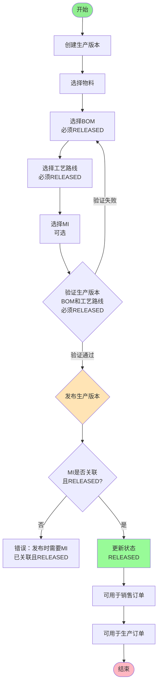

# 某某ERP系统 - 生产版本管理业务流程

## 文档说明

**版本：** v1.4  
**创建日期：** 2025-01-XX  
**最后更新：** 2025-01-XX  
**模块：** ENG（工程管理）

本文档描述了某某ERP系统生产版本管理模块的业务流程，使用Mermaid流程图格式展示。本文档基于需求规格说明书v1.4编写。

---

## 生产版本管理流程

### 流程说明

生产版本管理流程将BOM和工艺路线组合，建立生产版本。BOM和工艺路线准备可以并行进行，无依赖关系。生产版本建立必须等待BOM和工艺路线都准备好，如果任一准备失败，生产版本建立失败，提示用户。MI在创建生产版本时是可选的，但在发布生产版本时是必选的。

**关键步骤：**

1. **创建生产版本**：选择物料、BOM、工艺路线、MI（可选）

2. **验证依赖**：验证BOM和工艺路线必须为RELEASED状态

3. **发布生产版本**：发布时需要MI已关联且状态为RELEASED。发布后的生产版本可用于销售订单和生产订单

4. **使用生产版本**：发布后的生产版本可用于销售订单和生产订单

### 流程图

---

## 生产版本状态说明

- **ACTIVE**：激活
- **RELEASED**：已发布

---

## 流程规则说明

### 依赖规则

1. **BOM和工艺路线**：只有RELEASED状态的BOM和工艺路线才能用于生产版本
2. **MI依赖**：生产版本发布时需要MI已关联且状态为RELEASED

---

## 相关文档

- [需求规格说明书](../需求/某某ERP系统MVP版本需求规格说明书1.4.md)
- [用例文档](./某某ERP系统02%20-%20用例（Use%20Cases）.md)
- [BOM管理流程](./workflow-eng-boms.md)
- [工艺路线流程](./workflow-eng-routings.md)
- [MI管理流程](./workflow-eng-mis.md)
- [完整业务流程](./workflow.md)

---

**文档版本：** v1.4  
**最后更新：** 2025-01-XX  
**维护者：** 开发团队

