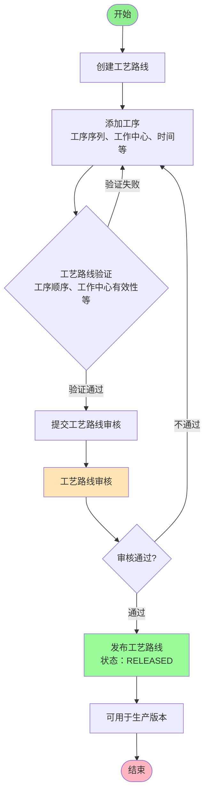

# 某某ERP系统 - 工艺路线管理业务流程

## 文档说明

**版本：** v1.4  
**创建日期：** 2025-01-XX  
**最后更新：** 2025-01-XX  
**模块：** ENG（工程管理）

本文档描述了某某ERP系统工艺路线管理模块的业务流程，使用Mermaid流程图格式展示。本文档基于需求规格说明书v1.4编写。

---

## 工艺路线管理流程

### 流程说明

工艺路线创建流程用于定义产品的生产工艺流程，包括创建工艺路线、添加工序、版本管理等环节。

**关键步骤：**

1. **工艺路线创建**：创建新的工艺路线，指定父项产品（本厂编号）和版本信息。如果本厂编号对应的产品主数据不存在，系统提示用户创建。产品主数据由工程管理模块创建，以本厂编号作为唯一标识

2. **添加工序**：在工艺路线中添加工序，设置工序序列、工作中心、标准时间等信息

3. **工艺路线保存**：保存工艺路线，可以保存为草稿或直接发布

4. **工艺路线审核**：对工艺路线进行审核，确认工艺流程的准确性。审核不通过时，退回修改，记录审核历史，保存退回原因

5. **工艺路线发布**：发布工艺路线，使其可用于生产。只有RELEASED状态的工艺路线才能用于生产版本

6. **版本管理**：可以基于现有工艺路线创建新版本

### 流程图

---

## 工艺路线状态说明

- **DRAFT**：草稿
- **RELEASED**：已发布
- **OBSOLETE**：已废弃

---

## 流程规则说明

### 依赖规则

1. **工艺路线状态**：只有RELEASED状态的工艺路线才能用于生产版本
2. **工作中心验证**：工艺路线中的工作中心必须存在且有效
3. **工序顺序**：工序序列必须合理且连续

---

## 相关文档

- [需求规格说明书](../需求/某某ERP系统MVP版本需求规格说明书1.4.md)
- [用例文档](./某某ERP系统02%20-%20用例（Use%20Cases）.md)
- [生产版本流程](./workflow-eng-production-versions.md)
- [工作中心流程](./workflow-pp-work-centers.md)
- [完整业务流程](./workflow.md)

---

**文档版本：** v1.4  
**最后更新：** 2025-01-XX  
**维护者：** 开发团队

