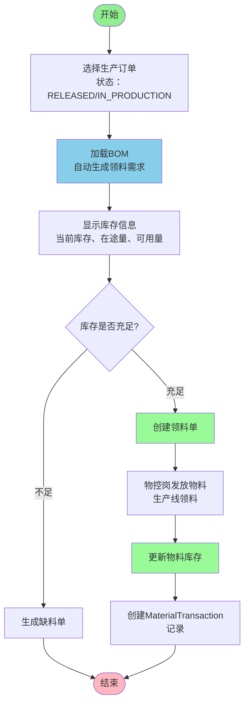

# 某某ERP系统 - 生产领料业务流程

## 文档说明

**版本：** v1.4  
**创建日期：** 2025-01-XX  
**最后更新：** 2025-01-XX  
**模块：** MM（物料管理）

本文档描述了某某ERP系统生产领料模块的业务流程，使用Mermaid流程图格式展示。本文档基于需求规格说明书v1.4编写。

---

## 生产领料流程

### 流程说明

生产领料流程用于处理生产订单/工单的物料发放，包括创建领料单、库存检查、物料发放、审核确认等环节。

**关键步骤：**

1. **创建领料单**：根据生产订单/工单自动生成领料需求，创建领料单

2. **库存检查**：系统自动检查物料库存，显示当前库存和安全库存

3. **库存预警**：当库存低于安全库存时，系统自动预警

4. **物料发放**：仓库管理员根据领料单发放物料，记录实际发放数量

5. **领料审核**：对领料单进行审核确认

### 流程图

---

## 流程规则说明

### 自动生成规则

1. **领料需求**：生产领料时，系统根据BOM自动生成领料需求
2. **物料事务**：领料后自动创建MaterialTransaction记录

### 库存更新规则

1. **库存更新**：领料后自动更新物料库存

---

## 相关文档

- [需求规格说明书](../需求/某某ERP系统MVP版本需求规格说明书1.4.md)
- [用例文档](./某某ERP系统02%20-%20用例（Use%20Cases）.md)
- [BOM管理流程](./workflow-eng-boms.md)
- [工单管理流程](./workflow-pp-production-orders.md)
- [物料主数据流程](./workflow-mm-materials.md)
- [完整业务流程](./workflow.md)

---

**文档版本：** v1.4  
**最后更新：** 2025-01-XX  
**维护者：** 开发团队

