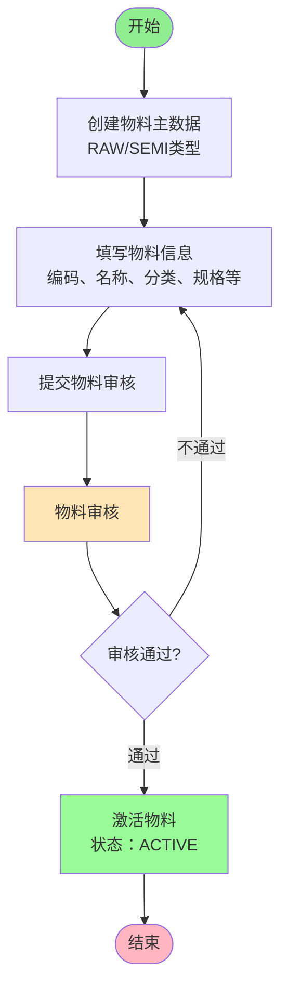

# 某某ERP系统 - 物料主数据管理业务流程

## 文档说明

**版本：** v1.4  
**创建日期：** 2025-01-XX  
**最后更新：** 2025-01-XX  
**模块：** MM（物料管理）

本文档描述了某某ERP系统物料主数据管理模块的业务流程，使用Mermaid流程图格式展示。本文档基于需求规格说明书v1.4编写。

---

## 物料主数据管理流程

### 流程说明

物料主数据管理流程包括物料创建、审核、激活等环节。物料主数据管理不显示FG类型的物料（FG类型在产品主数据管理中显示）。

**关键步骤：**
1. 创建物料：创建物料主数据（RAW、SEMI等类型）
2. 填写物料信息：填写物料编码、名称、分类、规格型号、库存信息等
3. 审核物料：对物料进行审核
4. 激活物料：审核通过后激活物料，状态更新为"ACTIVE"

### 流程图

---

## 物料主数据特点

1. **物料类型**：包含原材料（RAW）、半成品（SEMI）、辅材、化工材料、维修等类型
2. **不包含成品**：物料主数据管理中不显示成品(FG类型)，成品通过产品主数据管理进行维护
3. **库存信息**：包含当前库存、安全库存等信息

---

## 相关文档

- [需求规格说明书](../需求/某某ERP系统MVP版本需求规格说明书1.4.md)
- [用例文档](./某某ERP系统02%20-%20用例（Use%20Cases）.md)
- [产品主数据流程](./workflow-eng-products.md)
- [BOM管理流程](./workflow-eng-boms.md)
- [生产领料流程](./workflow-mm-material-issues.md)
- [完整业务流程](./workflow.md)

---

**文档版本：** v1.4  
**最后更新：** 2025-01-XX  
**维护者：** 开发团队

