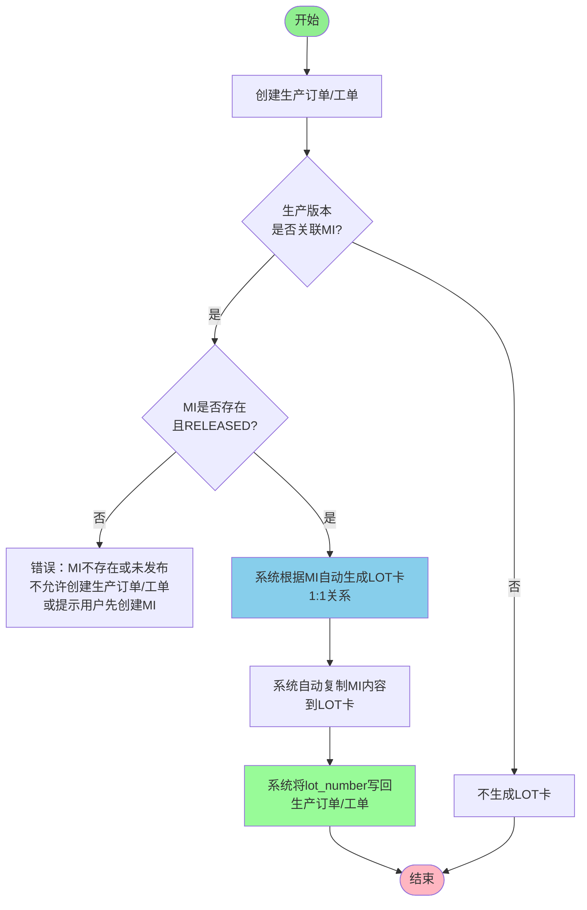

# 某某ERP系统 - LOT卡管理业务流程

## 文档说明

**版本：** v1.4  
**创建日期：** 2025-01-XX  
**最后更新：** 2025-01-XX  
**模块：** PP（生产计划与控制）

本文档描述了某某ERP系统LOT卡管理模块的业务流程，使用Mermaid流程图格式展示。本文档基于需求规格说明书v1.4编写。

---

## LOT卡生成流程

### 流程说明

LOT卡（生产批次卡）由MI自动生成，关联生产订单/工单，包含MI内容、数量、单位、状态等信息，是工序报工的批次依据。一个生产订单/工单对应一个LOT卡（1:1关系）。

**关键步骤：**

1. **创建生产订单**：创建生产订单/工单

2. **检查MI关联**：如果生产版本关联了MI，系统检查MI是否存在且状态为RELEASED。如果MI不存在，不允许创建生产订单/工单或提示用户先创建MI

3. **生成LOT卡**：如果关联了MI，系统根据MI自动生成LOT卡（1:1关系），自动复制MI内容到LOT卡，并将lot_number写回生产订单。如果MI不存在，不允许创建生产订单/工单或提示用户先创建MI

### 流程图

---

## LOT卡特点

1. **自动生成**：由MI自动生成，无需手动创建
2. **1:1关系**：一个生产订单/工单对应一个LOT卡
3. **MI内容复制**：自动复制MI内容到LOT卡
4. **批次依据**：是工序报工的批次依据
5. **关联关系**：关联生产订单号、MI编号、物料编码等

---

## 流程规则说明

### 自动生成规则

1. **LOT卡生成**：在生产订单/工单创建时，如果关联了MI，系统根据MI自动生成LOT卡（1:1关系），自动复制MI内容到LOT卡，并将lot_number写回生产订单/工单

2. **MI依赖**：如果MI不存在，不允许创建生产订单/工单或提示用户先创建MI

---

## 相关文档

- [需求规格说明书](../需求/某某ERP系统MVP版本需求规格说明书1.4.md)
- [用例文档](./某某ERP系统02%20-%20用例（Use%20Cases）.md)
- [MI管理流程](./workflow-eng-mis.md)
- [工单管理流程](./workflow-pp-production-orders.md)
- [工序报工流程](./workflow-pp-operation-reports.md)
- [完整业务流程](./workflow.md)

---

**文档版本：** v1.4  
**最后更新：** 2025-01-XX  
**维护者：** 开发团队

