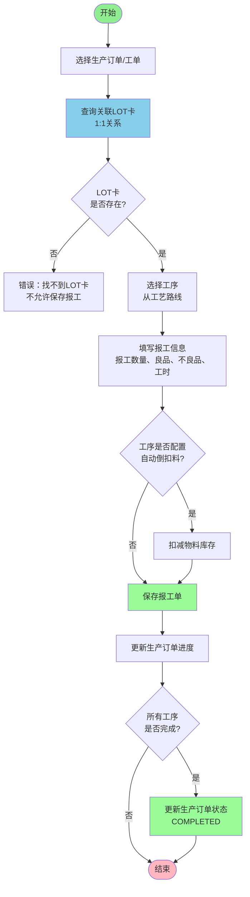

# 某某ERP系统 - 工序报工业务流程

## 文档说明

**版本：** v1.4  
**创建日期：** 2025-01-XX  
**最后更新：** 2025-01-XX  
**模块：** PP（生产计划与控制）

本文档描述了某某ERP系统工序报工模块的业务流程，使用Mermaid流程图格式展示。本文档基于需求规格说明书v1.4编写。

---

## 工序报工流程

### 流程说明

工序报工流程用于记录生产工序的完成情况，包括报工数据录入、不良品管理、工时记录等环节。

**关键步骤：**

1. **选择生产订单/工单并自动读取LOT卡**：选择要报工的生产订单/工单后，系统根据生产订单号自动查询关联的LOT卡（一个生产订单/工单对应一个LOT卡，1:1关系），并自动填充报工单中的LOT卡号字段（只读、不可修改）；如找不到LOT卡，则不允许保存报工

2. **任务确认**：确认当前工序任务，显示生产订单、LOT卡号、工序名称、计划数量等信息

3. **报工数据录入**：录入完成数量、良品数量、不良品数量等数据

4. **不良品管理**：记录不良品信息，包括不良原因、处理方式等

5. **工时记录**：记录实际工时，系统自动计算工时差异

6. **设备信息**：记录使用的设备信息和设备状态

7. **报工保存**：保存报工记录，更新生产进度

### 流程图

---

## 流程规则说明

### 依赖规则

1. **LOT卡依赖**：工序报工时必须找到关联的LOT卡，否则不允许保存
2. **自动读取**：系统根据生产订单号自动查询关联的LOT卡（1:1关系）

### 自动处理规则

1. **自动倒扣料**：如果工序配置了自动倒扣料，则扣减物料库存
2. **库存更新**：报工（自动倒扣料）后自动更新物料库存

---

## 相关文档

- [需求规格说明书](../需求/某某ERP系统MVP版本需求规格说明书1.4.md)
- [用例文档](./某某ERP系统02%20-%20用例（Use%20Cases）.md)
- [LOT卡管理流程](./workflow-pp-lot-cards.md)
- [工单管理流程](./workflow-pp-production-orders.md)
- [生产领料流程](./workflow-mm-material-issues.md)
- [完整业务流程](./workflow.md)

---

**文档版本：** v1.4  
**最后更新：** 2025-01-XX  
**维护者：** 开发团队

