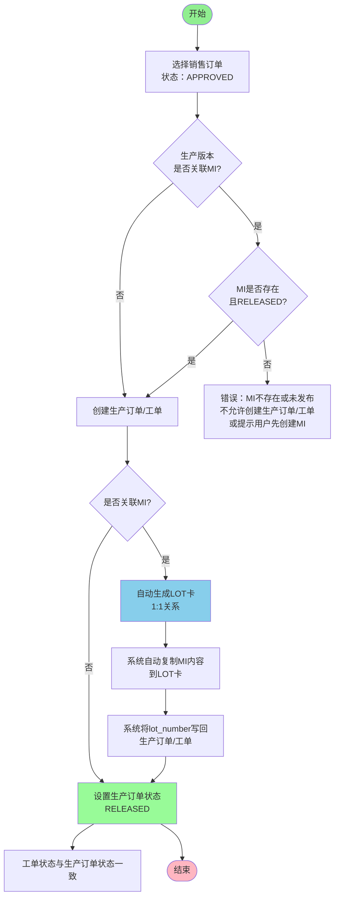
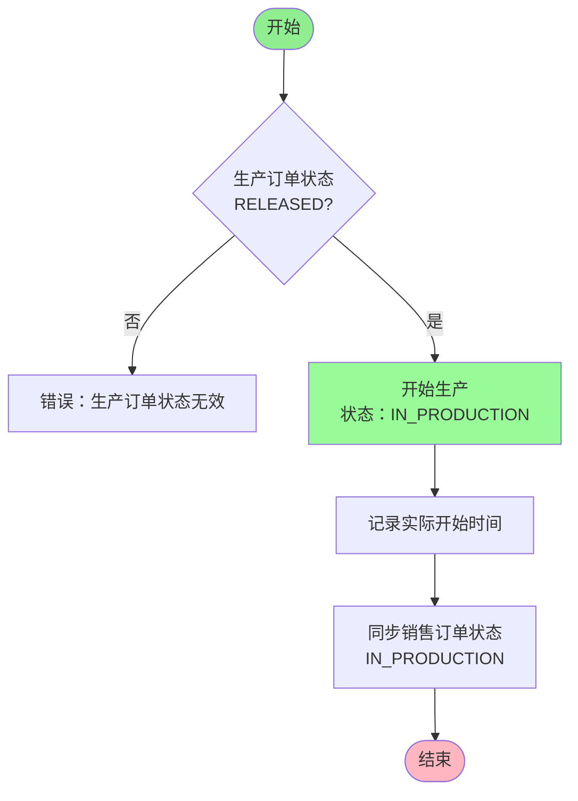
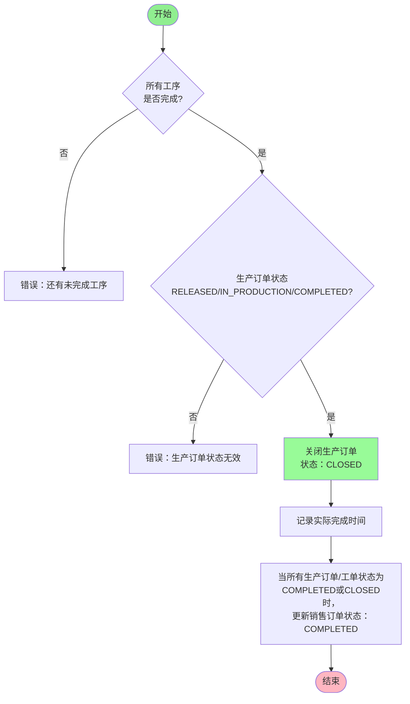

# 某某ERP系统 - 工单管理业务流程

## 文档说明

**版本：** v1.4  
**创建日期：** 2025-01-XX  
**最后更新：** 2025-01-XX  
**模块：** PP（生产计划与控制）

本文档描述了某某ERP系统工单管理模块的业务流程，使用Mermaid流程图格式展示。本文档基于需求规格说明书v1.4编写。

---

## 生产订单创建流程

### 流程说明

生产订单创建流程基于销售订单创建生产订单/工单，如果关联了MI，系统自动生成LOT卡。

**关键步骤：**

1. **选择销售订单**：选择已批准的销售订单

2. **创建生产订单**：基于销售订单创建生产订单/工单

3. **检查MI关联**：如果生产版本关联了MI，系统检查MI是否存在且状态为RELEASED。如果MI不存在，不允许创建生产订单/工单或提示用户先创建MI

4. **生成LOT卡**：如果关联了MI，系统根据MI自动生成LOT卡（1:1关系），自动复制MI内容到LOT卡，并将lot_number写回生产订单。如果MI不存在，不允许创建生产订单/工单或提示用户先创建MI

5. **设置生产订单状态**：设置生产订单状态为RELEASED。由于生产订单承担工单职责，工单状态与生产订单状态一致

### 流程图

---

## 开始生产流程

### 流程说明

开始生产流程将生产订单/工单从已下达（RELEASED）状态转为生产中（IN_PRODUCTION）状态。

**关键步骤：**
1. 检查生产订单状态：生产订单/工单状态必须为RELEASED
2. 开始生产：将生产订单/工单状态更新为IN_PRODUCTION
3. 记录实际开始时间：系统记录实际开始时间
4. 同步销售订单状态：系统同步销售订单状态为IN_PRODUCTION

### 流程图

---

## 生产订单关闭流程

### 流程说明

生产订单关闭流程在所有工序完成后，关闭生产订单。

**关键步骤：**

1. **检查完成情况**：检查所有工序是否已完成

2. **关闭生产订单**：更新生产订单状态为"CLOSED"。前置条件：生产订单状态必须为RELEASED、IN_PRODUCTION或COMPLETED。后置条件：状态更新为CLOSED，记录实际完成时间，同步销售订单状态

3. **更新销售订单**：当所有生产订单/工单状态为COMPLETED或CLOSED时，更新销售订单状态为COMPLETED

### 流程图

---

## 生产订单状态说明

- **DRAFT**：草稿
- **RELEASED**：已下达
- **IN_PRODUCTION**：生产中
- **COMPLETED**：已完成
- **CLOSED**：已关闭
- **CANCELLED**：已取消

**注意：** 由于生产订单承担工单职责，工单状态与生产订单状态一致。

---

## 流程规则说明

### 依赖规则

1. **生产订单依赖**：创建生产订单时，如果关联MI，MI必须存在且RELEASED
2. **LOT卡生成**：生产订单创建时，如果关联MI，自动生成LOT卡（1:1关系）

### 状态同步规则

1. **生产订单状态**：工单状态与生产订单状态一致
2. **销售订单状态同步**：
   - 当有生产订单/工单状态变为IN_PRODUCTION时，销售订单状态自动更新为IN_PRODUCTION
   - 当所有生产订单/工单状态为COMPLETED或CLOSED时，销售订单状态自动更新为COMPLETED

---

## 相关文档

- [需求规格说明书](../需求/某某ERP系统MVP版本需求规格说明书1.4.md)
- [用例文档](./某某ERP系统02%20-%20用例（Use%20Cases）.md)
- [销售订单流程](./workflow-sd-sales-orders.md)
- [LOT卡管理流程](./workflow-pp-lot-cards.md)
- [工序报工流程](./workflow-pp-operation-reports.md)
- [完整业务流程](./workflow.md)

---

**文档版本：** v1.4  
**最后更新：** 2025-01-XX  
**维护者：** 开发团队

