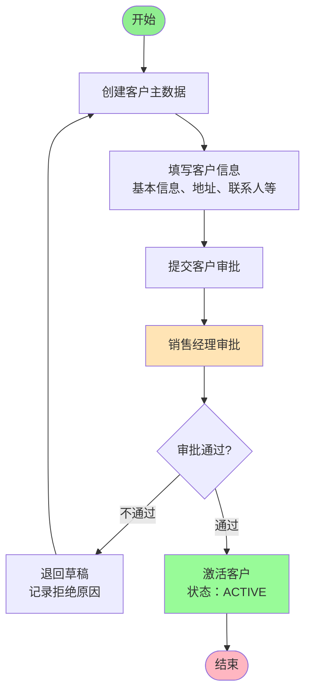

# 某某ERP系统 - 客户管理业务流程

## 文档说明

**版本：** v1.4  
**创建日期：** 2025-01-XX  
**最后更新：** 2025-01-XX  
**模块：** SD（销售与分销）

本文档描述了某某ERP系统客户管理模块的业务流程，使用Mermaid流程图格式展示。本文档基于需求规格说明书v1.4编写。

---

## 客户管理流程

### 流程说明

客户管理流程包括客户创建、提交审批、审批通过/拒绝等环节。

**关键步骤：**
1. 创建客户：销售员创建客户主数据
2. 提交审批：提交客户审批
3. 审批：销售经理审批客户
4. 审批通过：客户状态更新为"激活"
5. 审批拒绝：客户退回草稿状态

### 流程图

---

## 相关文档

- [需求规格说明书](../需求/某某ERP系统MVP版本需求规格说明书1.4.md)
- [用例文档](./某某ERP系统02%20-%20用例（Use%20Cases）.md)
- [完整业务流程](./workflow.md)

---

**文档版本：** v1.4  
**最后更新：** 2025-01-XX  
**维护者：** 开发团队

