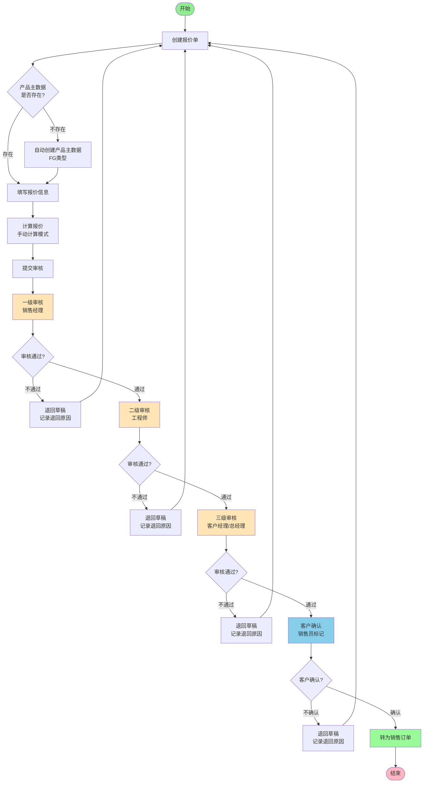
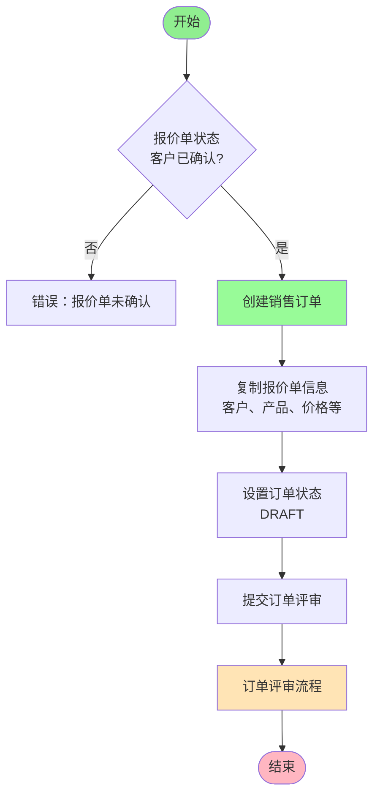

# 某某ERP系统 - 报价单业务流程

## 文档说明

**版本：** v1.4  
**创建日期：** 2025-01-XX  
**最后更新：** 2025-01-XX  
**模块：** SD（销售与分销）

本文档描述了某某ERP系统报价单管理模块的业务流程，使用Mermaid流程图格式展示。本文档基于需求规格说明书v1.4编写。

---

## 销售报价流程

### 流程说明

销售报价流程是销售业务的起点，从客户询价开始，经过报价单创建、报价计算、三级审核、销售员经客户确认报价单等环节，最终可以转为销售订单。

**关键步骤：**

1. **报价单创建**：销售员根据客户需求创建报价单，填写客户信息、产品信息（本厂编号、产品名称）、价格条款等。如果输入的14位本厂编号不存在对应的产品主数据，SD模块调用ENG模块的产品主数据创建API自动创建产品主数据（产品编码为本厂编号，产品类型为成品FG，物料分类为成品），并自动填充产品名称。自动创建的产品主数据不需要审核。产品主数据由工程管理模块统一管理，销售模块可以引用和自动创建

2. **报价单预估报价**：销售员填写板规格参数（出货长、出货宽、利用率、PNL参数等）、工艺参数（层数、板厚、铜厚、线宽线距、表面处理等）、加价选项（常规加价、特殊加价、额外加价等）后，点击"计算报价"按钮手动计算报价明细成本。计算内容包括：
   - **交货面积计算**：根据出货长、出货宽、订单数量计算交货面积（m²）
   - **基础成本计算**：根据基础成本基准值和层数调整系数计算成本/平米
   - **加价计算**：根据常规加价、特殊加价、额外加价选项计算总加价/平米
   - **最终成本计算**：基础成本 + 加价，得到最终成本/平米和成本PCS
   - **报价价格计算**：在成本基础上按利润率系数（如1.3，即30%利润）计算报价价格/平米和报价价格PCS
   - **费用计算**：计算工程费（根据层数）、板材费（成本×面积）、测试架费用（根据测试点数）、其他费用（最低消费等）
   - **最终总价计算**：工程费 + 板材费 + 测试架费用 + 其他费用
   - **工序成本分摊**：将成本按比例分摊到各工序（开料、钻孔、电镀、线路、阻焊、表面处理、成型等），生成工序成本明细
   - 系统采用手动计算模式（点击"计算报价"按钮）
   - 计算结果保存到报价单主表和报价明细工序表

3. **一级审核**：销售经理（SALES_MANAGER）进行一级审核，检查报价单的基本信息和价格合理性。审核不通过时，报价单退回草稿状态，销售员可修改后重新提交。退回操作记录审核历史，保存退回原因

4. **二级审核**：工程师（ENGINEER）进行二级审核，确认价格策略和交期承诺。审核不通过时，报价单退回草稿状态，销售员可修改后重新提交。退回操作记录审核历史，保存退回原因

5. **三级审核**：客户经理（ACCOUNT_MANAGER）或总经理（GENERAL_MANAGER）进行三级审核，最终确认报价单。审核不通过时，报价单退回草稿状态，销售员可修改后重新提交。退回操作记录审核历史，保存退回原因

6. **销售员经客户确认报价单**：销售员与客户确认报价单，客户确认是线下确认，销售员在系统中标记"客户已确认"。客户确认后可以转为销售订单。客户不确认时，报价单退回草稿状态，销售员可修改后重新提交审核。退回操作记录审核历史，保存退回原因

7. **报价转订单**：将已确认的报价单转为销售订单

### 流程图

---

## 报价转订单流程

### 流程说明

将已通过审核并获客户确认的报价单转为销售订单。

**关键步骤：**
1. 检查报价单状态：报价单必须为"客户已确认"状态
2. 创建销售订单：基于报价单信息创建销售订单
3. 订单评审：进入多部门评审流程

### 流程图

---

## 报价单状态说明

- **DRAFT**：草稿
- **PENDING_SALES**：待一级审核（销售经理）
- **PENDING_ENGINEER**：待二级审核（工程师）
- **PENDING_ACCOUNT_MANAGER**：待三级审核（客户经理/总经理）
- **APPROVED**：已批准
- **REJECTED**：已拒绝（自动退回DRAFT）
- **CUSTOMER_CONFIRMED**：客户已确认
- **LINKED**：已关联销售订单
- **CANCELLED**：已取消

---

## 流程规则说明

### 审核规则

1. **三级审核（串行）**：报价单审核必须按顺序进行，一级→二级→三级
2. **拒绝退回**：任何审核拒绝，都自动退回草稿状态，记录拒绝原因
3. **重新提交**：退回后可以修改并重新提交审核

### 自动生成规则

1. **产品主数据**：报价单创建时，如果本厂编号不存在，自动创建产品主数据（FG类型）。自动创建的产品主数据不需要审核。产品主数据由工程管理模块统一管理

### 客户确认规则

1. **客户确认**：客户确认是线下确认，销售员在系统中标记"客户已确认"
2. **客户不确认**：客户不确认时，报价单退回草稿状态，销售员可修改后重新提交审核。退回操作记录审核历史，保存退回原因

---

## 相关文档

- [需求规格说明书](../需求/某某ERP系统MVP版本需求规格说明书1.4.md)
- [用例文档](./某某ERP系统02%20-%20用例（Use%20Cases）.md)
- [销售订单流程](./workflow-sd-sales-orders.md)
- [完整业务流程](./workflow.md)

---

**文档版本：** v1.4  
**最后更新：** 2025-01-XX  
**维护者：** 开发团队

