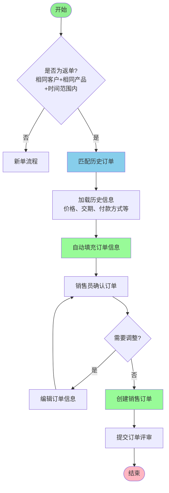
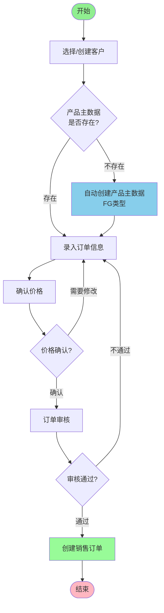
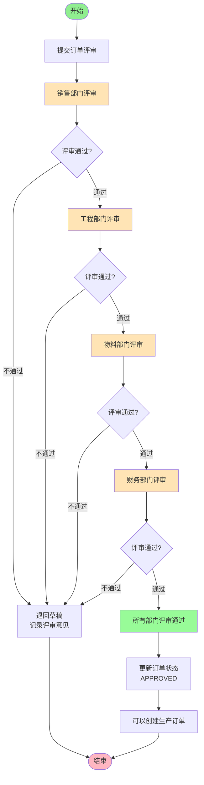

# 某某ERP系统 - 销售订单业务流程

## 文档说明

**版本：** v1.4  
**创建日期：** 2025-01-XX  
**最后更新：** 2025-01-XX  
**模块：** SD（销售与分销）

本文档描述了某某ERP系统销售订单管理模块的业务流程，使用Mermaid流程图格式展示。本文档基于需求规格说明书v1.4编写。

---

## 返单快速下单流程

### 流程说明

返单快速下单流程针对老客户重复下单的场景，系统自动识别返单并匹配历史订单信息，快速创建销售订单，跳过报价环节。

**关键步骤：**

1. **返单识别**：系统自动检测是否为返单（相同客户、相同产品主数据（本厂编号）、在时间范围内）

2. **历史订单匹配**：系统自动匹配历史订单，显示历史价格、交期等信息

3. **订单信息填充**：系统自动填充订单信息，包括产品主数据（本厂编号）、价格、交期等

4. **产品主数据确认**：确认或创建产品主数据（本厂编号），如果输入的14位本厂编号不存在对应的产品主数据，SD模块调用ENG模块的产品主数据创建API自动创建产品主数据（产品编码为本厂编号，产品类型为成品FG，物料分类为成品），并自动填充产品名称。自动创建的产品主数据不需要审核。产品主数据由工程管理模块统一管理

5. **订单确认**：销售员确认订单信息，可以调整数量、价格等

6. **订单创建**：创建销售订单，进入生产流程

### 流程图

---

## 新单下单流程

### 流程说明

新单下单流程针对新客户或新产品下单的场景，需要完整录入订单信息，经过订单审核等环节，创建销售订单。

**关键步骤：**
1. **客户选择**：选择或创建客户主数据，确认客户信息
2. **产品主数据确认**：确认或创建产品主数据（本厂编号），如果输入的14位本厂编号不存在对应的产品主数据，SD模块调用ENG模块的产品主数据创建API自动创建产品主数据（产品编码为本厂编号，产品类型为成品FG，物料分类为成品），并自动填充产品名称。自动创建的产品主数据不需要审核。产品主数据由工程管理模块统一管理
3. **订单信息录入**：手动录入订单信息，包括产品主数据（本厂编号）、数量、价格、交期、付款方式等
4. **价格确认**：确认订单价格，可以查询历史价格作为参考
5. **订单审核**：对订单进行审核，确认订单信息的完整性和准确性
6. **订单创建**：创建销售订单，进入生产流程

### 流程图

---

## 销售订单评审流程

### 流程说明

销售订单创建后，需要经过多部门评审（串行），包括销售、工程、物料、财务等部门。

**关键步骤：**
1. 提交评审：销售订单提交评审
2. 多部门评审（串行）：
   - 销售部门评审
   - 工程部门评审
   - 物料部门评审
   - 财务部门评审
3. 评审通过：所有部门评审通过后，订单状态更新为"已批准"
4. 评审拒绝：任一部门拒绝，订单退回草稿状态

### 流程图

---

## 销售订单状态说明

- **DRAFT**：草稿
- **PENDING_REVIEW**：待评审
- **REVIEWING**：评审中
- **APPROVED**：已批准
- **REJECTED**：已拒绝（自动退回DRAFT）
- **IN_PRODUCTION**：生产中
- **COMPLETED**：已完成
- **SHIPPED**：已发货
- **DELIVERED**：已交付
- **RECONCILED**：已对账
- **CLOSED**：已关闭
- **CANCELLED**：已取消

---

## 流程规则说明

### 审核规则

1. **多部门评审（串行）**：销售订单评审必须按顺序进行，销售→工程→物料→财务
2. **拒绝退回**：任何评审拒绝，都自动退回草稿状态，记录拒绝原因
3. **重新提交**：退回后可以修改并重新提交评审

### 自动生成规则

1. **产品主数据**：订单创建时，如果本厂编号不存在，SD模块调用ENG模块的产品主数据创建API自动创建产品主数据（产品编码为本厂编号，产品类型为成品FG，物料分类为成品）。自动创建的产品主数据不需要审核。产品主数据由工程管理模块统一管理

---

## 相关文档

- [需求规格说明书](../需求/某某ERP系统MVP版本需求规格说明书1.4.md)
- [用例文档](./某某ERP系统02%20-%20用例（Use%20Cases）.md)
- [报价单流程](./workflow-sd-quotations.md)
- [工单管理流程](./workflow-pp-production-orders.md)
- [完整业务流程](./workflow.md)

---

**文档版本：** v1.4  
**最后更新：** 2025-01-XX  
**维护者：** 开发团队

