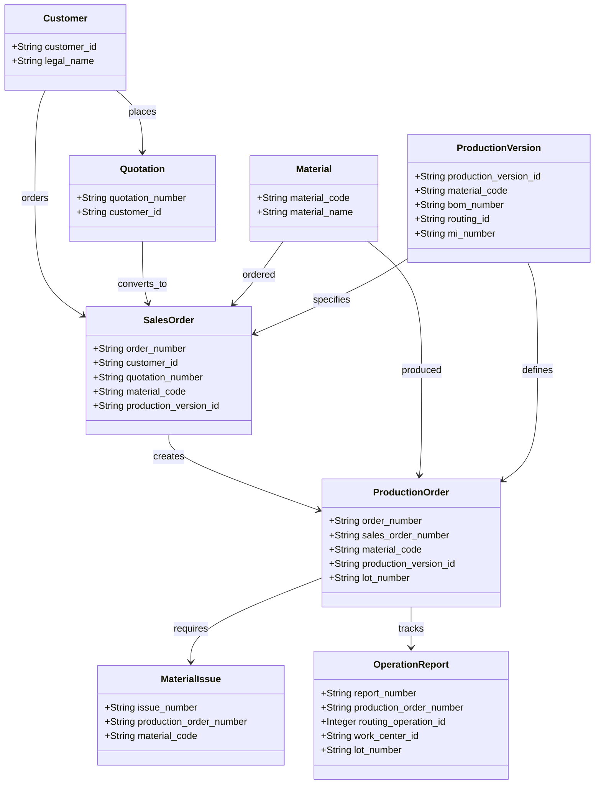

# 某某ERP系统 - 跨模块关系类图

## 文档说明

**版本：** v1.4  
**创建日期：** 2025-01-XX  
**最后更新：** 2025-01-XX  
**模块：** 跨模块

本文档描述了某某ERP系统跨模块的核心业务流程类关系图，使用Mermaid语法展示。本文档基于需求规格说明书v1.4编写。

---

## 核心业务流程类图

### 类图说明

核心业务流程类图展示了从客户到生产完成的完整业务流程中涉及的类及其关系。

### 类图



---

## 核心业务流程类关系链

### 业务流程说明

从销售报价到生产完成的完整业务流程：

```
Customer → Quotation → SalesOrder → ProductionOrder → OperationReport
                ↓
         MaterialIssue
                ↓
         MaterialTransaction
```

### 关键业务流程

1. **销售报价流程**：Customer → Quotation
2. **报价转订单**：Quotation → SalesOrder
3. **订单评审**：SalesOrder（多部门评审）
4. **创建生产订单**：SalesOrder → ProductionOrder
5. **生成LOT卡**：ProductionOrder（如果关联MI，自动生成LOT卡）
6. **生产领料**：ProductionOrder → MaterialIssue
7. **工序报工**：ProductionOrder → OperationReport
8. **生产完成**：所有工序完成，关闭生产订单

---

## 跨模块关系说明

### SD模块与ENG模块

- **产品主数据自动创建**：SD模块调用ENG模块的产品主数据创建API自动创建产品主数据
- **产品主数据引用**：SalesOrder引用Material（产品主数据）

### SD模块与PP模块

- **生产订单创建**：SalesOrder创建ProductionOrder
- **状态同步**：ProductionOrder状态变化时同步SalesOrder状态

### ENG模块与PP模块

- **生产版本使用**：ProductionOrder使用ProductionVersion
- **LOT卡生成**：如果ProductionVersion关联MI，ProductionOrder创建时自动生成LOTCard

### PP模块与MM模块

- **生产领料**：ProductionOrder生成MaterialIssue
- **物料事务**：MaterialIssue创建MaterialTransaction

---

## 相关文档

- [需求规格说明书](../../需求/某某ERP系统MVP版本需求规格说明书1.4.md)
- [用例文档](../../某某ERP系统02%20-%20用例（Use%20Cases）.md)
- [跨模块工作流](../工作流/workflow-cross-module.md)
- [完整类图文档](../../某某ERP系统%20-%20类图（Class%20Diagram）.md)

---

**文档版本：** v1.4  
**最后更新：** 2025-01-XX  
**维护者：** 开发团队

