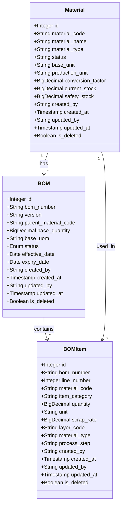

# 某某ERP系统 - BOM管理类图

## 文档说明

**版本：** v1.4  
**创建日期：** 2025-01-XX  
**最后更新：** 2025-01-XX  
**模块：** ENG（工程管理）

本文档描述了某某ERP系统BOM管理模块的类图，使用Mermaid语法展示。本文档基于需求规格说明书v1.4编写。

---

## BOM管理类图

### 类图说明

BOM管理类图展示了物料清单（BOM）及其明细项的类结构和关系。BOM关联物料，包含多个BOM明细项。

### 类图

---

## 类说明

### BOM（物料清单）

物料清单类，存储BOM的基本信息。

**主要属性：**
- `bom_number`：BOM编号（业务主键）
- `version`：版本号
- `parent_material_code`：父项物料编码（产品主数据，产品编码为本厂编号）
- `base_quantity`：基础数量
- `base_uom`：基础单位
- `status`：状态（NEW, REVIEWING, RELEASED, PRODUCING, OBSOLETE）
- `effective_date`：生效日期
- `expiry_date`：失效日期

**业务规则：**
- 只有RELEASED状态的BOM才能用于生产版本
- BOM的父项为产品主数据（产品编码为本厂编号）

### BOMItem（BOM明细）

BOM明细类，存储BOM的明细项信息。

**主要属性：**
- `bom_number`：BOM编号（外键）
- `line_number`：行号
- `material_code`：物料编码（外键）
- `item_category`：物料类别
- `quantity`：数量
- `unit`：单位
- `scrap_rate`：损耗率
- `layer_code`：层代码（PCB专有属性）
- `material_type`：物料类型（PCB专有属性）
- `process_step`：工序步骤（PCB专有属性）

---

## 关系说明

- **Material → BOM**：一个物料（产品主数据）可以有多个BOM（1对多）
- **BOM → BOMItem**：一个BOM可以包含多个BOM明细项（1对多）
- **Material → BOMItem**：一个物料可以用于多个BOM明细项（1对多）

---

## 相关文档

- [需求规格说明书](../../需求/某某ERP系统MVP版本需求规格说明书1.4.md)
- [用例文档](../../某某ERP系统02%20-%20用例（Use%20Cases）.md)
- [BOM管理ER图](../ER图/ENG-BOM管理ER图.puml)
- [BOM管理状态机](../状态机图/ENG-BOM管理状态机.puml)
- [BOM管理工作流](../工作流/workflow-eng-boms.md)
- [完整类图文档](../../某某ERP系统%20-%20类图（Class%20Diagram）.md)

---

**文档版本：** v1.4  
**最后更新：** 2025-01-XX  
**维护者：** 开发团队

