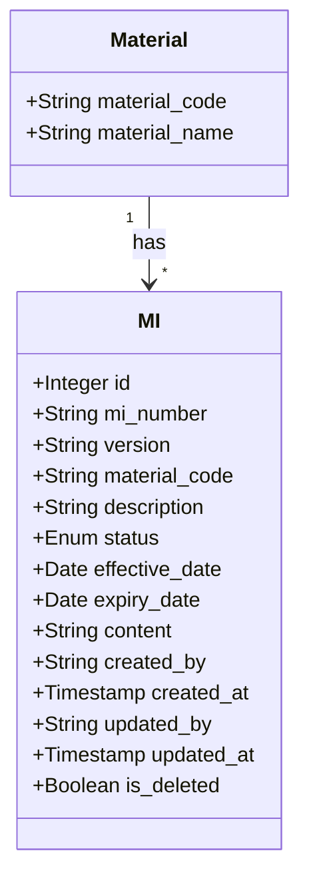

# 某某ERP系统 - MI管理类图

## 文档说明

**版本：** v1.4  
**创建日期：** 2025-01-XX  
**最后更新：** 2025-01-XX  
**模块：** ENG（工程管理）

本文档描述了某某ERP系统MI（制造指令）管理模块的类图，使用Mermaid语法展示。本文档基于需求规格说明书v1.4编写。

---

## MI管理类图

### 类图说明

MI管理类图展示了制造指令（MI）的类结构和关系。MI关联物料，可以基于工艺路线自动生成。

### 类图

---

## 类说明

### MI（制造指令）

制造指令类，存储MI的基本信息。

**主要属性：**
- `mi_number`：MI编号（业务主键）
- `version`：版本号
- `material_code`：物料编码（外键）
- `description`：描述
- `status`：状态（DRAFT, REVIEWING, APPROVED, RELEASED, OBSOLETE）
- `effective_date`：生效日期
- `expiry_date`：失效日期
- `content`：MI内容（JSON格式，包含工艺参数和指令集列表）

**业务规则：**
- MI可以基于工艺路线自动生成
- 发布后的MI可用于生产版本发布和生产订单/工单下达
- 在生产订单/工单创建时，如果关联了MI，系统根据MI自动生成LOT卡（1:1关系），自动复制MI内容到LOT卡
- 如果MI不存在，不允许创建生产订单/工单或提示用户先创建MI

---

## 关系说明

- **Material → MI**：一个物料可以有多个MI（1对多）

---

## 相关文档

- [需求规格说明书](../../需求/某某ERP系统MVP版本需求规格说明书1.4.md)
- [用例文档](../../某某ERP系统02%20-%20用例（Use%20Cases）.md)
- [MI管理ER图](../ER图/ENG-MI管理ER图.puml)
- [MI管理状态机](../状态机图/ENG-MI管理状态机.puml)
- [MI管理工作流](../工作流/workflow-eng-mi.md)
- [LOT卡管理类图](./class-diagram-pp-lot-cards.md)
- [完整类图文档](../../某某ERP系统%20-%20类图（Class%20Diagram）.md)

---

**文档版本：** v1.4  
**最后更新：** 2025-01-XX  
**维护者：** 开发团队

