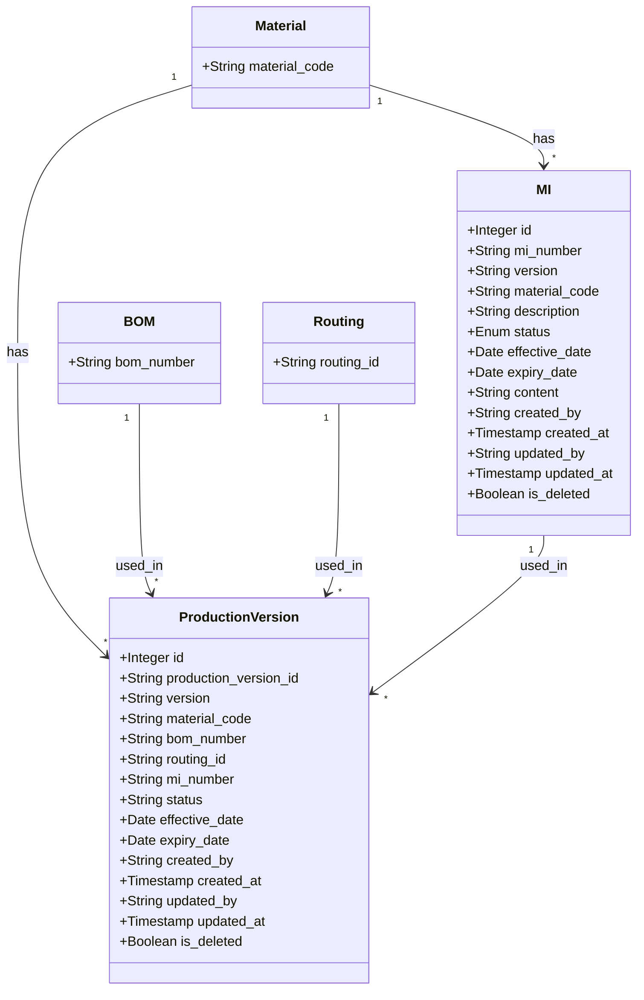

# 某某ERP系统 - 生产版本类图

## 文档说明

**版本：** v1.4  
**创建日期：** 2025-01-XX  
**最后更新：** 2025-01-XX  
**模块：** ENG（工程管理）

本文档描述了某某ERP系统生产版本管理模块的类图，使用Mermaid语法展示。本文档基于需求规格说明书v1.4编写。

---

## 生产版本类图

### 类图说明

生产版本类图展示了生产版本及其相关实体的类结构和关系。生产版本整合BOM、工艺路线和MI，形成可执行的生产版本。

### 类图

---

## 类说明

### ProductionVersion（生产版本）

生产版本类，存储生产版本的基本信息。

**主要属性：**
- `production_version_id`：生产版本ID（业务主键）
- `version`：版本号
- `material_code`：物料编码（外键）
- `bom_number`：BOM编号（外键）
- `routing_id`：工艺路线ID（外键）
- `mi_number`：MI编号（外键，可选）
- `status`：状态（ACTIVE, RELEASED）
- `effective_date`：生效日期
- `expiry_date`：失效日期

**业务规则：**
- BOM和工艺路线是必选的，必须为RELEASED状态
- MI在创建时是可选的，但在发布时是必选的
- 发布时需要MI已关联且状态为RELEASED
- 发布后的生产版本可用于销售订单和生产订单

---

## 关系说明

- **Material → ProductionVersion**：一个物料可以有多个生产版本（1对多）
- **BOM → ProductionVersion**：一个BOM可以用于多个生产版本（1对多）
- **Routing → ProductionVersion**：一个工艺路线可以用于多个生产版本（1对多）
- **MI → ProductionVersion**：一个MI可以用于多个生产版本（1对多）
- **Material → MI**：一个物料可以有多个MI（1对多）

---

## 相关文档

- [需求规格说明书](../../需求/某某ERP系统MVP版本需求规格说明书1.4.md)
- [用例文档](../../某某ERP系统02%20-%20用例（Use%20Cases）.md)
- [生产版本ER图](../ER图/ENG-生产版本ER图.puml)
- [生产版本状态机](../状态机图/ENG-生产版本状态机.puml)
- [生产版本工作流](../工作流/workflow-eng-production-versions.md)
- [完整类图文档](../../某某ERP系统%20-%20类图（Class%20Diagram）.md)

---

**文档版本：** v1.4  
**最后更新：** 2025-01-XX  
**维护者：** 开发团队

