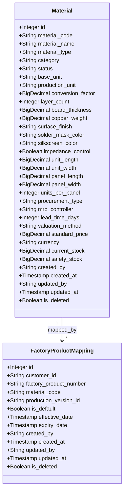

# 某某ERP系统 - 产品主数据类图

## 文档说明

**版本：** v1.4  
**创建日期：** 2025-01-XX  
**最后更新：** 2025-01-XX  
**模块：** ENG（工程管理）

本文档描述了某某ERP系统产品主数据管理模块的类图，使用Mermaid语法展示。本文档基于需求规格说明书v1.4编写。

---

## 产品主数据类图

### 类图说明

产品主数据类图展示了产品主数据（Material，material_type='FG'）及其与本厂编号映射的关系。

### 类图

---

## 类说明

### Material（物料/产品主数据）

产品主数据类，存储产品的基本信息。产品主数据以本厂编号作为唯一标识，本厂编号同时作为产品编码（material_code）。

**主要属性：**
- `material_code`：物料编码（本厂编号，业务主键）
- `material_name`：物料名称
- `material_type`：物料类型（FG=成品）
- `category`：物料分类（成品）
- `status`：状态
- `base_unit`：基础单位
- `production_unit`：生产单位
- `conversion_factor`：转换系数
- `layer_count`：层数（PCB专有属性）
- `board_thickness`：板厚（PCB专有属性）
- `copper_weight`：铜厚（PCB专有属性）
- `surface_finish`：表面处理（PCB专有属性）
- `solder_mask_color`：阻焊颜色（PCB专有属性）
- `silkscreen_color`：丝印颜色（PCB专有属性）
- `impedance_control`：是否阻抗控制（PCB专有属性）
- `unit_length`：单位长度
- `unit_width`：单位宽度
- `panel_length`：拼板长度
- `panel_width`：拼板宽度
- `units_per_panel`：每拼板单位数
- `current_stock`：当前库存
- `safety_stock`：安全库存

**业务规则：**
- 产品主数据由工程管理模块统一管理
- 产品主数据以本厂编号作为唯一标识，本厂编号同时作为产品编码（material_code）
- 产品主数据管理只显示成品(FG类型)的物料
- ENG模块拥有产品主数据的完整CRUD权限
- SD模块可以创建（自动创建）、查询、引用产品主数据，但不能修改、删除产品主数据（需ENG模块操作）
- 在报价单/订单创建时，如果本厂编号不存在，SD模块调用ENG模块的产品主数据创建API自动创建产品主数据（产品编码为本厂编号，产品类型为成品FG，物料分类为成品）。自动创建的产品主数据不需要审核

---

## 关系说明

- **Material → FactoryProductMapping**：一个产品主数据可以映射到多个客户的本厂编号（1对多）

---

## 相关文档

- [需求规格说明书](../../需求/某某ERP系统MVP版本需求规格说明书1.4.md)
- [用例文档](../../某某ERP系统02%20-%20用例（Use%20Cases）.md)
- [产品主数据ER图](../ER图/ENG-产品主数据ER图.puml)
- [产品主数据工作流](../工作流/workflow-eng-products.md)
- [完整类图文档](../../某某ERP系统%20-%20类图（Class%20Diagram）.md)

---

**文档版本：** v1.4  
**最后更新：** 2025-01-XX  
**维护者：** 开发团队

