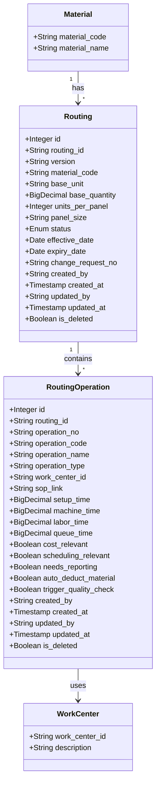

# 某某ERP系统 - 工艺路线类图

## 文档说明

**版本：** v1.4  
**创建日期：** 2025-01-XX  
**最后更新：** 2025-01-XX  
**模块：** ENG（工程管理）

本文档描述了某某ERP系统工艺路线管理模块的类图，使用Mermaid语法展示。本文档基于需求规格说明书v1.4编写。

---

## 工艺路线类图

### 类图说明

工艺路线类图展示了工艺路线及其工序的类结构和关系。工艺路线关联物料和工作中心，包含多个工序。

### 类图

---

## 类说明

### Routing（工艺路线）

工艺路线类，存储工艺路线的基本信息。

**主要属性：**
- `routing_id`：工艺路线ID（业务主键）
- `version`：版本号
- `material_code`：物料编码（外键）
- `base_unit`：基础单位
- `base_quantity`：基础数量
- `units_per_panel`：每拼板单位数
- `panel_size`：拼板尺寸
- `status`：状态（DRAFT, RELEASED, OBSOLETE）
- `effective_date`：生效日期
- `expiry_date`：失效日期
- `change_request_no`：变更请求号

**业务规则：**
- 只有RELEASED状态的工艺路线才能用于生产版本

### RoutingOperation（工艺路线工序）

工艺路线工序类，存储工艺路线的工序信息。

**主要属性：**
- `routing_id`：工艺路线ID（外键）
- `operation_no`：工序序号
- `operation_code`：工序代码
- `operation_name`：工序名称
- `operation_type`：工序类型
- `work_center_id`：工作中心ID（外键）
- `sop_link`：SOP链接
- `setup_time`：准备时间
- `machine_time`：机器时间
- `labor_time`：人工时间
- `queue_time`：排队时间
- `cost_relevant`：是否成本相关
- `scheduling_relevant`：是否排程相关
- `needs_reporting`：是否需要报工
- `auto_deduct_material`：是否自动倒扣料
- `trigger_quality_check`：是否触发质量检查

---

## 关系说明

- **Material → Routing**：一个物料可以有多个工艺路线（1对多）
- **Routing → RoutingOperation**：一个工艺路线可以包含多个工序（1对多）
- **RoutingOperation → WorkCenter**：工序使用工作中心（关联关系）

---

## 相关文档

- [需求规格说明书](../../需求/某某ERP系统MVP版本需求规格说明书1.4.md)
- [用例文档](../../某某ERP系统02%20-%20用例（Use%20Cases）.md)
- [工艺路线ER图](../ER图/ENG-工艺路线ER图.puml)
- [工艺路线状态机](../状态机图/ENG-工艺路线状态机.puml)
- [工艺路线工作流](../工作流/workflow-eng-routings.md)
- [完整类图文档](../../某某ERP系统%20-%20类图（Class%20Diagram）.md)

---

**文档版本：** v1.4  
**最后更新：** 2025-01-XX  
**维护者：** 开发团队

