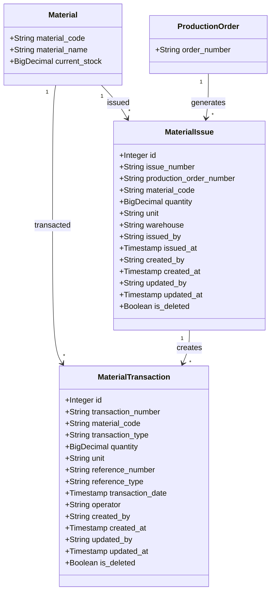

# 某某ERP系统 - 生产领料类图

## 文档说明

**版本：** v1.4  
**创建日期：** 2025-01-XX  
**最后更新：** 2025-01-XX  
**模块：** MM（物料管理）

本文档描述了某某ERP系统生产领料模块的类图，使用Mermaid语法展示。本文档基于需求规格说明书v1.4编写。

---

## 生产领料类图

### 类图说明

生产领料类图展示了生产领料及其相关实体的类结构和关系。生产领料关联生产订单、物料和物料事务。

### 类图

---

## 类说明

### MaterialIssue（生产领料）

生产领料类，存储生产领料的基本信息。MaterialIssue对应需求文档中的"领料单"。

**主要属性：**
- `issue_number`：领料单号（业务主键）
- `production_order_number`：生产订单号（外键）
- `material_code`：物料编码（外键）
- `quantity`：数量
- `unit`：单位
- `warehouse`：仓库
- `issued_by`：发放人
- `issued_at`：发放时间

**业务规则：**
- 系统根据生产订单关联的BOM自动生成领料需求
- 领料后自动更新物料库存，创建MaterialTransaction记录

### MaterialTransaction（物料事务）

物料事务类，存储物料的库存变动记录。

**主要属性：**
- `transaction_number`：事务编号（业务主键）
- `material_code`：物料编码（外键）
- `transaction_type`：事务类型（ISSUE=领料）
- `quantity`：数量
- `unit`：单位
- `reference_number`：参考单号（领料单号）
- `reference_type`：参考类型（MATERIAL_ISSUE）
- `transaction_date`：事务日期
- `operator`：操作人

**业务规则：**
- 领料后自动创建MaterialTransaction记录
- 物料事务用于记录所有库存变动

---

## 关系说明

- **Material → MaterialIssue**：一个物料可以发放多次（1对多）
- **Material → MaterialTransaction**：一个物料可以有多个物料事务记录（1对多）
- **ProductionOrder → MaterialIssue**：一个生产订单可以生成多个领料单（1对多）
- **MaterialIssue → MaterialTransaction**：一个领料单可以创建多个物料事务记录（1对多）

---

## 相关文档

- [需求规格说明书](../../需求/某某ERP系统MVP版本需求规格说明书1.4.md)
- [用例文档](../../某某ERP系统02%20-%20用例（Use%20Cases）.md)
- [生产领料ER图](../ER图/MM-生产领料ER图.puml)
- [生产领料工作流](../工作流/workflow-mm-material-issues.md)
- [工单管理类图](./class-diagram-pp-production-orders.md)
- [完整类图文档](../../某某ERP系统%20-%20类图（Class%20Diagram）.md)

---

**文档版本：** v1.4  
**最后更新：** 2025-01-XX  
**维护者：** 开发团队

