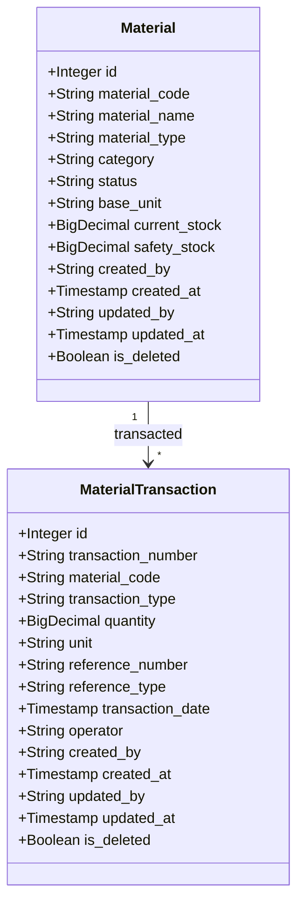

# 某某ERP系统 - 物料主数据类图

## 文档说明

**版本：** v1.4  
**创建日期：** 2025-01-XX  
**最后更新：** 2025-01-XX  
**模块：** MM（物料管理）

本文档描述了某某ERP系统物料主数据管理模块的类图，使用Mermaid语法展示。本文档基于需求规格说明书v1.4编写。

---

## 物料主数据类图

### 类图说明

物料主数据类图展示了物料主数据（非FG类型）及其物料事务的类结构和关系。物料主数据管理不显示FG类型的物料（FG类型在产品主数据管理中显示）。

### 类图

---

## 类说明

### Material（物料主数据）

物料主数据类，存储物料的基本信息。物料主数据管理不显示FG类型的物料。

**主要属性：**
- `material_code`：物料编码（业务主键）
- `material_name`：物料名称
- `material_type`：物料类型（RAW=原材料, SEMI=半成品等，不包括FG）
- `category`：物料分类
- `status`：状态
- `base_unit`：基础单位
- `current_stock`：当前库存
- `safety_stock`：安全库存

**业务规则：**
- 物料主数据管理不显示FG类型的物料（FG类型在产品主数据管理中显示）

### MaterialTransaction（物料事务）

物料事务类，存储物料的库存变动记录。

**主要属性：**
- `transaction_number`：事务编号（业务主键）
- `material_code`：物料编码（外键）
- `transaction_type`：事务类型（ISSUE=领料, RECEIPT=入库, ADJUSTMENT=调整等）
- `quantity`：数量
- `unit`：单位
- `reference_number`：参考单号（如生产订单号、领料单号等）
- `reference_type`：参考类型
- `transaction_date`：事务日期
- `operator`：操作人

**业务规则：**
- 领料和报工（自动倒扣料）后自动创建MaterialTransaction记录
- 物料事务用于记录所有库存变动

---

## 关系说明

- **Material → MaterialTransaction**：一个物料可以有多个物料事务记录（1对多）

---

## 相关文档

- [需求规格说明书](../../需求/某某ERP系统MVP版本需求规格说明书1.4.md)
- [用例文档](../../某某ERP系统02%20-%20用例（Use%20Cases）.md)
- [物料主数据ER图](../ER图/MM-物料主数据ER图.puml)
- [物料主数据工作流](../工作流/workflow-mm-materials.md)
- [产品主数据类图](./class-diagram-eng-products.md)
- [完整类图文档](../../某某ERP系统%20-%20类图（Class%20Diagram）.md)

---

**文档版本：** v1.4  
**最后更新：** 2025-01-XX  
**维护者：** 开发团队

