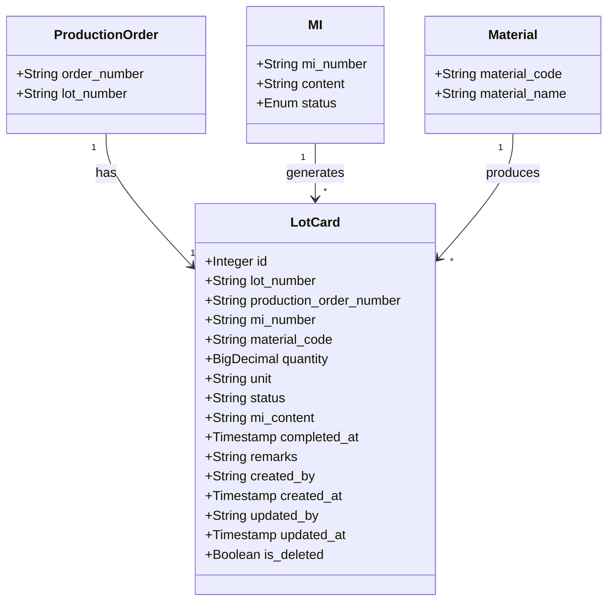

# 某某ERP系统 - LOT卡管理类图

## 文档说明

**版本：** v1.4  
**创建日期：** 2025-01-XX  
**最后更新：** 2025-01-XX  
**模块：** PP（生产计划与控制）

本文档描述了某某ERP系统LOT卡管理模块的类图，使用Mermaid语法展示。本文档基于需求规格说明书v1.4编写。

---

## LOT卡管理类图

### 类图说明

LOT卡管理类图展示了LOT卡（生产批次卡）及其相关实体的类结构和关系。LOT卡由MI自动生成，关联生产订单/工单。

### 类图

---

## 类说明

### LotCard（LOT卡）

LOT卡类，存储LOT卡的基本信息。LOT卡是生产批次卡，由MI自动生成。

**主要属性：**
- `lot_number`：LOT卡号（业务主键）
- `production_order_number`：生产订单号（外键）
- `mi_number`：MI编号（外键）
- `material_code`：物料编码（外键）
- `quantity`：数量
- `unit`：单位
- `status`：状态
- `mi_content`：MI内容（从MI复制，JSON格式）
- `completed_at`：完成时间
- `remarks`：备注

**业务规则：**
- 一个生产订单/工单对应一个LOT卡（1:1关系）
- 在生产订单/工单创建时，如果关联了MI，系统根据MI自动生成LOT卡
- 系统自动复制MI内容（mi_content）到LOT卡
- 支持编辑MI内容（mi_content）和备注（remarks）
- JSON格式解析为列表，每一条指令/属性项可单独编辑
- LOT卡是工序报工的批次依据
- 系统根据生产订单/工单号自动查询关联的LOT卡（1:1关系），并自动填充报工单中的LOT卡号字段（只读、不可修改）

---

## 关系说明

- **ProductionOrder → LotCard**：一个生产订单/工单对应一个LOT卡（1对1）
- **MI → LotCard**：一个MI可以生成多个LOT卡（1对多）
- **Material → LotCard**：一个物料可以生产多个LOT卡（1对多）

---

## 相关文档

- [需求规格说明书](../../需求/某某ERP系统MVP版本需求规格说明书1.4.md)
- [用例文档](../../某某ERP系统02%20-%20用例（Use%20Cases）.md)
- [LOT卡管理ER图](../ER图/PP-LOT卡管理ER图.puml)
- [工单管理类图](./class-diagram-pp-production-orders.md)
- [MI管理类图](./class-diagram-eng-mis.md)
- [工序报工类图](./class-diagram-pp-operation-reports.md)
- [完整类图文档](../../某某ERP系统%20-%20类图（Class%20Diagram）.md)

---

**文档版本：** v1.4  
**最后更新：** 2025-01-XX  
**维护者：** 开发团队

