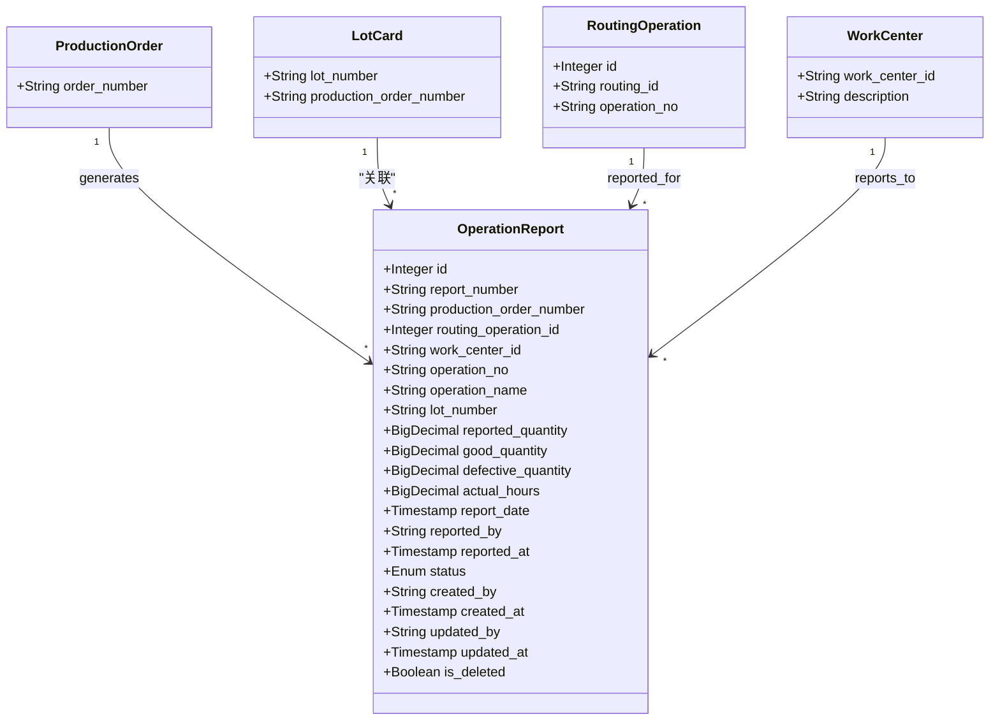

# 某某ERP系统 - 工序报工类图

## 文档说明

**版本：** v1.4  
**创建日期：** 2025-01-XX  
**最后更新：** 2025-01-XX  
**模块：** PP（生产计划与控制）

本文档描述了某某ERP系统工序报工模块的类图，使用Mermaid语法展示。本文档基于需求规格说明书v1.4编写。

---

## 工序报工类图

### 类图说明

工序报工类图展示了工序报工及其相关实体的类结构和关系。工序报工关联生产订单、工艺路线工序、工作中心和LOT卡。

### 类图

---

## 类说明

### OperationReport（工序报工）

工序报工类，存储工序报工的基本信息。

**主要属性：**
- `report_number`：报工单号（业务主键）
- `production_order_number`：生产订单号（外键）
- `routing_operation_id`：工艺路线工序ID（外键）
- `work_center_id`：工作中心ID（外键）
- `operation_no`：工序序号
- `operation_name`：工序名称
- `lot_number`：LOT卡号（外键，系统自动读取并填充，不可修改）
- `reported_quantity`：报工数量
- `good_quantity`：良品数量
- `defective_quantity`：不良品数量
- `actual_hours`：实际工时
- `report_date`：报工日期
- `reported_by`：报工人
- `reported_at`：报工时间
- `status`：状态（PENDING, IN_PROGRESS, COMPLETED, REJECTED）

**业务规则：**
- 系统根据生产订单/工单号自动查询关联的LOT卡（1:1关系），并自动填充报工单中的LOT卡号字段（只读、不可修改）
- 如果找不到LOT卡，不允许保存报工
- 如果工序配置了自动倒扣料，则扣减物料库存
- 记录完成数量、良品数量、不良品数量、工时等

---

## 关系说明

- **ProductionOrder → OperationReport**：一个生产订单可以生成多个工序报工（1对多）
- **LotCard → OperationReport**：一个LOT卡可以关联多个工序报工（1对多）
- **RoutingOperation → OperationReport**：一个工艺路线工序可以有多个报工记录（1对多）
- **WorkCenter → OperationReport**：一个工作中心可以有多个报工记录（1对多）

---

## 相关文档

- [需求规格说明书](../../需求/某某ERP系统MVP版本需求规格说明书1.4.md)
- [用例文档](../../某某ERP系统02%20-%20用例（Use%20Cases）.md)
- [工序报工ER图](../ER图/PP-工序报工ER图.puml)
- [工序报工状态机](../状态机图/PP-工序报工状态机.puml)
- [工序报工工作流](../工作流/workflow-pp-operation-reports.md)
- [LOT卡管理类图](./class-diagram-pp-lot-cards.md)
- [完整类图文档](../../某某ERP系统%20-%20类图（Class%20Diagram）.md)

---

**文档版本：** v1.4  
**最后更新：** 2025-01-XX  
**维护者：** 开发团队

