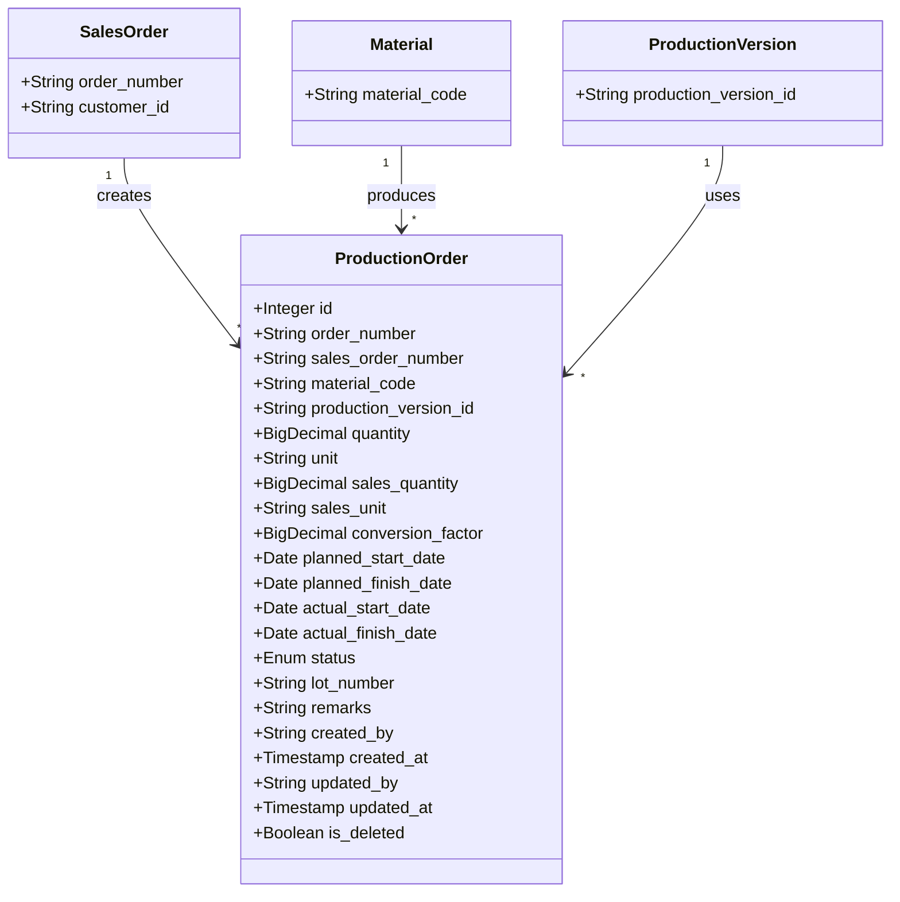

# 某某ERP系统 - 工单管理类图

## 文档说明

**版本：** v1.4  
**创建日期：** 2025-01-XX  
**最后更新：** 2025-01-XX  
**模块：** PP（生产计划与控制）

本文档描述了某某ERP系统工单管理模块的类图，使用Mermaid语法展示。本文档基于需求规格说明书v1.4编写。

---

## 工单管理类图

### 类图说明

工单管理类图展示了生产订单/工单及其相关实体的类结构和关系。生产订单关联销售订单、物料和生产版本，如果关联了MI，系统自动生成LOT卡。

### 类图

---

## 类说明

### ProductionOrder（生产订单/工单）

生产订单/工单类，存储生产订单的基本信息。在实现中同时承担"生产订单"和"工单"的职责。

**主要属性：**
- `order_number`：生产订单号（业务主键）
- `sales_order_number`：销售订单号（外键）
- `material_code`：物料编码（外键）
- `production_version_id`：生产版本ID（外键）
- `quantity`：数量
- `unit`：单位
- `sales_quantity`：销售数量
- `sales_unit`：销售单位
- `conversion_factor`：转换系数
- `planned_start_date`：计划开始日期
- `planned_finish_date`：计划完成日期
- `actual_start_date`：实际开始日期
- `actual_finish_date`：实际完成日期
- `status`：状态（DRAFT, RELEASED, IN_PRODUCTION, COMPLETED, CLOSED, CANCELLED）
- `lot_number`：LOT卡号（如果关联了MI，系统自动生成LOT卡并写回此字段）
- `remarks`：备注

**业务规则：**
- 在生产订单/工单创建时，如果关联了MI，系统根据MI自动生成LOT卡（1:1关系），自动复制MI内容到LOT卡，并将lot_number写回生产订单/工单
- 如果MI不存在，不允许创建生产订单/工单或提示用户先创建MI
- 由于生产订单承担工单职责，工单状态与生产订单状态一致
- 当有生产订单/工单状态变为IN_PRODUCTION时，销售订单状态自动更新为IN_PRODUCTION
- 当所有生产订单/工单状态为COMPLETED或CLOSED时，销售订单状态自动更新为COMPLETED

---

## 关系说明

- **SalesOrder → ProductionOrder**：一个销售订单可以创建多个生产订单（1对多）
- **Material → ProductionOrder**：一个物料可以生产多个生产订单（1对多）
- **ProductionVersion → ProductionOrder**：一个生产版本可以用于多个生产订单（1对多）

---

## 相关文档

- [需求规格说明书](../../需求/某某ERP系统MVP版本需求规格说明书1.4.md)
- [用例文档](../../某某ERP系统02%20-%20用例（Use%20Cases）.md)
- [工单管理ER图](../ER图/PP-工单管理ER图.puml)
- [工单管理状态机](../状态机图/PP-工单管理状态机.puml)
- [工单管理工作流](../工作流/workflow-pp-production-orders.md)
- [LOT卡管理类图](./class-diagram-pp-lot-cards.md)
- [完整类图文档](../../某某ERP系统%20-%20类图（Class%20Diagram）.md)

---

**文档版本：** v1.4  
**最后更新：** 2025-01-XX  
**维护者：** 开发团队

