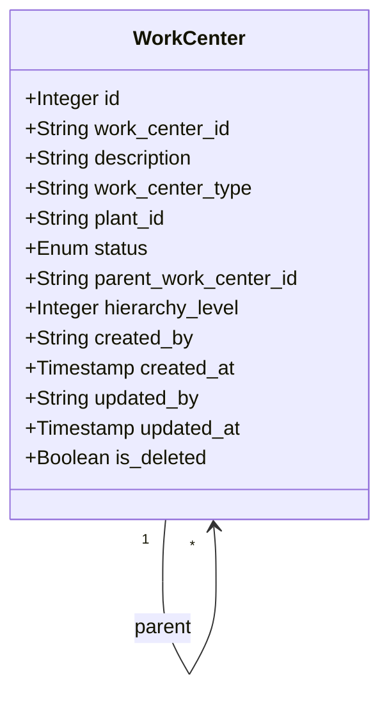

# 某某ERP系统 - 工作中心类图

## 文档说明

**版本：** v1.4  
**创建日期：** 2025-01-XX  
**最后更新：** 2025-01-XX  
**模块：** PP（生产计划与控制）

本文档描述了某某ERP系统工作中心管理模块的类图，使用Mermaid语法展示。本文档基于需求规格说明书v1.4编写。

---

## 工作中心类图

### 类图说明

工作中心类图展示了工作中心的类结构和关系。工作中心支持层级结构。

### 类图

---

## 类说明

### WorkCenter（工作中心）

工作中心类，存储工作中心的基本信息。

**主要属性：**
- `work_center_id`：工作中心ID（业务主键）
- `description`：描述
- `work_center_type`：工作中心类型
- `plant_id`：工厂ID
- `status`：状态（ACTIVE, INACTIVE, IN_MAINTENANCE）
- `parent_work_center_id`：父工作中心ID（外键，支持层级结构）
- `hierarchy_level`：层级级别

**业务规则：**
- 工作中心支持层级结构，可以有父工作中心
- 工作中心用于工艺路线工序和生产报工

---

## 关系说明

- **WorkCenter → WorkCenter**：工作中心可以有多级父子关系（1对多）

---

## 相关文档

- [需求规格说明书](../../需求/某某ERP系统MVP版本需求规格说明书1.4.md)
- [用例文档](../../某某ERP系统02%20-%20用例（Use%20Cases）.md)
- [工作中心ER图](../ER图/PP-工作中心ER图.puml)
- [工作中心状态机](../状态机图/PP-工作中心状态机.puml)
- [工作中心工作流](../工作流/workflow-pp-work-centers.md)
- [完整类图文档](../../某某ERP系统%20-%20类图（Class%20Diagram）.md)

---

**文档版本：** v1.4  
**最后更新：** 2025-01-XX  
**维护者：** 开发团队

