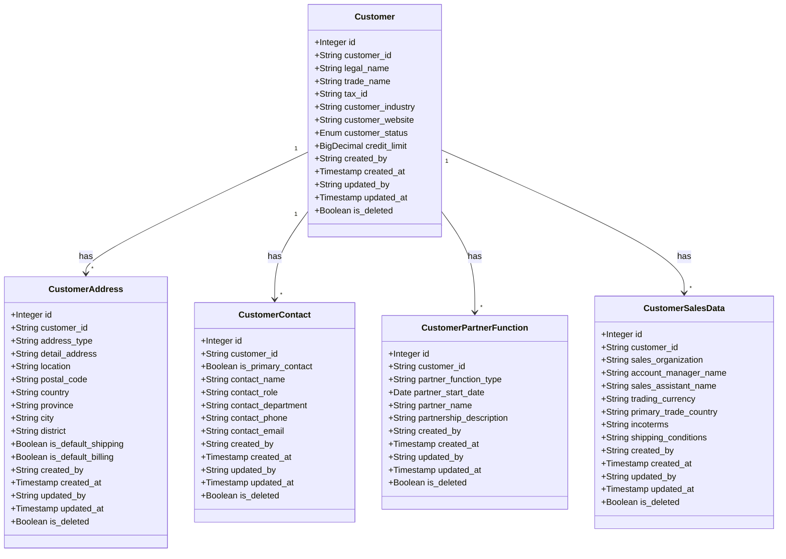

# 某某ERP系统 - 客户管理类图

## 文档说明

**版本：** v1.4  
**创建日期：** 2025-01-XX  
**最后更新：** 2025-01-XX  
**模块：** SD（销售与分销）

本文档描述了某某ERP系统客户管理模块的类图，使用Mermaid语法展示。本文档基于需求规格说明书v1.4编写。

---

## 客户管理类图

### 类图说明

客户管理类图展示了客户主数据及其相关实体的类结构和关系。客户主数据包括客户基本信息、地址、联系人、合作伙伴功能和销售数据等。

### 类图

---

## 类说明

### Customer（客户）

客户主数据类，存储客户的基本信息。

**主要属性：**
- `customer_id`：客户编号（主键）
- `legal_name`：法人名称
- `trade_name`：贸易名称
- `tax_id`：税号
- `customer_status`：客户状态（DRAFT, PENDING_APPROVAL, ACTIVE, BLOCKED, INACTIVE）
- `credit_limit`：信用额度

### CustomerAddress（客户地址）

客户地址类，存储客户的地址信息。

**主要属性：**
- `customer_id`：客户编号（外键）
- `address_type`：地址类型
- `detail_address`：详细地址
- `is_default_shipping`：是否默认发货地址
- `is_default_billing`：是否默认账单地址

### CustomerContact（客户联系人）

客户联系人类，存储客户的联系人信息。

**主要属性：**
- `customer_id`：客户编号（外键）
- `is_primary_contact`：是否主要联系人
- `contact_name`：联系人姓名
- `contact_role`：联系人角色
- `contact_phone`：联系电话
- `contact_email`：联系邮箱

### CustomerPartnerFunction（客户合作伙伴功能）

客户合作伙伴功能类，存储客户的合作伙伴信息。

**主要属性：**
- `customer_id`：客户编号（外键）
- `partner_function_type`：合作伙伴功能类型
- `partner_name`：合作伙伴名称

### CustomerSalesData（客户销售数据）

客户销售数据类，存储客户的销售相关信息。

**主要属性：**
- `customer_id`：客户编号（外键）
- `sales_organization`：销售组织
- `account_manager_name`：客户经理姓名
- `trading_currency`：交易货币
- `incoterms`：国际贸易术语

---

## 关系说明

- **Customer → CustomerAddress**：一个客户可以有多个地址（1对多）
- **Customer → CustomerContact**：一个客户可以有多个联系人（1对多）
- **Customer → CustomerPartnerFunction**：一个客户可以有多个合作伙伴功能（1对多）
- **Customer → CustomerSalesData**：一个客户可以有多个销售数据记录（1对多）

---

## 相关文档

- [需求规格说明书](../../需求/某某ERP系统MVP版本需求规格说明书1.4.md)
- [用例文档](../../某某ERP系统02%20-%20用例（Use%20Cases）.md)
- [客户管理ER图](../ER图/SD-客户管理ER图.puml)
- [客户管理状态机](../状态机图/SD-客户管理状态机.puml)
- [客户管理工作流](../工作流/workflow-sd-customers.md)
- [完整类图文档](../../某某ERP系统%20-%20类图（Class%20Diagram）.md)

---

**文档版本：** v1.4  
**最后更新：** 2025-01-XX  
**维护者：** 开发团队

