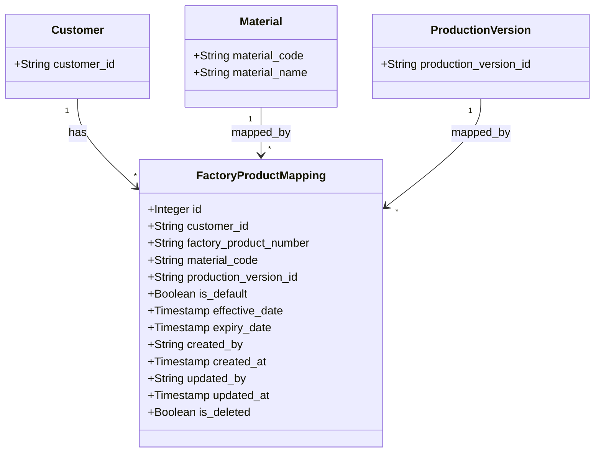

# 某某ERP系统 - 本厂编号映射类图

## 文档说明

**版本：** v1.4  
**创建日期：** 2025-01-XX  
**最后更新：** 2025-01-XX  
**模块：** SD（销售与分销）

本文档描述了某某ERP系统本厂编号映射模块的类图，使用Mermaid语法展示。本文档基于需求规格说明书v1.4编写。

---

## 本厂编号映射类图

### 类图说明

本厂编号映射类图展示了客户本厂编号与产品主数据和生产版本的映射关系。

### 类图

---

## 类说明

### FactoryProductMapping（本厂编号映射）

本厂编号映射类，存储客户本厂编号与产品主数据和生产版本的映射关系。

**主要属性：**
- `customer_id`：客户编号（外键）
- `factory_product_number`：本厂编号（14位）
- `material_code`：物料编码（外键，产品主数据）
- `production_version_id`：生产版本ID（外键）
- `is_default`：是否默认
- `effective_date`：生效日期
- `expiry_date`：失效日期

**业务规则：**
- 本厂编号用于销售订单快速引用产品主数据
- 一个客户可以有多个本厂编号映射
- 一个产品主数据可以映射到多个客户的本厂编号

---

## 关系说明

- **Customer → FactoryProductMapping**：一个客户可以有多个本厂编号映射（1对多）
- **Material → FactoryProductMapping**：一个产品主数据可以映射到多个客户的本厂编号（1对多）
- **ProductionVersion → FactoryProductMapping**：一个生产版本可以映射到多个客户的本厂编号（1对多）

---

## 相关文档

- [需求规格说明书](../../需求/某某ERP系统MVP版本需求规格说明书1.4.md)
- [用例文档](../../某某ERP系统02%20-%20用例（Use%20Cases）.md)
- [产品主数据类图](./class-diagram-eng-products.md)
- [销售订单类图](./class-diagram-sd-sales-orders.md)
- [完整类图文档](../../某某ERP系统%20-%20类图（Class%20Diagram）.md)

---

**文档版本：** v1.4  
**最后更新：** 2025-01-XX  
**维护者：** 开发团队

