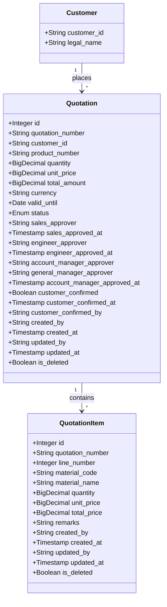

# 某某ERP系统 - 报价单类图

## 文档说明

**版本：** v1.4  
**创建日期：** 2025-01-XX  
**最后更新：** 2025-01-XX  
**模块：** SD（销售与分销）

本文档描述了某某ERP系统报价单管理模块的类图，使用Mermaid语法展示。本文档基于需求规格说明书v1.4编写。

---

## 报价单类图

### 类图说明

报价单类图展示了报价单及其明细项的类结构和关系。报价单关联客户，包含多个报价明细项。

### 类图

---

## 类说明

### Quotation（报价单）

报价单主数据类，存储报价单的基本信息。

**主要属性：**
- `quotation_number`：报价单号（业务主键）
- `customer_id`：客户编号（外键）
- `product_number`：产品编号（本厂编号）
- `quantity`：数量
- `unit_price`：单价
- `total_amount`：总金额
- `currency`：货币
- `valid_until`：有效期至
- `status`：状态（DRAFT, PENDING_SALES, PENDING_ENGINEER, PENDING_ACCOUNT_MANAGER, APPROVED, REJECTED, CUSTOMER_CONFIRMED, LINKED, CANCELLED）
- `sales_approver`：销售审核人
- `engineer_approver`：工程师审核人
- `account_manager_approver`：客户经理审核人
- `general_manager_approver`：总经理审核人
- `customer_confirmed`：客户是否确认
- `customer_confirmed_at`：客户确认时间

**业务规则：**
- 创建报价单时，如果输入的14位本厂编号不存在对应的产品主数据，SD模块调用ENG模块的产品主数据创建API自动创建产品主数据（产品编码为本厂编号，产品类型为成品FG，物料分类为成品），并自动填充产品名称。自动创建的产品主数据不需要审核。产品主数据由工程管理模块统一管理

### QuotationItem（报价单明细）

报价单明细类，存储报价单的明细项信息。

**主要属性：**
- `quotation_number`：报价单号（外键）
- `line_number`：行号
- `material_code`：物料编码
- `material_name`：物料名称
- `quantity`：数量
- `unit_price`：单价
- `total_price`：总价
- `remarks`：备注

---

## 关系说明

- **Customer → Quotation**：一个客户可以创建多个报价单（1对多）
- **Quotation → QuotationItem**：一个报价单可以包含多个报价明细项（1对多）

---

## 相关文档

- [需求规格说明书](../../需求/某某ERP系统MVP版本需求规格说明书1.4.md)
- [用例文档](../../某某ERP系统02%20-%20用例（Use%20Cases）.md)
- [报价单ER图](../ER图/SD-报价单ER图.puml)
- [报价单状态机](../状态机图/SD-报价单状态机.puml)
- [报价单工作流](../工作流/workflow-sd-quotations.md)
- [完整类图文档](../../某某ERP系统%20-%20类图（Class%20Diagram）.md)

---

**文档版本：** v1.4  
**最后更新：** 2025-01-XX  
**维护者：** 开发团队

