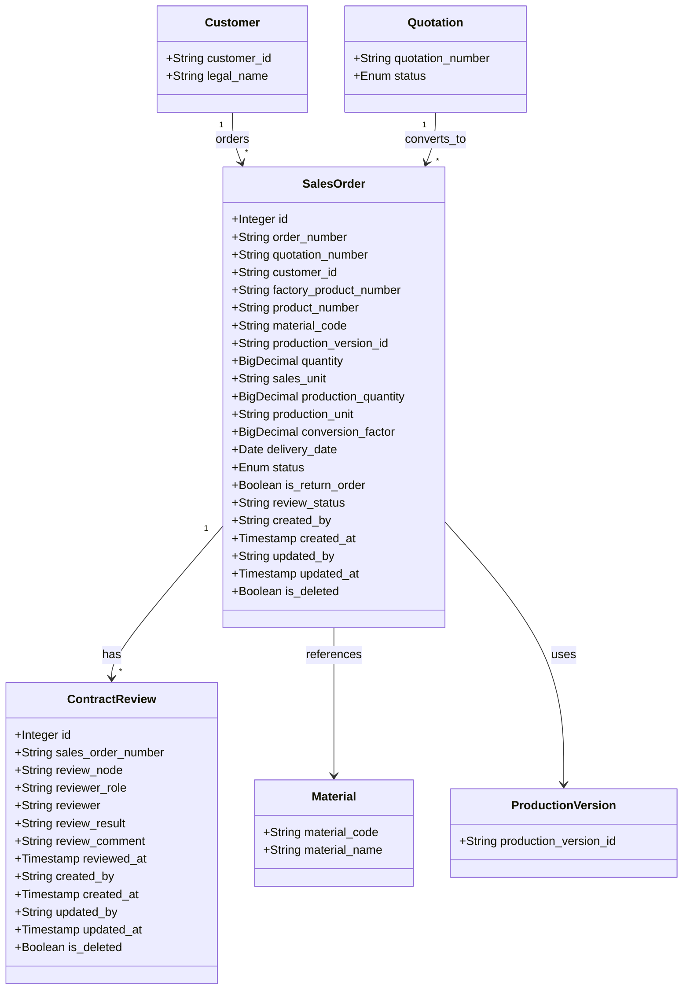

# 某某ERP系统 - 销售订单类图

## 文档说明

**版本：** v1.4  
**创建日期：** 2025-01-XX  
**最后更新：** 2025-01-XX  
**模块：** SD（销售与分销）

本文档描述了某某ERP系统销售订单管理模块的类图，使用Mermaid语法展示。本文档基于需求规格说明书v1.4编写。

---

## 销售订单类图

### 类图说明

销售订单类图展示了销售订单及其相关实体的类结构和关系。销售订单关联客户、报价单、物料和生产版本，包含合同评审记录。

### 类图

---

## 类说明

### SalesOrder（销售订单）

销售订单主数据类，存储销售订单的基本信息。

**主要属性：**
- `order_number`：订单号（业务主键）
- `quotation_number`：报价单号（外键）
- `customer_id`：客户编号（外键）
- `factory_product_number`：本厂编号（14位）
- `product_number`：产品编号
- `material_code`：物料编码（外键）
- `production_version_id`：生产版本ID（外键）
- `quantity`：数量
- `sales_unit`：销售单位
- `production_quantity`：生产数量
- `production_unit`：生产单位
- `conversion_factor`：转换系数
- `delivery_date`：交货日期
- `status`：状态（DRAFT, PENDING_REVIEW, REVIEWING, APPROVED, REJECTED, IN_PRODUCTION, COMPLETED, SHIPPED, DELIVERED, RECONCILED, CLOSED, CANCELLED）
- `is_return_order`：是否退货订单
- `review_status`：评审状态

**业务规则：**
- 创建订单时，如果输入的14位本厂编号不存在对应的产品主数据，SD模块调用ENG模块的产品主数据创建API自动创建产品主数据（产品编码为本厂编号，产品类型为成品FG，物料分类为成品），并自动填充产品名称。自动创建的产品主数据不需要审核。产品主数据由工程管理模块统一管理
- 当有生产订单/工单状态变为IN_PRODUCTION时，销售订单状态自动更新为IN_PRODUCTION
- 当所有生产订单/工单状态为COMPLETED或CLOSED时，销售订单状态自动更新为COMPLETED

### ContractReview（合同评审）

合同评审类，存储销售订单的多部门评审记录。

**主要属性：**
- `sales_order_number`：销售订单号（外键）
- `review_node`：评审节点（SALES_REVIEW, ENGINEERING_REVIEW, WAREHOUSE_REVIEW, FINANCE_REVIEW）
- `reviewer_role`：评审人角色
- `reviewer`：评审人
- `review_result`：评审结果（APPROVED, REJECTED）
- `review_comment`：评审意见
- `reviewed_at`：评审时间

**业务规则：**
- 多部门评审流程（串行）：销售 → 工程 → 物料 → 财务
- 任一部门评审拒绝，订单退回草稿状态

---

## 关系说明

- **Customer → SalesOrder**：一个客户可以创建多个销售订单（1对多）
- **Quotation → SalesOrder**：一个报价单可以转为多个销售订单（1对多）
- **SalesOrder → ContractReview**：一个销售订单可以有多个评审记录（1对多）
- **SalesOrder → Material**：销售订单引用物料（关联关系）
- **SalesOrder → ProductionVersion**：销售订单使用生产版本（关联关系）

---

## 相关文档

- [需求规格说明书](../../需求/某某ERP系统MVP版本需求规格说明书1.4.md)
- [用例文档](../../某某ERP系统02%20-%20用例（Use%20Cases）.md)
- [销售订单ER图](../ER图/SD-销售订单ER图.puml)
- [销售订单状态机](../状态机图/SD-销售订单状态机.puml)
- [销售订单工作流](../工作流/workflow-sd-sales-orders.md)
- [完整类图文档](../../某某ERP系统%20-%20类图（Class%20Diagram）.md)

---

**文档版本：** v1.4  
**最后更新：** 2025-01-XX  
**维护者：** 开发团队

