# 某某ERP系统MVP版本需求规格说明书

## 一、项目概述

### 1.1 项目背景

某某是一家专业的PCB（印制电路板）制造企业，随着业务规模的不断扩大和市场竞争的加剧，传统的管理方式已无法满足企业快速发展的需求。为了提高企业管理效率、优化业务流程、降低运营成本，某某决定建设一套符合PCB行业特点的ERP（企业资源计划）系统。

当前企业面临的主要挑战包括：

- **业务流程分散**：销售、工程、生产、物料等各业务环节缺乏统一的信息化管理平台，数据流转依赖人工传递，效率低下
- **数据管理混乱**：客户信息、产品数据、订单信息等关键业务数据分散在多个系统中，缺乏统一的数据标准和规范
- **生产管理粗放**：生产计划、物料需求、工序报工等环节缺乏精细化管理，难以准确掌握生产进度和成本
- **决策支持不足**：缺乏实时的业务数据分析和报表，管理层难以快速获取决策所需的信息

为了应对这些挑战，某某启动了ERP系统MVP（最小可行产品）版本的建设，旨在构建一个覆盖核心业务流程的信息化管理平台。

### 1.2 项目目标

本项目旨在建设一套符合PCB行业特点的ERP系统MVP版本，实现以下目标：

#### 1.2.1 业务目标

- **提升业务效率**：通过系统化的业务流程管理，减少人工操作，提高业务处理效率。支持返单快速下单，自动识别返单并匹配历史订单信息，跳过报价环节
- **优化订单管理**：建立从客户建档、客户询价、报价、三级审核、客户确认、订单评审到生产执行的完整订单管理流程
- **加强生产管控**：实现生产订单/工单、LOT卡管理、工序报工等生产环节的精细化管理。支持LOT卡自动生成（1:1关系），工序报工时自动关联LOT卡
- **规范数据管理**：建立统一的主数据管理体系，确保数据的准确性和一致性。支持产品主数据自动创建（SD模块调用ENG模块API），产品主数据由工程管理模块统一管理
- **流程自动化**：实现报价单三级审核（串行）、订单多部门评审（串行）、生产订单状态同步销售订单状态等自动化流程

#### 1.2.2 技术目标

- **系统集成**：实现销售、工程、生产、物料等各业务模块的有机集成
- **数据标准化**：建立统一的数据标准和编码规范，为后续系统扩展奠定基础
- **流程自动化**：通过工作流引擎实现业务流程的自动化流转和状态管理
- **可扩展性**：采用模块化设计，支持后续功能扩展和系统升级

#### 1.2.3 管理目标

- **提高决策效率**：通过实时数据分析和报表，为管理层提供决策支持
- **降低运营成本**：通过优化业务流程和减少人工操作，降低企业运营成本
- **提升客户满意度**：通过快速响应客户需求和准确交付，提升客户满意度

### 1.3 项目范围

#### 1.3.1 功能范围

本MVP版本涵盖以下核心业务模块：

- **SD模块（销售与分销）**：客户管理、报价单管理、销售订单管理、订单评审等
- **ENG模块（工程管理）**：产品主数据管理、BOM管理、工艺路线管理、MI管理、生产版本管理等
- **PP模块（生产计划与控制）**：工作中心管理、生产订单/工单管理、LOT卡管理、工序报工等
- **MM模块（物料管理）**：物料主数据管理、生产领料、库存管理等

#### 1.3.2 业务流程范围

本MVP版本支持以下核心业务流程：

- **客户建档流程**：销售员创建客户主数据，销售经理审批，激活客户
- **销售报价流程**：从客户询价到报价单创建、三级审核（串行：销售经理→工程师→客户经理/总经理）、销售员经客户确认报价单的完整流程。报价单创建时，如果本厂编号不存在，SD模块自动调用ENG模块API创建产品主数据
- **报价转订单流程**：将已通过审核并获客户确认的报价单转为销售订单
- **返单快速下单流程**：老客户重复下单，系统自动识别返单并匹配历史订单信息，快速创建销售订单，跳过报价环节
- **新单下单流程**：新客户或新产品下单，完整录入订单信息，经过订单审核等环节，创建销售订单
- **订单评审流程**：销售订单的多部门评审流程（串行：销售部门→工程部门→物料部门→财务部门），所有部门评审通过后订单状态更新为已批准
- **生产订单创建流程**：基于已批准的销售订单创建生产订单/工单。如果生产版本关联了MI，系统检查MI是否存在且状态为RELEASED，如果关联了MI则自动生成LOT卡（1:1关系），复制MI内容到LOT卡，并将lot_number写回生产订单
- **生产领料流程**：根据生产订单/工单关联的BOM自动生成领料需求，创建领料单，物控岗发放物料，生产线领料，自动更新库存
- **开始生产流程**：将生产订单/工单状态从RELEASED更新为IN_PRODUCTION，记录实际开始时间，同步销售订单状态
- **工序报工流程**：各工序完成后进行报工，系统根据生产订单/工单自动查询关联的LOT卡（1:1关系），自动填充报工单中的LOT卡号字段（只读、不可修改），记录完成数量、良品数量、不良品数量、工时等，更新生产进度
- **生产订单关闭流程**：当所有工序完成后，关闭生产订单（状态：CLOSED），记录实际完成时间。当所有生产订单/工单状态为COMPLETED或CLOSED时，更新销售订单状态为COMPLETED

#### 1.3.3 技术范围

- **系统架构**：采用前后端分离的架构
- **数据库**：使用PostgreSQL作为主数据库
- **接口规范**：采用RESTful API设计规范
- **权限管理**：基于角色的访问控制（RBAC）

#### 1.3.4 非功能范围

本MVP版本暂不包含以下内容（将在后续版本中实现）：

- 财务模块（应收应付、成本核算等）
- 采购模块（采购订单、供应商管理等）
- 质量管理模块（质检流程、不良品分析等）
- 设备管理模块（设备维护、设备台账等）
- 人力资源模块（员工管理、考勤管理等）
- 高级报表和数据分析功能
- 移动端应用

### 1.4 系统概述

#### 1.4.1 系统定位

某某ERP系统MVP版本是一个面向PCB制造企业的核心业务管理系统，专注于销售、工程、生产、物料等核心业务流程的信息化管理。

#### 1.4.2 系统特点

- **行业特色**：针对PCB制造行业的特点，支持本厂编号管理（14位编码，同时作为产品编码）、PCB专有属性管理（层数、板厚、铜厚、表面处理等）、MI管理、LOT卡管理等行业特色功能
- **流程驱动**：以业务流程为核心，通过工作流引擎实现业务流程的自动化管理。支持串行审核流程（报价单三级审核、订单多部门评审）、状态自动同步（生产订单状态同步销售订单状态）
- **数据统一**：建立统一的主数据管理体系，确保数据的准确性和一致性。产品主数据由工程管理模块统一管理，SD模块可以引用和自动创建，但不能修改和删除
- **自动化处理**：支持产品主数据自动创建（SD模块调用ENG模块API）、LOT卡自动生成（生产订单与LOT卡1:1关系）、领料需求自动生成（基于BOM）、库存自动更新等自动化处理
- **灵活扩展**：采用模块化设计，支持后续功能扩展和系统升级

#### 1.4.3 系统架构

系统采用前后端分离的架构设计：

- **前端**：提供友好的用户交互界面
- **后端**：基于FastAPI框架的RESTful API服务，提供业务逻辑处理和数据访问
- **数据库**：PostgreSQL关系型数据库，存储业务数据
- **工作流引擎**：支持业务流程的自动化流转和状态管理

#### 1.4.4 用户角色

系统支持以下用户角色（系统角色枚举），各角色按模块划分职责：

**SD模块（销售与分销）角色：**
- **销售员（SALES）**：负责客户建档、客户信息维护、报价单创建、报价单预估报价、销售订单创建、返单快速下单等
- **销售经理（SALES_MANAGER）**：负责报价单一级审核、销售订单评审（销售部门评审）等
- **工程师（ENGINEER）**：参与报价单二级审核，负责确认价格策略和交期承诺
- **总经理（GENERAL_MANAGER）**：负责报价单三级审核（与客户经理二选一）、销售订单评审等

**ENG模块（工程管理）角色：**
- **工程师（ENGINEER）**：负责产品主数据管理、BOM创建和管理、工艺路线创建和管理、MI创建和管理、生产版本建立等。工程师也负责MI审核，确认技术参数和生产要求

**PP模块（生产计划与控制）角色：**
- **计划员（PLANNER）**：负责工作中心管理、生产订单/工单管理、LOT卡查询和管理、生产进度查看、生产订单关闭等
- **生产人员（PRODUCTION）**：负责工序报工、不良品记录、LOT卡查询和查看等

**MM模块（物料管理）角色：**
- **计划员（PLANNER）**：负责物料主数据管理、物料列表查询、库存查询、生产领料单创建、缺料单生成等（物控岗）
- **仓库管理员（WAREHOUSE）**：负责生产领料处理、领料单审核、库存查询等

**跨模块角色：**
- **财务人员（FINANCE）**：负责销售订单评审（财务部门评审）等
- **系统管理员（ADMIN）**：负责系统配置、用户管理、角色权限管理等，拥有所有模块的操作权限

**说明：**
- 系统角色枚举包括：SALES、SALES_MANAGER、ENGINEER、PLANNER、PRODUCTION、WAREHOUSE、FINANCE、GENERAL_MANAGER、ADMIN
- 业务角色（如客户经理、审核员、产线工人、生产主管、物控员等）通过分配相应的系统角色来实现权限控制
- 系统管理员（ADMIN）角色拥有所有模块的操作权限，可以绕过所有角色限制

### 1.5 文档说明

#### 1.5.1 文档目的

本文档旨在详细描述某某ERP系统MVP版本的功能需求、业务流程、数据模型等，为系统设计、开发、测试和实施提供依据。

#### 1.5.2 文档结构

本文档包含以下主要内容：

- **第一章 项目概述**：介绍项目背景、目标、范围和系统概述
- **第二章 实体**：定义系统的核心业务实体及其关系
- **第三章 用例**：描述各业务模块的功能用例
- **第四章 流程说明**：详细说明各业务流程的处理逻辑

#### 1.5.3 文档版本

- **版本号**：v1.3
- **创建日期**：2025-01-XX
- **最后更新**：2025-01-XX

#### 1.5.4 术语定义

- **本厂编号**：某某内部为每个产品分配的唯一标识，14位编码，同时作为产品编码（material_code）。产品主数据以本厂编号作为唯一标识
- **LOT卡**：生产批次卡，由MI自动生成，关联生产订单/工单，是工序报工的批次依据。一个生产订单/工单对应一个LOT卡（1:1关系）。在生产订单/工单创建时，如果关联了MI，系统自动生成LOT卡，自动复制MI内容到LOT卡，并将lot_number写回生产订单
- **MI**：制造指令（Manufacturing Instruction），包含客户型号、技术参数、生产要求等，是生产执行的依据。MI由工程管理模块创建和管理，发布后的MI可用于生产版本发布和生产订单/工单下达
- **BOM**：物料清单（Bill of Materials），定义产品的物料组成结构，包含父项产品、子项物料、用量等。只有RELEASED状态的BOM才能用于生产版本
- **工艺路线**：定义产品的生产工艺流程，包含工序序列、工作中心、标准时间等。只有RELEASED状态的工艺路线才能用于生产版本
- **生产版本**：将BOM和工艺路线组合，形成可执行的生产版本。发布生产版本时需要MI已关联且状态为RELEASED
- **生产订单/工单**：生产订单/工单，包含生产数量、交期、关联的MI、BOM、工艺路线、工序任务、工作中心、计划时间等。当前实现中由实体 ProductionOrder 同时承担"生产订单+工单"职责，工单状态与生产订单状态一致
- **工序报工**：记录各工序的完成情况，包含完成数量、良品数量、不良品数量、工时等，关联LOT卡号。系统根据生产订单/工单自动查询关联的LOT卡（1:1关系），自动填充报工单中的LOT卡号字段（只读、不可修改）

---

## 二、实体

### 实体列表

实体名称|说明
-|-
客户|客户主数据，包含客户基本信息、合作属性、地址信息、联系人信息、销售数据等
报价单|销售报价单，包含客户信息、产品信息、价格条款、交付条款等，支持三级审核流程
销售订单|销售订单，由报价单转换或返单创建，包含订单信息、产品明细、交期承诺等
产品主数据|产品主数据，以本厂编号作为唯一标识，本厂编号同时作为产品编码（material_code）。产品主数据包含物料主数据中成品(FG)的所有内容，包括产品基本信息、PCB专有工程属性（层数、板厚、铜厚、表面处理等）、技术参数、尺寸信息、供应链计划参数等。产品主数据管理只显示成品(FG类型)的物料
物料|物料主数据，包含物料编码、名称、分类（原材料、辅材、化工材料、半成品、维修等）、规格型号、库存信息等。物料主数据管理中不显示成品(FG类型)，成品通过产品主数据管理进行维护
BOM|物料清单，定义产品的物料组成结构，包含父项产品、子项物料、用量等
工艺路线|定义产品的生产工艺流程，包含工序序列、工作中心、标准时间等
生产版本|将BOM和工艺路线组合，形成可执行的生产版本
MI|制造指令，包含客户型号、技术参数、生产要求等，是生产执行的依据
工作中心|生产资源主数据，包含工作中心代码、类型、产能数据、成本数据等
生产订单|生产执行订单/工单，包含生产数量、交期、关联的MI、BOM、工艺路线、工序任务、工作中心、计划时间等；当前实现中由实体 ProductionOrder 同时承担“生产订单+工单”职责
LOT卡|生产批次卡，由MI自动生成，关联生产订单/工单，包含MI内容、数量、单位、状态等信息，是工序报工的批次依据
领料单|生产领料单，包含领料明细、库存信息、发放记录等
报工单|工序报工记录，包含完成数量、良品数量、不良品数量、工时等，关联LOT卡号

### ER图

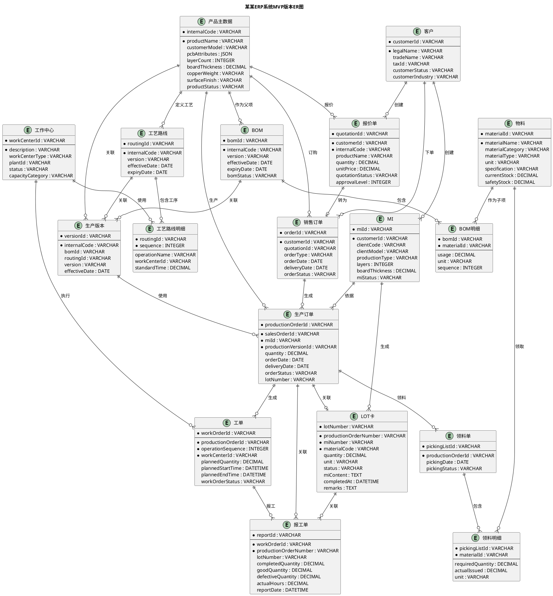

## 三、用例

### SD模块（销售与分销）

#### 用例列表

用例|功能说明
-|-
客户建档|创建新客户主数据，包含客户基本信息、合作属性、地址信息、联系人信息、销售数据等
客户信息修改|修改已存在的客户主数据信息
维护送货地址|为客户添加或修改送货地址信息
产品主数据管理|创建和维护产品主数据，以本厂编号作为唯一标识，本厂编号同时作为产品编码。产品主数据包含物料主数据中成品(FG)的所有内容，包括产品基本信息、PCB专有工程属性、技术参数、尺寸信息、供应链计划参数等。新建产品主数据时，如果本厂编号对应的产品不存在，系统提供创建产品的快捷入口。产品主数据管理只显示成品(FG类型)的物料
报价单创建|创建销售报价单，包含客户信息、产品信息（本厂编号、产品名称）、价格条款等。创建报价单时，如果输入的14位本厂编号不存在对应的产品主数据，系统自动创建产品主数据（产品编码为本厂编号，产品类型为成品FG，物料分类为成品）
报价单预估报价|根据板规格参数、工艺参数、加价选项等自动计算报价明细成本，包括交货面积、成本/平米、成本PCS、报价价格、工程费、板材费、测试架费用等，并生成工序成本明细。支持实时计算和手动计算两种模式
报价单审核|三级审核流程：一级审核、二级审核、三级审核
报价转订单|将已通过审核并获客户确认的报价单转为销售订单
返单快速下单|老客户重复下单，系统自动识别并匹配历史订单信息，快速创建销售订单
销售订单管理|查看、编辑、审核销售订单
订单评审|对销售订单进行评审，确认价格、交期等条款

#### 用例图

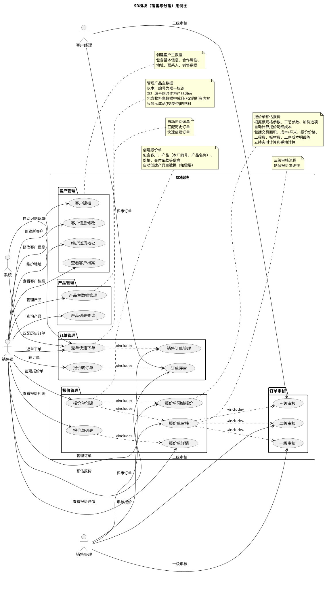

### ENG模块（工程管理）

#### 用例列表

用例|功能说明
-|-
产品主数据管理|创建和维护产品主数据，以本厂编号作为唯一标识，本厂编号同时作为产品编码。产品主数据包含物料主数据中成品(FG)的所有内容。产品主数据管理只显示成品(FG类型)的物料。新建产品主数据时，如果本厂编号对应的产品不存在，系统提供创建产品的快捷入口
BOM创建|创建物料清单，定义产品的物料组成结构（父项为产品主数据，产品编码为本厂编号）
BOM版本管理|创建BOM新版本，管理BOM版本历史
BOM物料管理|在BOM中添加、编辑、删除物料
工艺路线创建|创建工艺路线，定义产品的生产工艺流程
工艺路线版本管理|创建工艺路线新版本，管理版本历史
工艺路线工序管理|在工艺路线中添加、编辑、删除工序
生产版本建立|将BOM和工艺路线组合，建立生产版本
MI创建|创建制造指令，包含客户型号、技术参数等
MI审核|对MI进行审核，确认技术参数和生产要求
MI修改|根据审核意见修改MI

#### 用例图

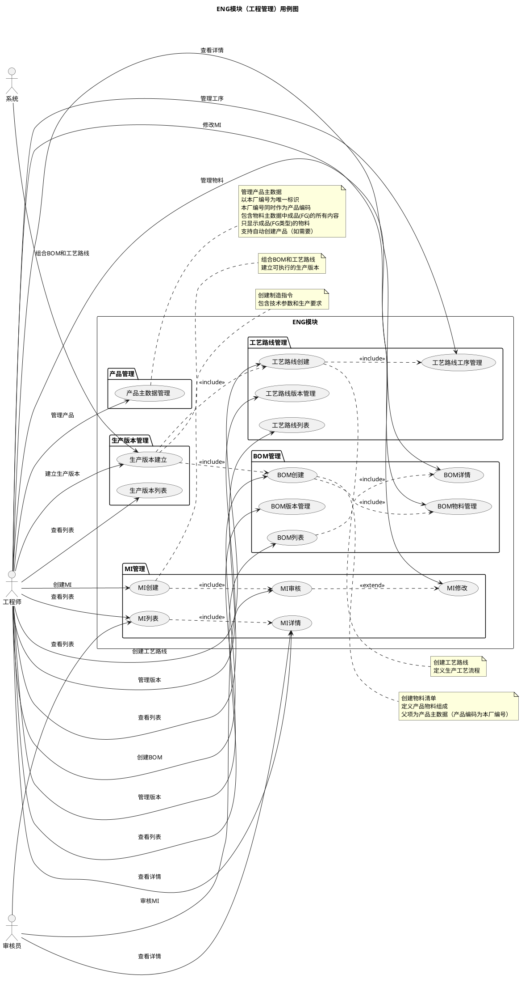

### PP模块（生产计划与控制）

#### 用例列表

用例|功能说明
-|-
工作中心管理|创建和维护工作中心主数据，包含基本信息、产能数据、成本数据等
工作中心激活|激活工作中心，使其可用于生产
工作中心停用|停用工作中心
工序报工|记录工序完成情况，包含完成数量、良品数量、不良品数量、工时等
LOT卡管理|LOT卡的全生命周期管理，包括自动生成、查询、详情查看、编辑、状态管理等
LOT卡生成|创建生产订单/工单时，系统根据MI自动生成LOT卡，自动复制MI内容并写回lot_number到生产订单
LOT卡查询|查询LOT卡信息，支持按生产订单号、MI编号、状态等条件查询
LOT卡列表|查看LOT卡列表，支持按生产订单号、MI编号、状态等条件筛选和分页
LOT卡详情查看|查看LOT卡的详细信息，包括MI内容、生产信息、关联的报工记录等
LOT卡编辑|编辑LOT卡的MI内容（mi_content）和备注（remarks），支持JSON格式解析为列表，每一条指令/属性项可单独编辑
不良品管理|记录不良品信息，包含不良原因、处理方式等
生产订单关闭|关闭已完成的生产订单
生产进度查看|查看生产订单的执行进度

#### 用例图

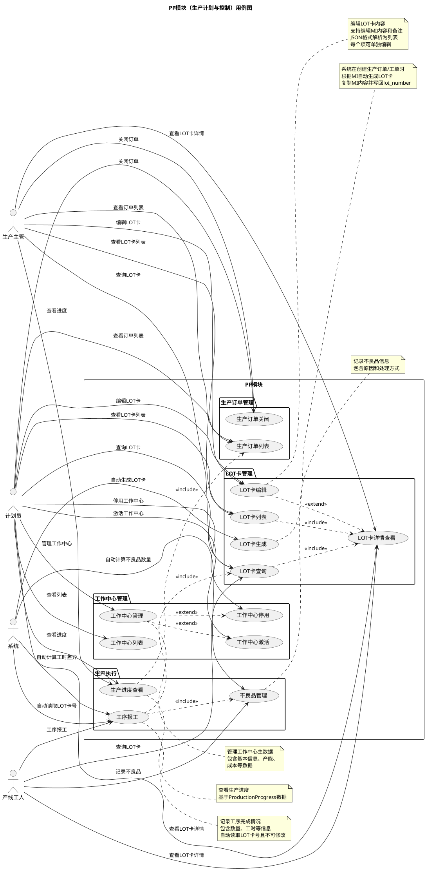

### MM模块（物料管理）

#### 用例列表

用例|功能说明
-|-
产品主数据管理|创建和维护产品主数据，以本厂编号作为唯一标识，本厂编号同时作为产品编码。产品主数据包含物料主数据中成品(FG)的所有内容。产品主数据管理只显示成品(FG类型)的物料。新建产品主数据时，如果本厂编号对应的产品不存在，系统提供创建产品的快捷入口，创建的产品自动设置为成品类型且不可修改
物料主数据管理|创建和维护物料主数据，包含物料编码、名称、分类（原材料、辅材、化工材料、半成品、维修等）、规格、库存信息等。物料主数据管理中不显示成品(FG类型)，成品通过产品主数据管理进行维护。新建物料页面标题为"新建产品"，当从产品主数据页面跳转创建产品时，物料类型和物料分类自动设为成品且不可修改。编辑产品时，产品类型和物料分类不能修改
物料列表查询|查询物料列表，支持条件过滤
生产领料|根据生产订单创建领料单，包含领料明细、库存信息等
库存查询|查询物料当前库存、安全库存等信息
缺料单生成|当库存不足时，生成缺料单

#### 用例图

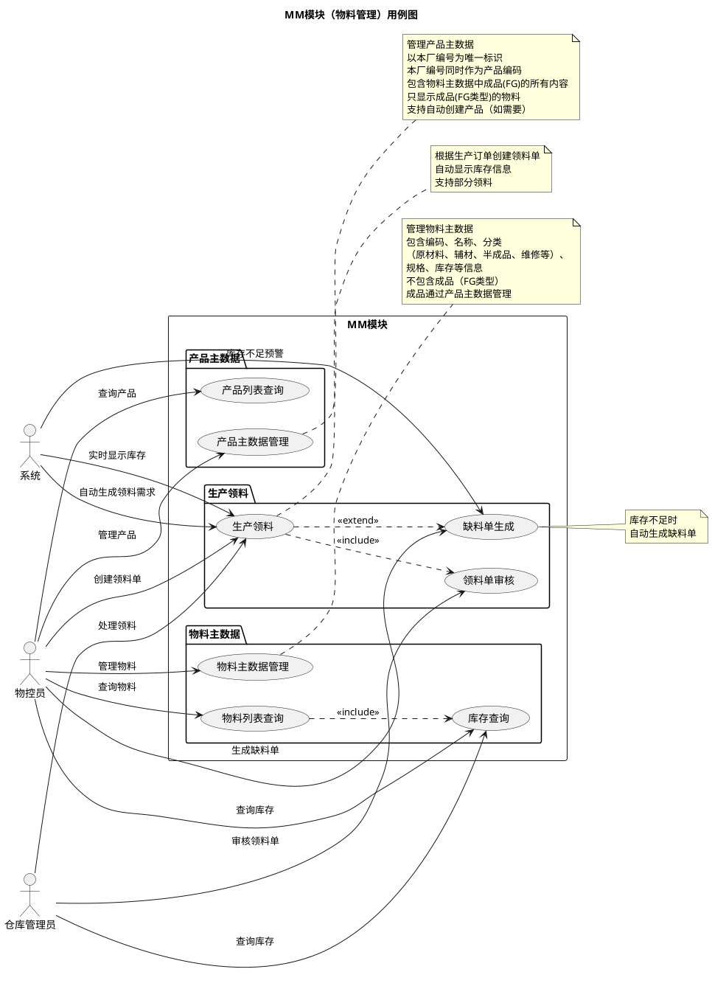

## 四、流程说明

### 销售报价流程

#### 流程说明

销售报价流程是销售业务的起点，从客户询价开始，经过报价单创建、报价计算、三级审核、客户确认等环节，最终可以转为销售订单。流程包括：

1. **报价单创建**：销售员根据客户需求创建报价单，填写客户信息、产品信息（本厂编号、产品名称）、价格条款等。如果输入的14位本厂编号不存在对应的产品主数据，系统自动创建产品主数据（产品编码为本厂编号，产品类型为成品FG，物料分类为成品），并自动填充产品名称
2. **报价单预估报价**：销售员填写板规格参数（出货长、出货宽、利用率、PNL参数等）、工艺参数（层数、板厚、铜厚、线宽线距、表面处理等）、加价选项（常规加价、特殊加价、额外加价等）后，系统自动计算报价明细成本。计算内容包括：
   - **交货面积计算**：根据出货长、出货宽、订单数量计算交货面积（m²）
   - **基础成本计算**：根据基础成本基准值和层数调整系数计算成本/平米
   - **加价计算**：根据常规加价、特殊加价、额外加价选项计算总加价/平米
   - **最终成本计算**：基础成本 + 加价，得到最终成本/平米和成本PCS
   - **报价价格计算**：在成本基础上按利润率系数（如1.3，即30%利润）计算报价价格/平米和报价价格PCS
   - **费用计算**：计算工程费（根据层数）、板材费（成本×面积）、测试架费用（根据测试点数）、其他费用（最低消费等）
   - **最终总价计算**：工程费 + 板材费 + 测试架费用 + 其他费用
   - **工序成本分摊**：将成本按比例分摊到各工序（开料、钻孔、电镀、线路、阻焊、表面处理、成型等），生成工序成本明细
   - 系统支持实时计算（修改参数时自动计算）和手动计算（点击"计算报价"按钮）两种模式
   - 计算结果保存到报价单主表和报价明细工序表
3. **一级审核**：销售经理进行一级审核，检查报价单的基本信息和价格合理性。审核不通过时，报价单退回草稿状态，销售员可修改后重新提交
4. **二级审核**：工程部门进行二级审核，确认价格策略和交期承诺。审核不通过时，报价单退回草稿状态，销售员可修改后重新提交
5. **三级审核**：客户经理进行三级审核，最终确认报价单。审核不通过时，报价单退回草稿状态，销售员可修改后重新提交
6. **客户确认**：客户确认报价单后，可以转为销售订单
7. **报价转订单**：将已确认的报价单转为销售订单

#### 流程图

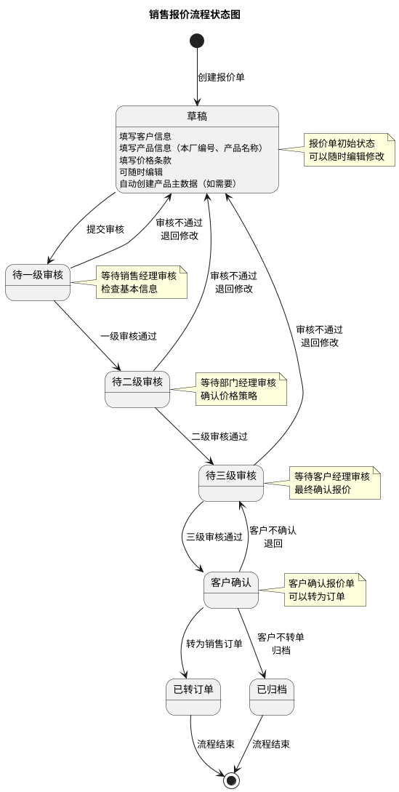

### 返单快速下单流程

#### 流程说明

返单快速下单流程针对老客户重复下单的场景，系统自动识别返单并匹配历史订单信息，快速创建销售订单，跳过报价环节。流程包括：

1. **返单识别**：系统自动检测是否为返单（相同客户、相同产品主数据（本厂编号）、在时间范围内）
2. **历史订单匹配**：系统自动匹配历史订单，显示历史价格、交期等信息
3. **订单信息填充**：系统自动填充订单信息，包括产品主数据（本厂编号）、价格、交期等
4. **订单确认**：销售员确认订单信息，可以调整数量、价格等
5. **订单创建**：创建销售订单，进入生产流程

#### 流程图

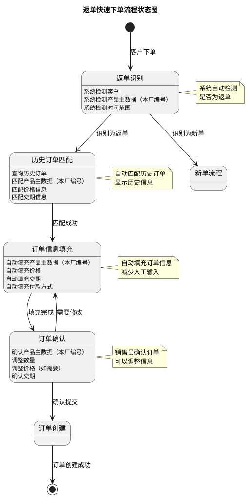

### 新单下单流程

#### 流程说明

新单下单流程针对新客户或新产品下单的场景，需要完整录入订单信息，经过订单审核等环节，创建销售订单。流程包括：

1. **客户选择**：选择或创建客户主数据，确认客户信息
2. **产品主数据确认**：确认或创建产品主数据（本厂编号），如果输入的14位本厂编号不存在对应的产品主数据，系统自动创建产品主数据（产品编码为本厂编号，产品类型为成品FG，物料分类为成品），并自动填充产品名称
3. **订单信息录入**：手动录入订单信息，包括产品主数据（本厂编号）、数量、价格、交期、付款方式等
4. **价格确认**：确认订单价格，可以查询历史价格作为参考
5. **订单审核**：对订单进行审核，确认订单信息的完整性和准确性
6. **订单创建**：创建销售订单，进入生产流程

#### 流程图

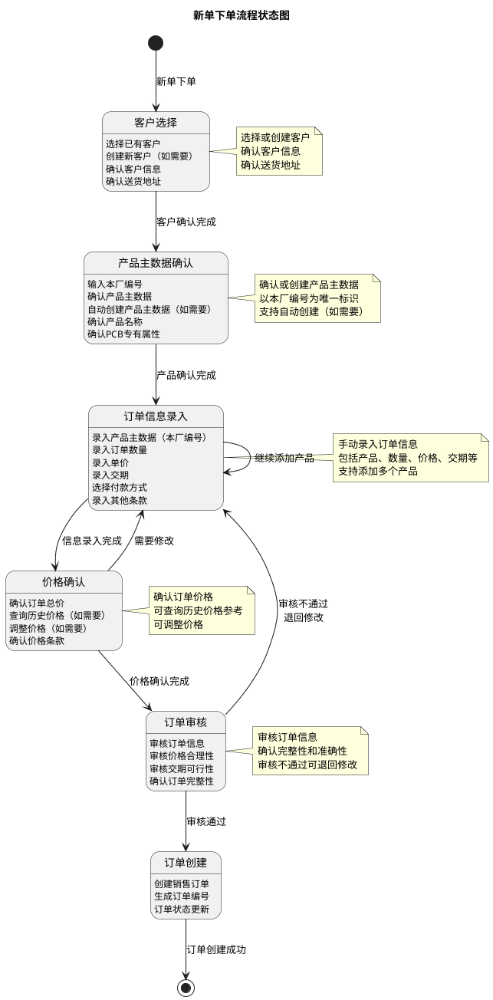

### BOM创建流程

#### 流程说明

BOM创建流程用于定义产品的物料组成结构，包括创建BOM、添加物料、版本管理等环节。流程包括：

1. **产品主数据创建**：创建产品主数据，以本厂编号作为唯一标识，填写产品基本信息、PCB专有工程属性等
2. **BOM创建**：创建新的BOM，指定父项产品（本厂编号）和版本信息
2. **添加物料**：在BOM中添加子项物料，设置用量等信息
3. **BOM保存**：保存BOM，可以保存为草稿或直接发布
4. **BOM审核**：对BOM进行审核，确认物料清单的准确性
5. **BOM发布**：发布BOM，使其可用于生产
6. **版本管理**：可以基于现有BOM创建新版本

#### 流程图

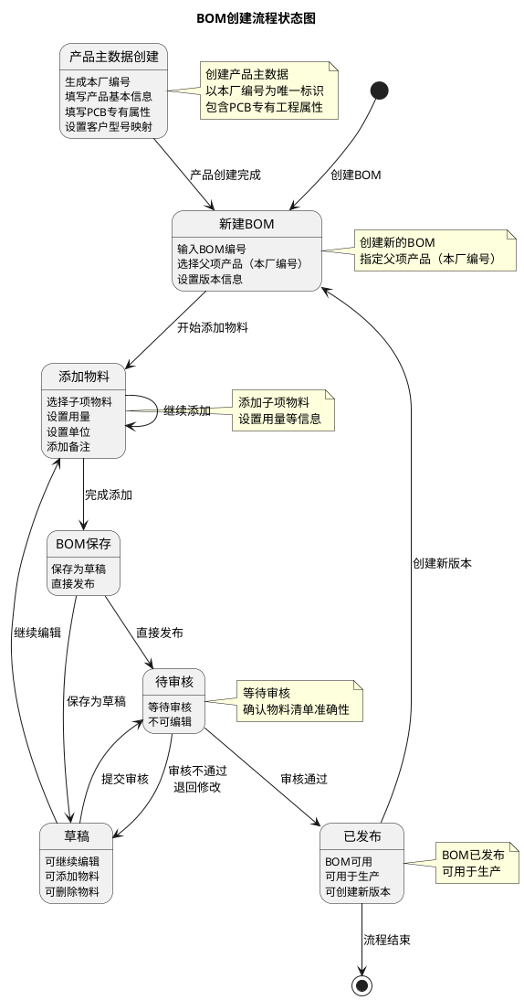

### 工艺路线创建流程

#### 流程说明

工艺路线创建流程用于定义产品的生产工艺流程，包括创建工艺路线、添加工序、版本管理等环节。流程包括：

1. **产品主数据创建**：创建产品主数据，以本厂编号作为唯一标识，填写产品基本信息、PCB专有工程属性等
2. **工艺路线创建**：创建新的工艺路线，指定父项产品（本厂编号）和版本信息
3. **添加工序**：在工艺路线中添加工序，设置工序序列、工作中心、标准时间等信息
4. **工艺路线保存**：保存工艺路线，可以保存为草稿或直接发布
5. **工艺路线审核**：对工艺路线进行审核，确认工艺流程的准确性
6. **工艺路线发布**：发布工艺路线，使其可用于生产
7. **版本管理**：可以基于现有工艺路线创建新版本

#### 流程图

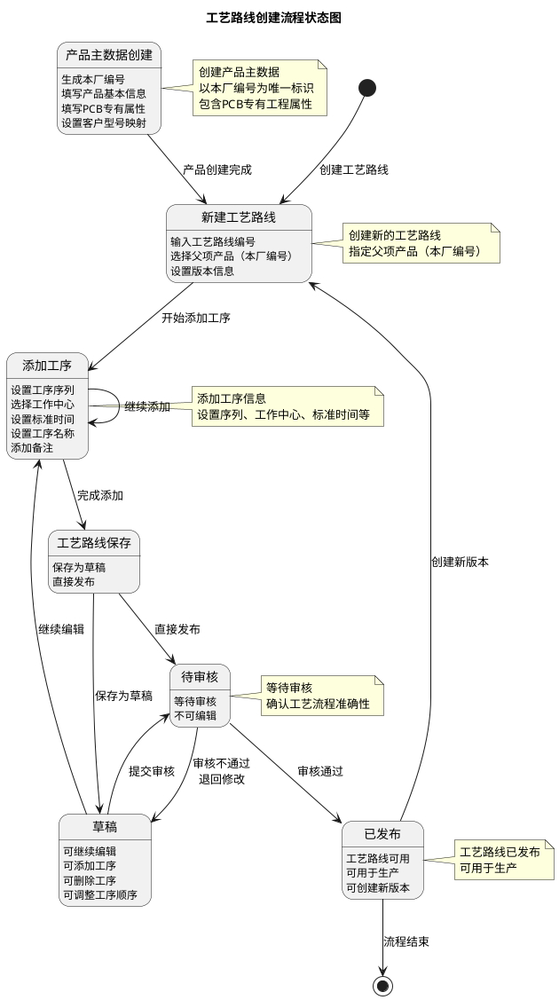

### 生产领料流程

#### 流程说明

生产领料流程用于处理生产订单的物料发放，包括创建领料单、库存检查、物料发放、审核确认等环节。流程包括：

1. **创建领料单**：根据生产订单自动生成领料需求，创建领料单
2. **库存检查**：系统自动检查物料库存，显示当前库存和安全库存
3. **库存预警**：当库存低于安全库存时，系统自动预警
4. **物料发放**：仓库管理员根据领料单发放物料，记录实际发放数量
5. **领料审核**：对领料单进行审核确认
6. **缺料处理**：当库存不足时，生成缺料单

#### 流程图

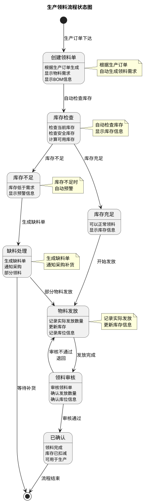

### 工序报工流程

#### 流程说明

工序报工流程用于记录生产工序的完成情况，包括报工数据录入、不良品管理、工时记录等环节。流程包括：

1. **选择生产订单/工单并自动读取LOT卡**：选择要报工的生产订单/工单后，系统根据生产订单号自动查询关联的LOT卡，并自动填充报工单中的LOT卡号字段（只读、不可修改）；如找不到LOT卡，则不允许保存报工
2. **任务确认**：确认当前工序任务，显示生产订单、LOT卡号、工序名称、计划数量等信息
3. **报工数据录入**：录入完成数量、良品数量、不良品数量等数据
4. **不良品管理**：记录不良品信息，包括不良原因、处理方式等
5. **工时记录**：记录实际工时，系统自动计算工时差异
6. **设备信息**：记录使用的设备信息和设备状态
7. **报工保存**：保存报工记录，更新生产进度

#### 流程图

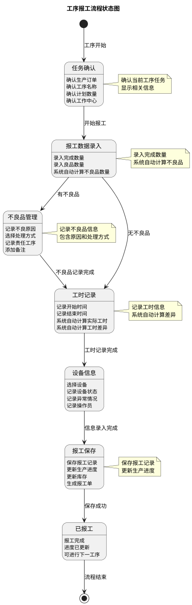

### 生产执行全流程

#### 流程说明

生产执行全流程从销售订单开始，经过订单评审、BOM和工艺路线准备、生产版本建立、MI制作、生产版本发布、生产订单下达、物料领料、工序报工等环节，最终完成生产并入库。流程包括：

1. **订单评审**：对销售订单进行评审，确认价格、交期等
2. **产品主数据确认**：确认或创建产品主数据，以本厂编号作为唯一标识
3. **BOM和工艺路线准备**：准备产品的BOM和工艺路线（基于产品主数据的本厂编号）
4. **生产版本建立**：将BOM和工艺路线组合，建立生产版本
5. **MI制作**：根据订单创建制造指令，包含技术参数和生产要求
6. **生产版本发布**：发布生产版本，使其可用于生产订单下达
7. **生产订单下达**：下达生产订单/工单，系统根据MI自动生成LOT卡，LOT卡包含MI内容和生产信息，并将lot_number写回生产订单
8. **物料领料**：根据生产订单领料
9. **工序报工**：各工序完成后进行报工，系统根据生产订单自动读取LOT卡号并填充到报工单中，LOT卡号不可修改
10. **成品入库**：生产完成后，成品入库

#### 流程图

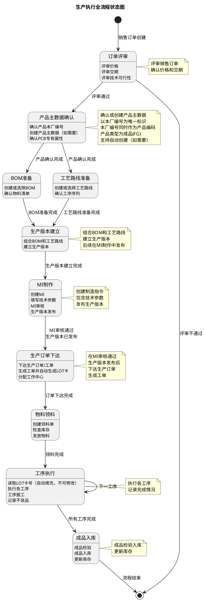
